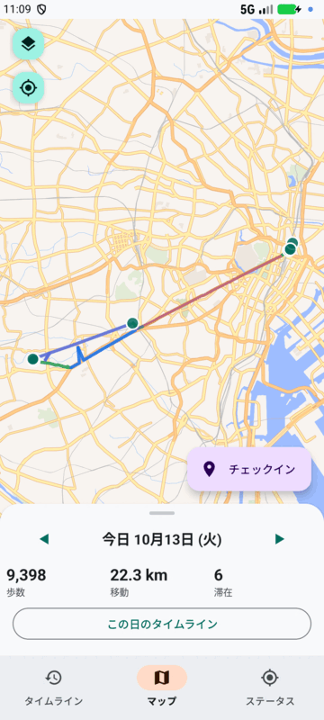
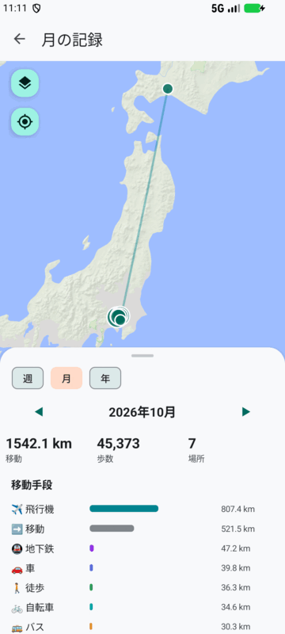

# ashidori

足取り（ashidori）は Android 向けの行動記録アプリである。GNSS と IMU により移動と滞在を自動で記録し、タイムラインと地図で表示する。Google マップのタイムラインの代替を目的とする。記録は端末内に保存し、同期時は端末側で暗号化する（エンドツーエンド暗号化）。

<p>
  
  
  
</p>

## 機能

### タイムライン

日・週・月の単位で、新しい順に過去へ遡って表示する。日単位では滞在と移動を時系列に並べ、日ごとに経路の地図を付ける。経路は移動手段ごとに色分けする。場所の名前と移動手段は一覧上で修正できる。

<p>
  
  
  
</p>

- 滞在の検出、移動区間の分割、移動手段の推定（徒歩・自転車・車・バス・電車・地下鉄・飛行機など）
- 位置精度の低い区間は距離に「約」を付け、地図上は淡色の線で表示
- 週・月・年の集計（距離、歩数、移動手段の内訳、訪問の多い場所、訪問した都市・国）
- 過去のチェックイン地点付近の滞在に、その名称を候補として表示
- 記録の検索（場所の名称、地域、チェックイン先、日付）

### マップとチェックイン

日ごとの経路を地図上に表示する。背景地図は OpenStreetMap（OpenFreeMap）と国土地理院の各種地図（標準・淡色・航空写真・色別標高）から選択でき、任意の XYZ タイルも指定できる。チェックインは周辺施設（OpenStreetMap）または任意の名称で行う。

<p>
  
  
</p>

### 記録モードと省電力

記録は停止操作を行うまで継続し、通常の操作はモードの切り替えのみとする。静止中は GNSS と加速度センサーを停止し、移動開始をセンサーの割り込み（significant motion）で検知する。電池残量と実測の消費量に応じて記録頻度を下げる。屋内では Wi-Fi・基地局で測位し、移動開始時と移動中の一定間隔で衛星による屋外判定を行う。屋内の歩行中は歩数と方位から位置を推定する（PDR）。

<p>
  
  
  
</p>

| モード | 移動中の測位間隔 | 詳細ログ |
| --- | --- | --- |
| 省電力 | 30秒 | 移動中6時間ごとに30秒 |
| バランス | 10秒（乗り物5秒） | 移動中30分ごとに1分 |
| 高精度 | 1〜2秒 | 移動中10分ごとに1分 |
| 全力ログ | 常時1秒 | 常時 |

詳細ログは、GNSS の生の観測値（GnssMeasurement・航法メッセージ・NMEA）と加速度・ジャイロ・地磁気の生データである。解析や後処理（RTK・PPK など）に用いる。

### 保存とエクスポート

- 前日までの記録は日単位の Parquet ファイルに変換し、月単位で統合する。時系列向けの符号化（DELTA_BINARY_PACKED・BYTE_STREAM_SPLIT）により容量を抑える。
- 期間を指定してエクスポートできる。形式は Timeline.json（Google 互換）、GPX、Parquet（テーブル単位）、GnssLogger 形式。
- Google マップのタイムラインからエクスポートした Timeline.json を取り込める。

### 端末間の同期（エンドツーエンド暗号化）

複数端末の記録を、自前のサーバを介して共有する。記録は端末側で AES-256-GCM により暗号化して送信するため、サーバは内容を復号できない。鍵は端末のみが保持し、別の端末へは復旧コードで渡す。容量の大きい生ログは従量制でない回線でのみ送信する。サーバは Cloudflare Workers・D1・R2 上で動作する。詳細は [`server/README.md`](server/README.md) と [`docs/sync-protocol.md`](docs/sync-protocol.md) を参照。

## 構成

| ディレクトリ | 内容 |
| --- | --- |
| `app/` | Android アプリ（Scala 3、Views、MapLibre） |
| `core/` | 端末に依存しない処理（滞在検出、移動手段推定、記録方針、Parquet、暗号化、軌跡シミュレータ）。JVM 上でテストする |
| `server/` | 同期サーバ（TypeScript、Hono、Cloudflare Workers） |
| `docs/` | 同期プロトコル |

## ビルド

JDK 17 と Android SDK（compileSdk 37）が必要。対応 OS は Android 13 以降（minSdk 33）。

```sh
./gradlew :core:test          # コアのテスト（軌跡シミュレータによる E2E テストを含む）
./gradlew :app:assembleDebug  # デバッグ版 APK
```

デバッグ版では、シミュレーションによる記録を投入して画面を確認できる。

```sh
adb shell am start -n net.sksat.ashidori.debug/net.sksat.ashidori.MainActivity \
  --ez ashidori.sim true --ei ashidori.simDays 40
```

同期サーバの開発には Node 24 と pnpm を用いる。

```sh
cd server
pnpm install
pnpm test
```
