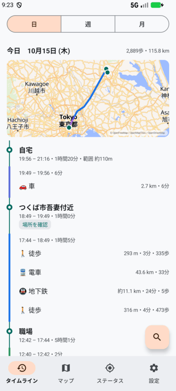

# ashidori

足取り（ashidori）は Android 向けの行動記録アプリである。GNSS と IMU により移動と滞在を自動で記録し、タイムラインと地図で表示する。Google マップのタイムラインの代替を目的とする。記録は端末内に保存し、同期時は端末側で暗号化する（エンドツーエンド暗号化）。

<p>
  
  
  
</p>

## 機能

### タイムライン

日・週・月の単位で、新しい順に過去へ遡って表示する。日単位では滞在と移動を時系列に並べ、日ごとに経路の地図を付ける。経路は移動手段ごとに色分けする。場所の名前と移動手段は一覧上で修正できる。

<p>
  
  
  
</p>

- 滞在の検出、移動区間の分割、移動手段の推定（徒歩・自転車・車・バス・電車・地下鉄・飛行機など）
- 位置精度の低い区間は距離に「約」を付け、地図上は淡色の線で表示
- 週・月・年の集計（距離、歩数、移動手段の内訳、訪問の多い場所、訪問した都市・国）
- 過去のチェックイン地点付近の滞在に、その名称を候補として表示
- 記録の検索（場所の名称、地域、チェックイン先、日付）

### マップとチェックイン

日ごとの経路を地図上に表示する。背景地図は、オフライン地図（初回にダウンロードし、表示では通信しない）、OpenStreetMap（OpenFreeMap）、国土地理院の各種地図（標準・淡色・航空写真・色別標高）から選択でき、任意の XYZ タイルも指定できる。オフライン地図は日本をズーム 10 まで、全世界をズーム 5 まで収録し、市区町村名・主要道路・駅を表示する。チェックインは周辺施設または任意の名称で行う。周辺施設は端末内の施設データ（OpenStreetMap から作成した日本の施設の索引。初回にダウンロードし、検索では通信しない）から探し、「オンラインで検索」を押したときだけ OpenStreetMap のサーバに問い合わせる。

<p>
  
  
</p>

### 記録モードと省電力

記録は停止操作を行うまで継続し、通常の操作はモードの切り替えのみとする。静止中は GNSS と加速度センサーを停止し、移動開始をセンサーの割り込み（significant motion）で検知する。電池残量と実測の消費量に応じて記録頻度を下げる。屋内では Wi-Fi・基地局で測位し、移動開始時と移動中の一定間隔で衛星による屋外判定を行う。屋内の歩行中は歩数と方位から位置を推定する（PDR）。

<p>
  
  
  
</p>

| モード | 移動中の測位間隔 | 生データ |
| --- | --- | --- |
| 省電力 | 30秒 | 移動中6時間間隔で30秒 |
| バランス | 10秒（乗り物5秒） | 移動中30分間隔で1分 |
| 高精度 | 1〜2秒 | 移動中10分間隔で1分 |
| 最高精度 | 常時1秒 | 常時 |

生データは、GNSS の生の観測値（GnssMeasurement・航法メッセージ・NMEA）と加速度・ジャイロ・地磁気の値である。解析や後処理（RTK・PPK など）に用いる。

### 保存とエクスポート

- 前日までの記録は日単位の Parquet ファイルに変換し、月単位で統合する。時系列向けの符号化（DELTA_BINARY_PACKED・BYTE_STREAM_SPLIT）により容量を抑える。
- 期間を指定してエクスポートできる。形式は Timeline.json（Google 互換）、GPX、Parquet（テーブル単位）、GnssLogger 形式。
- Google マップのタイムラインからエクスポートした Timeline.json を取り込める。

### 端末間の同期（エンドツーエンド暗号化）

複数端末の記録を、自前のサーバを介して共有する。記録は端末側で AES-256-GCM により暗号化して送信するため、サーバは内容を復号できない。鍵は端末のみが保持し、別の端末へは復旧コードで渡す。容量の大きい生データは従量制でない回線でのみ送信する。サーバは Cloudflare Workers・D1・R2 上で動作する。詳細は [`server/README.md`](server/README.md) と [`docs/sync-protocol.md`](docs/sync-protocol.md) を参照。

端末の登録には、最初の端末で利用者を作る「新しく登録」と、登録済みの利用者に端末を加える「この端末を追加」がある。アプリにはサーバの URL が組み込まれていないため、登録リンクを使うか、URL を入力する。

1. 最初の端末は、サーバの管理者から受け取った招待のリンク（`https://<サーバ>/pair#i=<招待>`）を開くか、その QR コードを設定 →「サーバ同期」→「QR コードを読み取る」で読み取る。「新しく登録」でユーザ名を決めると、利用者とこの端末が作られる。続けて暗号化の鍵を作り、表示される復旧コードを控える。
2. 2 台目以降は、登録済みの端末の「別の端末を追加」でペアリングコードと登録リンク（`https://<サーバ>/pair#c=<コード>`）を発行し、新しい端末でリンクを開くか QR コードを読み取る。「この端末を追加」で登録先を確かめて追加し、控えた復旧コードを入力する。リンクを使わない場合は、サーバの URL とコードを入力する。
3. QR コードの読み取りは端末内で行う（CameraX と ZXing）。復旧コードはリンクにも QR コードにも含まれない。

ユーザ名は利用者を表す唯一の名前で、英小文字・数字・`_` の 3〜20 文字である。公開登録のサーバ（`REGISTRATION=open`）では、招待がなくても URL を入力して「新しく登録」を選べる。

### 地名と位置情報の送信

名前のない場所の地名（「渋谷区宇田川町付近」など）は、端末内の索引から求める。日本国内は大字・町丁目の代表点のうち最も近いもの（2 km 以内、それより遠い場合は市区町村名）、国外は GeoNames の都市名を用いる。

地図タイルを取得すると、表示中の範囲がタイルの配信元に伝わる。設定の「データの扱い」で、送信先（オンライン地図の配信元、Android の Geocoder、施設のオンライン検索、地図・施設データの取得）ごとに、送るかどうか（送信しない、操作時のみ、自動）と送信する粒度（地域 約 10 km、地区 約 1 km、制限なし）を選ぶ。既定では、オンライン地図は「オンライン地図で表示（表示範囲を送信）」を押した地図だけ、施設の検索は「オンラインで検索」を押したときだけ送り、Geocoder には送らない。「外部への送信を停止」で、地図、地名検索、施設の検索、データの取得への送信をまとめて止められる。

アプリが送るすべての要求は、送信の直前と再試行、リダイレクトのたびに、その時点の設定で許されているかを確かめる。MapLibre の要求もアプリの interceptor で確かめ、許されていない要求は送らない。詳細は [`docs/privacy.md`](docs/privacy.md#外部への送信データの扱い) にある。

この設定の範囲外のものは次のとおりである。

- OS の測位サービス：現在地は、端末の設定に従い fused／network provider から取得する。Google の位置情報の精度などが端末側で送る情報は、この設定では止まらない。
- 利用者の明示的な操作：地図アプリで開く（`geo:` インテント）、エクスポートの共有の各操作は、その操作の分だけ位置情報を渡す。
- 端末間の同期：記録は端末側で暗号化してから送るため、サーバは位置を読めない。
- チェックインの共有：共有したチェックインは暗号化しないため、サーバの運用者とフォロワーが位置を読める。チェックインごとの共有操作でのみ送る（共有の画面は未実装）。

以前の設定「オンライン地図と地名検索」（保存値 `blockExternalLocation`）は、初回の起動で同じ動作の「データの扱い」の設定に移す。以前の設定「近くの施設を OpenStreetMap で検索」をオフにしていた場合は、「オンライン地図と地名検索」のオフとして移す。以前の版が Geocoder で求めて保存した地名は、更新時に索引で求め直し、索引で求まらないものは消去する。

## 構成

| ディレクトリ | 内容 |
| --- | --- |
| `app/` | Android アプリ（Scala 3、Views、MapLibre） |
| `core/` | 端末に依存しない処理（滞在検出、移動手段推定、記録方針、Parquet、暗号化、軌跡シミュレータ、地名の索引）。JVM 上でテストする |
| `server/` | 同期サーバ（TypeScript、Hono、Cloudflare Workers） |
| `docs/` | 仕組みの概要（[`docs/overview.md`](docs/overview.md)）と同期プロトコル |
| `tools/geocoder/` | 地名の索引の生成（Python 3、標準ライブラリのみ） |
| `tools/basemap/` | オフライン地図の生成（go-pmtiles、Python 3、Node） |

## データの出典

地名の索引は次のデータを加工して作成する。生成には `tools/geocoder/fetch.sh <作業ディレクトリ>` を用い、`app/src/main/assets/geocoder/` に索引（`index.bin`）と入力の版・sha256 を記録した `manifest.json` を出力する。位置参照情報のダウンロードには、位置参照情報ダウンロードサービス利用約款と位置参照情報利用約款への同意が必要である。

- 大字・町丁目レベル位置参照情報　国土交通省（2025 年、第 19.0b 版、01000-19.0b.zip〜47000-19.0b.zip）、<https://nlftp.mlit.go.jp/isj/>。加工: 索引形式に変換（ashidori）
- GeoNames（cities1000.zip、2026-10-13 版）、<https://www.geonames.org/>、[CC BY 4.0](https://creativecommons.org/licenses/by/4.0/)。改変: 索引形式に変換し、日本国内の地点と廃止・歴史上の地点などを除外（ashidori）

オフライン地図は次のデータから作成する。生成には `tools/basemap/build.sh <作業ディレクトリ>` を用い、`tools/basemap/out/` に出力する（約 65 MB、リポジトリにも APK にも含めない）。ツールとデータの版は `build.sh` に固定し、出力の sha256 を `manifest.json` に記録する。アプリへの配布は「[オフライン地図](#オフライン地図)」を参照。

- © OpenStreetMap contributors、[ODbL 1.0](https://www.openstreetmap.org/copyright)。地図データは OpenStreetMap から作成した Produced Work である
- [Protomaps Basemap](https://protomaps.com/)（2026-10-13 の日次ビルド）。加工: 日本（ズーム 6〜10）と全世界（ズーム 0〜5）を切り出し（ashidori）
- [Natural Earth](https://www.naturalearthdata.com/)（パブリックドメイン）。低ズームの海岸線と境界に含まれる
- Noto Sans の字形（SIL Open Font License 1.1）、protomaps/basemaps-assets のアイコン（MIT License）、@protomaps/basemaps の配色（BSD-3-Clause）。漢字とかなは端末のフォントで描画する

出典の一覧は `tools/ATTRIBUTION` と、生成物と同じディレクトリの `ATTRIBUTION` にも記す。フォント、アイコン、配色とレイヤー定義のライセンスの全文は `tools/licenses/` に出典のコミットとともに置き、生成物（`OFL.txt`、`LICENSE-icons.txt`、`LICENSE-basemaps.txt`）とアプリ（「データの出典」の「ライセンス」）に含める。アプリの「データの出典」は、ダウンロードしたオフライン地図の `manifest.json` の出典を表示し、未取得の間は同じ内容の固定の文を表示する。

施設データ（チェックインの候補）は次のデータから作成する。生成には `tools/venues/build.sh <作業ディレクトリ>` を用い、`tools/venues/out/` に出力する（約 18 MB、リポジトリにも APK にも含めない）。入力の抽出の版と sha256、pyosmium の版は `build.sh` に固定し、件数と出力の sha256 を `manifest.json` に記録する。

- © OpenStreetMap contributors、[ODbL 1.0](https://www.openstreetmap.org/copyright)。施設データは OpenStreetMap から作成した Derivative Database であり、ODbL 1.0 の下で提供する
- [Geofabrik](https://download.geofabrik.de/asia/japan.html) の日本の抽出（`japan-261014.osm.pbf`、OpenStreetMap 2026-10-14 時点）。加工: 名前と種別（amenity、shop、tourism など）を持つ施設から、チェックインの対象とならないもの（線路、ホーム、駐車場、案内板など）を除いて抜き出し、索引形式に変換（ashidori）

配布はオフライン地図と同じ仕組みで、アーカイブ `ashidori-venues-<版>.zip` を GitHub Releases（タグ `venues-<版>`）に置き、アプリは `app/src/main/assets/venues-pin.json` の sha256 で照合する（同期サーバからは取得しない）。設定の「施設データ」で状態の確認、取得、削除ができる。

```sh
tools/venues/build.sh <作業ディレクトリ>   # tools/venues/out/ に生成する（約 3 GB の作業領域、5 分ほど）
tools/venues/package.sh                    # tools/venues/dist/ にアーカイブと記述子を作り、アプリの固定値を更新する
tools/venues/release.sh                    # 公開のコマンドを表示する（実行はしない）
```

デバッグ版では、オフライン地図と同じく `--es ashidori.venuesUrl <URL>` で手元の HTTP サーバから、`--ez ashidori.venuesImport true` で `files/venues/` に置いたアーカイブから取り込める。

近くの施設をオンラインで検索するとき（「オンラインで検索」を押したときだけ）も OpenStreetMap のデータ（© OpenStreetMap contributors、ODbL）を用いる。検索の結果は端末に 90 日間保存し（約 2 万件まで、使っていない場所から消す）、通信できないときや検索サーバが応答しないときにも候補として表示する。保存した結果は同期やエクスポートに含めない。

## オフライン地図

オフライン地図のデータ（約 64 MB）は APK に含めない。アプリは初回の起動時に、版ごとのアーカイブ `ashidori-basemap-<版>.zip` を Wi-Fi 接続時にダウンロードし、`filesDir/basemap/<版>/` に展開する。従量制の回線では、設定の「オフライン地図」で確認した後にだけ取得する。取得するまでの地図は、無地の背景に経路と滞在地を表示する。

- 取得元：同期を設定した端末は、サーバの `GET /v1/info` が固定の版を挙げていればサーバ（`/basemap/<版>/<ファイル>`）から、それ以外は GitHub Releases（タグ `basemap-<版>`）から取得する。一方が失敗すると他方を試す。サーバへの要求にデバイスのトークンは付けない。
- 照合：アプリは `app/src/main/assets/basemap-pin.json`（版、ファイル名、サイズ、sha256）に固定したアーカイブだけを受け入れる。取得元を信頼する必要はない。
- 中断と再開：WorkManager で実行し、一時ファイルに HTTP Range で続きから取得する。照合後に一時ディレクトリへ展開し、版のディレクトリへ rename で置き換え、古い版を削除する。
- Protomaps の日次ビルドは 1 週間ほどで消え、直接の参照も推奨されないため、切り出したデータを自前で配布する。

アーカイブはリポジトリで作り、公開する。

```sh
tools/basemap/build.sh <作業ディレクトリ>   # tools/basemap/out/ に生成する（BUILD=YYYYMMDD で日次ビルドを指定）
tools/basemap/package.sh                    # tools/basemap/dist/ にアーカイブと記述子を作り、アプリの固定値を更新する
tools/basemap/release.sh                    # 公開のコマンドを表示する（実行はしない）
```

`package.sh` の版は、既定では Protomaps の日次ビルドの日付である。データを変えたときは `VERSION=<版>` で新しい版にする。`release.sh` は `gh release create basemap-<版> …` と、同期サーバに置く場合の `wrangler r2 object put … --remote` を表示する（[`server/README.md`](server/README.md#オフライン地図の配信)）。固定値（`basemap-pin.json`）の変更をコミットし、そのアプリを配布する前にアーカイブを公開する。

リリースを作らずにエミュレータで確かめるには、`package.sh` で固定値を更新してデバッグ版をビルドし、アーカイブを端末に置いて取り込む。取り込みも固定値で照合する。

```sh
./gradlew :app:installDebug
v=$(python3 -c 'import json; print(json.load(open("app/src/main/assets/basemap-pin.json"))["version"])')
adb push tools/basemap/dist/ashidori-basemap-$v.zip /sdcard/Android/data/net.sksat.ashidori.debug/files/basemap/
adb shell am start -n net.sksat.ashidori.debug/net.sksat.ashidori.MainActivity --ez ashidori.basemapImport true
```

ダウンロードの経路を確かめるには、手元の HTTP サーバから取得させる（デバッグ版のみ。`""` で既定の取得元に戻す）。

```sh
(cd tools/basemap/dist && python3 -m http.server 8000) &
adb shell am start -n net.sksat.ashidori.debug/net.sksat.ashidori.MainActivity --es ashidori.basemapUrl http://10.0.2.2:8000
```

## ビルド

JDK 17 と Android SDK（compileSdk 37）が必要。対応 OS は Android 13 以降（minSdk 33）。

```sh
./gradlew :core:test          # コアのテスト（軌跡シミュレータによる E2E テストを含む）
./gradlew :app:assembleDebug  # デバッグ版 APK
```

Gradle のプロパティ `ashidori.defaultServer=https://<ホスト>` を指定すると、同期設定の URL 欄にそのサーバを入力済みにし、そのホストの登録リンク（`https://<ホスト>/pair`）を App Links でアプリに開かせる。個人用のビルドでは、リポジトリの外の `~/.gradle/gradle.properties` に書く。指定しなければ URL 欄は空で、App Links は宣言しない。

リリース版は、`ashidori.release.storeFile`、`ashidori.release.storePassword`、`ashidori.release.keyAlias` で指定した鍵で署名する（同じく `~/.gradle/gradle.properties` に書く）。指定しなければデバッグ用の鍵で署名する。配布する APK は `tools/release/sign.sh` で署名し直し、以前の鍵からの引き継ぎ（APK Signature Scheme v3 の鍵のローテーション）を含める。これがないと、以前の版の上に更新できない。

デバッグ版では、シミュレーションによる記録を投入して画面を確認できる。

```sh
adb shell am start -n net.sksat.ashidori.debug/net.sksat.ashidori.MainActivity \
  --ez ashidori.sim true --ei ashidori.simDays 40
```

同期サーバの開発には Node 24 と pnpm を用いる。

```sh
cd server
pnpm install
pnpm test
```

## ライセンス

[GNU Affero General Public License v3.0](LICENSE)（AGPL-3.0-only）。改変した同期サーバをネットワーク越しに提供する場合は、その利用者にソースコードを提供する必要がある（第 13 条）。

同梱・依存するライブラリは、それぞれのライセンスに従う。

| 対象 | ライブラリ | ライセンス |
| --- | --- | --- |
| アプリ | Scala 3 標準ライブラリ、AndroidX（Core、Activity、AppCompat、WorkManager、CameraX）、Material Components、Tink、ZXing | Apache-2.0 |
| アプリ | MapLibre Native | BSD-2-Clause |
| アプリ | uJson | MIT |
| サーバ | Hono | MIT |
| Web | MapLibre GL JS、PMTiles | BSD-3-Clause |
| Web | @hpke/core、fflate、hyparquet、qrcode-generator（`server/src/vendor/` に同梱） | MIT |

データの出典は「[データの出典](#データの出典)」を参照。
