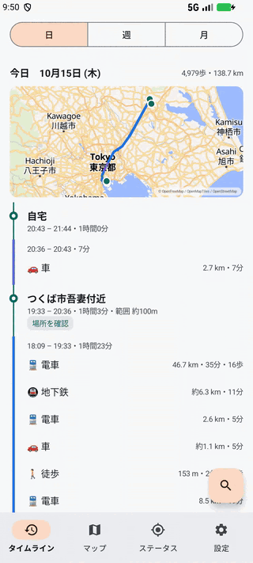
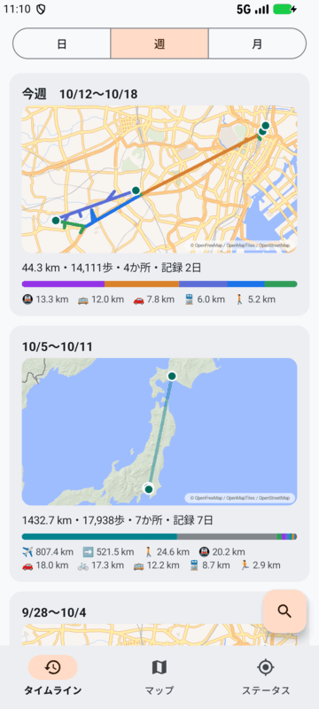
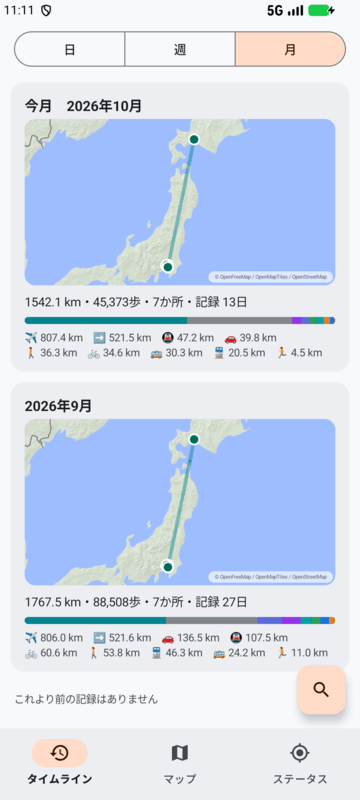
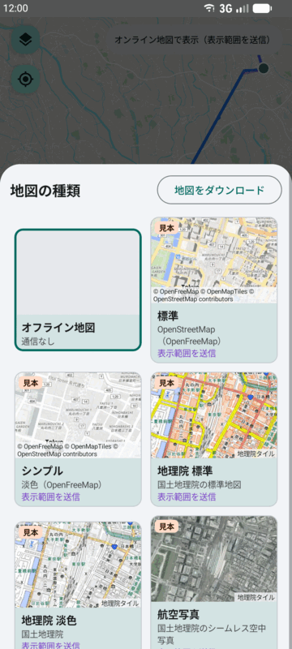
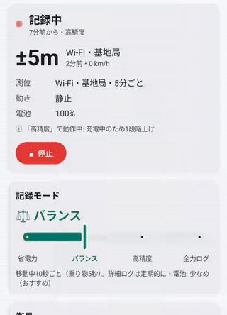
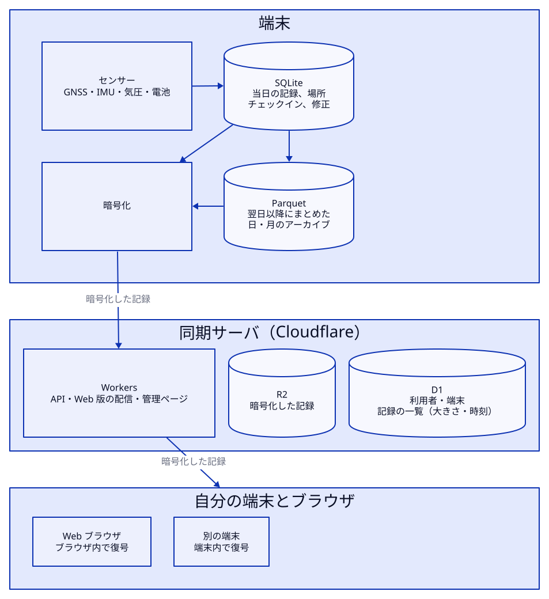

# ashidori

[](https://github.com/sksat/ashidori/actions/workflows/server.yml)
[](https://github.com/sksat/ashidori/actions/workflows/formal.yml)
[](https://github.com/sksat/ashidori/actions/workflows/docs.yml)
[](https://github.com/sksat/ashidori/releases/latest)
[](LICENSE)

足取り（ashidori）は Android 向けの行動記録アプリである。GNSS と IMU で移動と滞在を自動で記録し、タイムラインと地図で振り返る。Google マップのタイムラインの代わりを目指す。記録は端末内に置き、同期するときは端末で暗号化してから送る（エンドツーエンド暗号化）。

APK は [Releases](https://github.com/sksat/ashidori/releases/latest) から入手できる。対応 OS は Android 13 以降。

<p>
  
  
  
</p>

## 機能

### タイムライン

日・週・月の単位で、新しい順に過去へ遡って表示する。日単位では滞在と移動を時系列に並べ、経路の地図を付ける。経路は移動手段ごとに色分けする。場所の名前と移動手段は一覧上で修正できる。

<p>
  
  
  
</p>

- 滞在の検出、移動区間の分割、移動手段の推定（徒歩・自転車・車・バス・電車・地下鉄・飛行機など）
- 位置精度の低い区間は距離に「約」を付け、地図上は淡色の線で表示
- 週・月・年の集計（距離、歩数、移動手段の内訳、訪問の多い場所、訪問した都市・国）
- 記録の検索（場所の名称、地域、チェックイン先、日付）

### マップとチェックイン

背景の地図は、端末内のオフライン地図、OpenStreetMap（OpenFreeMap）、国土地理院の地図（標準・淡色・航空写真・色別標高）、任意の XYZ タイルから選ぶ。オフライン地図は日本をズーム 10、全世界をズーム 5 まで収め、地域データ（日本の区画ごとにズーム 14 まで）を選んで足せる。

地図には施設データ（OpenStreetMap から作った日本の施設）の店や駅を表示し、押すとチェックインできる。施設の検索は端末内で行い、「オンラインで検索」を押したときだけ OpenStreetMap のサーバに問い合わせる。

<p>
  
  
</p>

### 記録モードと省電力

記録は停止するまで続き、普段の操作はモードの切り替えだけである。静止中は GNSS と加速度センサーを止め、移動の開始をセンサーの割り込み（significant motion）で検知する。屋内では Wi-Fi・基地局で測位し、屋内の歩行は歩数と方位から位置を推定する（PDR）。

<p>
  
  
  
</p>

| モード | 移動中の測位間隔 | 生データ |
| --- | --- | --- |
| 省電力 | 30秒 | 移動中6時間間隔で30秒 |
| バランス | 10秒（乗り物5秒） | 移動中30分間隔で1分 |
| 高精度 | 1〜2秒 | 移動中10分間隔で1分 |
| 最高精度 | 常時1秒 | 常時 |

生データは GNSS の観測値（GnssMeasurement・航法メッセージ・NMEA）と加速度・ジャイロ・地磁気の値で、解析や後処理（RTK・PPK など）に使える。

### 保存とエクスポート

- 前日までの記録は日単位の Parquet ファイルにまとめ、月単位で統合する。
- 期間を指定してエクスポートできる。形式は Timeline.json（Google 互換）、GPX、Parquet、GnssLogger 形式。
- Google マップのタイムラインからエクスポートした Timeline.json を取り込める。
- 記録はすぐに保存し、空き容量が少なくなっても記録を失わないための仕組みを持つ（[`docs/recording.md`](docs/recording.md)）。

### 同期（エンドツーエンド暗号化）

記録を同期サーバに送り、別の端末や Web ブラウザから見られるようにする。記録は端末で AES-256-GCM により暗号化してから送るので、サーバは内容を読めない。鍵は端末だけが持ち、別の端末へは復旧コードで、ブラウザへはペアリングで渡す。

同期サーバは [`server/`](server/) にあり、Cloudflare Workers・D1・R2 で動く。アプリにサーバの URL は組み込まれておらず、サーバの管理者から受け取った登録リンクか URL で登録する。手順は [`docs/pairing.md`](docs/pairing.md)、サーバの立て方は [`server/README.md`](server/README.md) にある。

同期サーバの Worker は、端末とブラウザからの API、Web 版のページ、管理ページ（Cloudflare Access で保護）を受け持つ。サーバが持つものは次のとおりである。

| 持つもの | 置き場所 | サーバの運用者に見えるか |
| --- | --- | --- |
| 暗号化した記録 | R2 | 見えない |
| 記録の一覧（端末、種類、大きさ、送った時刻） | D1 | 見える |
| ユーザ名、端末の名前、登録と最終アクセスの時刻 | D1 | 見える |
| 共有したチェックイン | D1 | 見える（共有の画面は未実装） |

運用者は記録を読めないが、送った量と時刻から、移動していたかどうかなどは推測できる。詳しくは [`docs/privacy.md`](docs/privacy.md#同期サーバの運用者に見えるもの) にある。

### 送信するもの

地名と施設は端末内のデータベースから求め、通信しない。アプリが外に送るのは次のものだけで、同期サーバ以外への送信は設定の「データの扱い」で送信先ごとに選べる。アプリの要求は、送る直前と再試行、リダイレクトのたびに、その時点の設定を確かめる。

| 送信先 | 送るもの | 既定で送るとき |
| --- | --- | --- |
| 同期サーバ | 暗号化した記録 | 同期を設定したとき |
| オンライン地図の配信元 | 表示範囲 | 「オンライン地図で表示」を押したとき |
| Android の Geocoder | 位置 | 送らない |
| OpenStreetMap の施設検索 | 位置 | 「オンラインで検索」を押したとき |
| GitHub Releases | 取得するファイルの名前（地域データは選んだ区画） | 地図と施設のデータを取得するとき |

取得したデータは、アプリに固定した sha256 で照合してから使う。OS の測位サービスと、地図アプリで開く・共有するなどの操作は、この設定の対象外である。詳しくは [`docs/privacy.md`](docs/privacy.md) にある。

## 記録の流れ



当日の記録は SQLite に書き、翌日以降に日・月の Parquet にまとめる。同期するのは、まとめた日・月のファイルと、場所・チェックイン・移動手段の修正・端末の状態で、どれも端末で暗号化してから送る。詳しくは [`docs/overview.md`](docs/overview.md)、[`docs/recording.md`](docs/recording.md)、[`docs/sync.md`](docs/sync.md) にある。地図と施設のデータの生成と公開の手順は [`docs/data-packages.md`](docs/data-packages.md) にある。

## 構成

| ディレクトリ | 内容 |
| --- | --- |
| `app/` | Android アプリ（Scala 3、Views、MapLibre） |
| `core/` | 端末に依存しない処理（滞在検出、移動手段推定、記録方針、Parquet、暗号化、軌跡シミュレータ、地名データベース）。JVM 上でテストする |
| `server/` | 同期サーバ（TypeScript、Hono、Cloudflare Workers）と Web 版（`server/web/`） |
| `docs/` | 仕組みの説明（[`docs/overview.md`](docs/overview.md) から辿れる）、同期プロトコル、設計 |
| `tools/` | 配布データの生成（地名データベース、オフライン地図、施設データ、地域データ）、署名、図の生成 |

## ビルド

JDK 17 と Android SDK（compileSdk 37）が必要。

```sh
./gradlew :core:test          # コアのテスト（軌跡シミュレータによる E2E テストを含む）
./gradlew :app:assembleDebug  # デバッグ版 APK
```

デバッグ版では、シミュレーションによる記録を投入して画面を確かめられる。

```sh
adb shell am start -n net.sksat.ashidori.debug/net.sksat.ashidori.MainActivity \
  --ez ashidori.sim true --ei ashidori.simDays 40
```

同期サーバと Web 版の開発には Node 24 と pnpm を使う。

```sh
cd server
pnpm install
pnpm test
```

Gradle のプロパティ（リポジトリの外の `~/.gradle/gradle.properties` に書く）:

- `ashidori.defaultServer=https://<ホスト>`: 同期設定の URL 欄にそのサーバを入れておき、そのホストの登録リンクを App Links でアプリに開かせる。
- `ashidori.release.storeFile`、`ashidori.release.storePassword`、`ashidori.release.keyAlias`: リリース版の署名の鍵。配布する APK は `tools/release/sign.sh` で署名し直し、以前の鍵からの引き継ぎ（APK Signature Scheme v3 の鍵のローテーション）を含める。

## データの出典

- 地名データベース: 大字・町丁目レベル位置参照情報　国土交通省（<https://nlftp.mlit.go.jp/isj/>）、GeoNames（<https://www.geonames.org/>、[CC BY 4.0](https://creativecommons.org/licenses/by/4.0/)）
- オフライン地図・地域データ: © OpenStreetMap contributors（[ODbL 1.0](https://www.openstreetmap.org/copyright)、Produced Work）、[Protomaps Basemap](https://protomaps.com/)、[Natural Earth](https://www.naturalearthdata.com/)
- 施設データ: © OpenStreetMap contributors（[ODbL 1.0](https://www.openstreetmap.org/copyright)、Derivative Database として ODbL 1.0 の下で提供）、[Geofabrik](https://download.geofabrik.de/asia/japan.html) の日本の抽出
- 地図のフォント・アイコン・配色: Noto Sans（SIL Open Font License 1.1）、tangrams/icons（MIT）、@protomaps/basemaps（BSD-3-Clause）
- ペアリングの確認の語: BIP-39 の日本語の単語表（[bitcoin/bips](https://github.com/bitcoin/bips/blob/master/bip-0039/japanese.txt)、MIT）

版と加工の内容は [`tools/ATTRIBUTION`](tools/ATTRIBUTION)、ライセンスの全文は [`tools/licenses/`](tools/licenses/) にあり、アプリの「設定 > データの出典」にも表示する。

## ライセンス

[GNU Affero General Public License v3.0](LICENSE)（AGPL-3.0-only）
