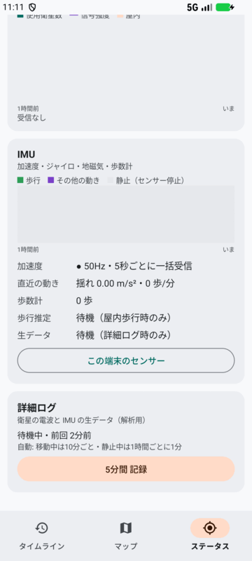

# ashidori

足取り（ashidori）は Android 向けの行動記録アプリである。GNSS と IMU により移動と滞在を自動で記録し、タイムラインと地図で表示する。Google マップのタイムラインの代替を目的とする。記録は端末内に保存し、同期時は端末側で暗号化する（エンドツーエンド暗号化）。

<p>
  
  
  
</p>

## 機能

### タイムライン

日・週・月の単位で、新しい順に過去へ遡って表示する。日単位では滞在と移動を時系列に並べ、日ごとに経路の地図を付ける。経路は移動手段ごとに色分けする。場所の名前と移動手段は一覧上で修正できる。

<p>
  
  
  
</p>

- 滞在の検出、移動区間の分割、移動手段の推定（徒歩・自転車・車・バス・電車・地下鉄・飛行機など）
- 位置精度の低い区間は距離に「約」を付け、地図上は淡色の線で表示
- 週・月・年の集計（距離、歩数、移動手段の内訳、訪問の多い場所、訪問した都市・国）
- 過去のチェックイン地点付近の滞在に、その名称を候補として表示
- 記録の検索（場所の名称、地域、チェックイン先、日付）

### マップとチェックイン

日ごとの経路を地図上に表示する。背景地図は、アプリに同梱する簡易地図（通信しない）、OpenStreetMap（OpenFreeMap）、国土地理院の各種地図（標準・淡色・航空写真・色別標高）から選択でき、任意の XYZ タイルも指定できる。簡易地図は日本をズーム 10 まで、全世界をズーム 5 まで収録し、市区町村名・主要道路・駅を表示する。チェックインは周辺施設（OpenStreetMap）または任意の名称で行う。

<p>
  
  
</p>

### 記録モードと省電力

記録は停止操作を行うまで継続し、通常の操作はモードの切り替えのみとする。静止中は GNSS と加速度センサーを停止し、移動開始をセンサーの割り込み（significant motion）で検知する。電池残量と実測の消費量に応じて記録頻度を下げる。屋内では Wi-Fi・基地局で測位し、移動開始時と移動中の一定間隔で衛星による屋外判定を行う。屋内の歩行中は歩数と方位から位置を推定する（PDR）。

<p>
  
  
  
</p>

| モード | 移動中の測位間隔 | 詳細ログ |
| --- | --- | --- |
| 省電力 | 30秒 | 移動中6時間ごとに30秒 |
| バランス | 10秒（乗り物5秒） | 移動中30分ごとに1分 |
| 高精度 | 1〜2秒 | 移動中10分ごとに1分 |
| 全力ログ | 常時1秒 | 常時 |

詳細ログは、GNSS の生の観測値（GnssMeasurement・航法メッセージ・NMEA）と加速度・ジャイロ・地磁気の生データである。解析や後処理（RTK・PPK など）に用いる。

### 保存とエクスポート

- 前日までの記録は日単位の Parquet ファイルに変換し、月単位で統合する。時系列向けの符号化（DELTA_BINARY_PACKED・BYTE_STREAM_SPLIT）により容量を抑える。
- 期間を指定してエクスポートできる。形式は Timeline.json（Google 互換）、GPX、Parquet（テーブル単位）、GnssLogger 形式。
- Google マップのタイムラインからエクスポートした Timeline.json を取り込める。

### 端末間の同期（エンドツーエンド暗号化）

複数端末の記録を、自前のサーバを介して共有する。記録は端末側で AES-256-GCM により暗号化して送信するため、サーバは内容を復号できない。鍵は端末のみが保持し、別の端末へは復旧コードで渡す。容量の大きい生ログは従量制でない回線でのみ送信する。サーバは Cloudflare Workers・D1・R2 上で動作する。詳細は [`server/README.md`](server/README.md) と [`docs/sync-protocol.md`](docs/sync-protocol.md) を参照。

### 地名と位置情報の送信

名前のない場所の地名（「渋谷区宇田川町付近」など）は、端末内の索引から求める。日本国内は大字・町丁目の代表点のうち最も近いもの（2 km 以内、それより遠い場合は市区町村名）、国外は GeoNames の都市名を用いる。

地図タイルを取得すると、表示中の範囲がタイルの配信元に伝わる。設定「位置情報を外部サービスに送らない」（既定でオン）は、アプリが利用者の操作なしに位置情報を外部へ送る経路を止める。対象は地図タイルの取得、Android の Geocoder への問い合わせ、施設の検索（OpenStreetMap）である。

| 経路 | オン | オフ |
| --- | --- | --- |
| 地図の表示（タイムライン、期間、場所） | 簡易地図。「この範囲を詳しい地図で表示（位置情報を送信）」を押した地図のみ、その画面を離れるまで選択中の地図を取得する | 選択中の地図 |
| 地図の静止画（フィード、期間のカード、他の端末の位置） | 簡易地図 | 選択中の地図 |
| 地図の種類のサムネイル | 簡易地図のみ描画する | すべて描画する |
| 地名 | 端末内の索引のみ | 索引で求まらない位置に限り Android の Geocoder |
| 近くの施設の検索（OpenStreetMap） | 検索を指示したときのみ | 自動 |

設定を切り替えると、それまでに予約した処理は新しい設定に従う。待機中の地図の静止画と自動の施設検索は破棄し、実行中のものは中止する。地図の静止画は、描画を始める直前の設定で地図を選ぶ。詳しい地図の表示は、操作した地図にだけ適用し、その画面を離れる（戻る、タブの切替、別の期間を開く）か設定を切り替えると終わる。

オンの間は MapLibre にも通信不可と通知する（取得済みのキャッシュは表示する）。ただし、この通知はプロセス全体に効き、予約済みの要求を取り消さない。詳しい地図を表示している間は通信可となるため、他の地図が送信しないことは、端末内の地図を使うことで担保する。

この設定の範囲外のものは次のとおりである。

- OS の測位サービス：現在地は、端末の設定に従い fused／network provider から取得する。Google の位置情報の精度などが端末側で送る情報は、この設定では止まらない。
- 利用者の明示的な操作：地図アプリで開く（`geo:` インテント）、エクスポートの共有、詳しい地図の表示、施設の検索の各操作は、その操作の分だけ位置情報を渡す。
- 端末間の同期：記録は端末側で暗号化してから送るため、サーバは位置を読めない。
- チェックインの共有：共有したチェックインは暗号化しないため、サーバの運用者とフォロワーが位置を読める。外部への送信として扱い、設定によらずチェックインごとの共有操作でのみ送る（共有の画面は未実装）。以前の設定「近くの施設を OpenStreetMap で検索」はこの設定に統合した。以前の設定をオフにしていた場合は、この設定をオンにして引き継ぐ。以前の版が Geocoder で求めて保存した地名は、更新時に索引で求め直し、索引で求まらないものは消去する。

## 構成

| ディレクトリ | 内容 |
| --- | --- |
| `app/` | Android アプリ（Scala 3、Views、MapLibre） |
| `core/` | 端末に依存しない処理（滞在検出、移動手段推定、記録方針、Parquet、暗号化、軌跡シミュレータ、地名の索引）。JVM 上でテストする |
| `server/` | 同期サーバ（TypeScript、Hono、Cloudflare Workers） |
| `docs/` | 同期プロトコル |
| `tools/geocoder/` | 地名の索引の生成（Python 3、標準ライブラリのみ） |
| `tools/basemap/` | 簡易地図の生成（go-pmtiles、Python 3、Node） |

## データの出典

地名の索引は次のデータを加工して作成する。生成には `tools/geocoder/fetch.sh <作業ディレクトリ>` を用い、`app/src/main/assets/geocoder/` に索引（`index.bin`）と入力の版・sha256 を記録した `manifest.json` を出力する。位置参照情報のダウンロードには、位置参照情報ダウンロードサービス利用約款と位置参照情報利用約款への同意が必要である。

- 大字・町丁目レベル位置参照情報　国土交通省（2025 年、第 19.0b 版、01000-19.0b.zip〜47000-19.0b.zip）、<https://nlftp.mlit.go.jp/isj/>。加工: 索引形式に変換（ashidori）
- GeoNames（cities1000.zip、2026-10-13 版）、<https://www.geonames.org/>、[CC BY 4.0](https://creativecommons.org/licenses/by/4.0/)。改変: 索引形式に変換し、日本国内の地点と廃止・歴史上の地点などを除外（ashidori）

簡易地図は次のデータから作成する。生成には `tools/basemap/build.sh <作業ディレクトリ>` を用い、`app/src/main/assets/basemap/` に出力する（約 65 MB、リポジトリには含めない）。ツールとデータの版は `build.sh` に固定し、出力の sha256 を `manifest.json` に記録する。

- © OpenStreetMap contributors、[ODbL 1.0](https://www.openstreetmap.org/copyright)。地図データは OpenStreetMap から作成した Produced Work である
- [Protomaps Basemap](https://protomaps.com/)（2026-10-13 の日次ビルド）。加工: 日本（ズーム 6〜10）と全世界（ズーム 0〜5）を切り出し（ashidori）
- [Natural Earth](https://www.naturalearthdata.com/)（パブリックドメイン）。低ズームの海岸線と境界に含まれる
- Noto Sans の字形（SIL Open Font License 1.1）、protomaps/basemaps-assets のアイコン（MIT License）、@protomaps/basemaps の配色（BSD-3-Clause）。漢字とかなは端末のフォントで描画する

出典の一覧は `tools/ATTRIBUTION` と、生成物と同じディレクトリの `ATTRIBUTION` にも記す。

近くの施設の検索には OpenStreetMap のデータ（© OpenStreetMap contributors、ODbL）を用いる。

## ビルド

JDK 17 と Android SDK（compileSdk 37）が必要。対応 OS は Android 13 以降（minSdk 33）。

```sh
./gradlew :core:test          # コアのテスト（軌跡シミュレータによる E2E テストを含む）
./gradlew :app:assembleDebug  # デバッグ版 APK
```

デバッグ版では、シミュレーションによる記録を投入して画面を確認できる。

```sh
adb shell am start -n net.sksat.ashidori.debug/net.sksat.ashidori.MainActivity \
  --ez ashidori.sim true --ei ashidori.simDays 40
```

同期サーバの開発には Node 24 と pnpm を用いる。

```sh
cd server
pnpm install
pnpm test
```
