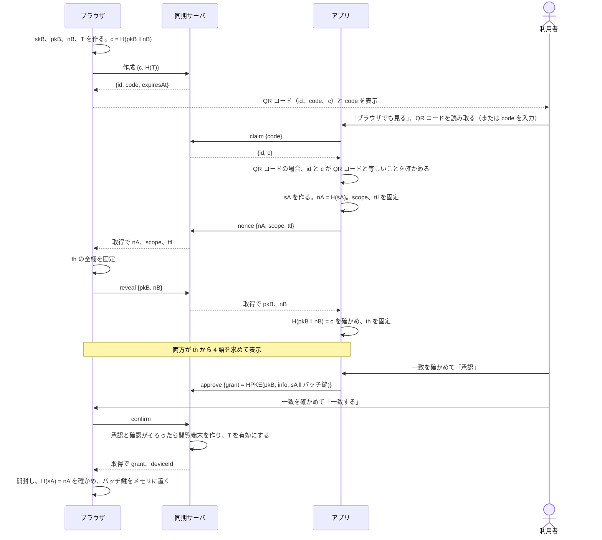

# ブラウザのペアリング v1（設計案）

> 状態：**実装中**。「推奨」と記した項目は採用した（[未決事項](#未決事項)）。サーバ、アプリ、ブラウザのペアリングは実装した。blob の認証（v1.1）は別に実装しており、アプリはそれが入るまで、リリースのビルドではペアリングを始めない。実ブラウザ（Playwright）の試験は未実施である。
> 現行の同期は [`sync-protocol.md`](../sync-protocol.md)（v1）、鍵の階層の将来案は [`key-hierarchy.md`](key-hierarchy.md)（v2）である。
> 形式モデルは [`formal/crypto/browser_pairing.spthy`](../../formal/crypto/browser_pairing.spthy) にある。

最初の Web 閲覧のために、アプリからブラウザへ **バッチ鍵** を渡す手順を定める。
アプリはブラウザが表示する QR コードを読み取る。読み取れない場合は、ブラウザが表示するコードを入力する（[QR コード](#qr-コード)）。
v1 の鍵（`K`、バッチ鍵 = HKDF(`K`, `ashidori batch v1`)）は変えない。
バッチ鍵を持つ者が偽の blob を作れないように、先に blob に認証を加える（[v1.1](#blob-の認証v11)）。
手順は v2 のブラウザのペアリングの部分集合とし、v2 では渡すものをバッチ鍵から世代ごとの EK に替えるだけで済むようにする。

## 要件と信頼の前提

| 項目 | 内容 |
| --- | --- |
| ブラウザが受け取るもの | バッチ鍵だけ。`K`、復旧コード、blob の認証鍵は Web に渡さない（推奨：この禁止を仕様に残す） |
| 受け渡し | ブラウザの一時的な X25519 鍵に宛てた HPKE（RFC 9180 base mode） |
| ブラウザでの保管 | メモリだけ。再読み込みやタブを閉じると消え、ペアリングからやり直す |
| ブラウザの扱い | 読み取り専用の端末（閲覧端末）。自分のトークンを持つ。アプリ、管理ページ、ブラウザ自身（推奨）が終了できる |
| 期限 | 1 時間か 24 時間、既定 1 時間（推奨）。期限後はサーバが閲覧端末のトークンを `401` にする |
| 照合 | ブラウザが QR コードと短いコードを表示し、利用者がアプリで QR コードを読み取る（読み取れない場合はコードを入力する）。両方に同じ 4 語を表示し、利用者がアプリで「承認」、ブラウザで「一致する」を押す（ブラウザでの確認は推奨、[理由](#流れ)） |
| 有効にする操作 | 「ブラウザでも見る」。説明は「アプリだけで見る場合より、保護は弱くなります。」と「詳しく」 |

**信頼の前提**：ページは同期サーバと同じ Worker が配信し、利用者が自分で有効にする。
書き換えたページはバッチ鍵を外へ送れるので、ページの配信者は信頼する。
この手順が防ぐ攻撃者は、ページを書き換えずに API、D1、R2、通信路を操作する者である（D1 だけの漏洩や改ざん、将来の別の場所からのページの配信を含む）。

**承認の画面** は次を示す：「このブラウザは、これまでの記録と、これから送る記録を読めます。期限はサーバが渡すのをやめるだけで、鍵が持ち出されると期限後も読めます。」

「詳しく」で示す、v1 で弱くなる点：

- バッチ鍵は変わらないので、全期間の記録と、今後同じ鍵で暗号化する記録を読める。v1 には漏れた後に守る方法がない（`K` の取り替えがない）。
- 閲覧端末は書き手を確かめられない。漏れたバッチ鍵とサーバが組むと、ブラウザに偽の記録を見せられる。アプリは v1.1 の認証で拒否する。ただし、切り替えをまだ知らない端末のアプリは受け付けうる（[残る危険](#blob-の認証v11)）。
- v2 では付与する範囲を月と種別に限り、書き手を署名で確かめる。

## 流れ



- アプリの「承認」はバッチ鍵を渡す判断であり、秘匿を守る。
- ブラウザの「一致する」は、受け取る鍵がそのアプリから来たと判断する根拠である。これを省くと、サーバがアプリになりすまして自分の鍵をブラウザに渡し、偽の記録を見せられる（[形式検証](#形式検証) の `APPONLY`）。ブラウザは入力を受けないと、相手が正しいアプリかサーバかを区別できない。
- 二つの操作の順序は問わない。ブラウザは自分で「一致する」を押す前に届いた `grant` を開かない。

## 値と符号化

H は SHA-256、‖ は連結である。ラベルは ASCII で、終端の文字を含めない。
JSON では byte 列を base64url（パディングなし）で送る。

| 値 | 作る者 | 長さ | 定義 |
| --- | --- | --- | --- |
| `skB`、`pkB` | ブラウザ | 32 | X25519。WebCrypto で取り出し不可として作る。`pkB` は RFC 7748 の u 座標（raw 形式） |
| `nB` | ブラウザ | 32 | 乱数 |
| `T` | ブラウザ | 32 | 乱数。base64url で 43 文字（デバイストークンと同じ形式） |
| `c`（commit） | ブラウザ | 32 | H(`ashidori pair commit v1` ‖ pkB ‖ nB) |
| `id` | サーバ | 16 | 乱数。試行 ID |
| `code` | サーバ | 8 | Crockford base32 の大文字 ASCII。`XXXX-XXXX` と表示する |
| `sA` | アプリ | 32 | 乱数。付与の中でだけ開示する |
| `nA` | アプリ | 32 | H(`ashidori pair app v1` ‖ sA) |
| `scope` | アプリ | 可変 | v1 では `batch-v1` だけ |
| `ttl` | アプリ | 4 | 閲覧端末の有効期間（秒、big-endian）。3600 か 86400 |
| `th` | 両方 | 32 | H(`ashidori pair v1` ‖ id ‖ code ‖ c ‖ nA ‖ len(scope)（1）‖ scope ‖ ttl ‖ pkB ‖ nB) |

可変長の欄は `scope` だけで、長さを前に置くので、`th` の入力は一意に分解できる。

**固定する時点**：後から変えられる欄は、サーバが 4 語を合わせる余地になる。
各端は次の時点で欄を固定し、以後に届く別の値では中断する。
4 語の表示、承認または確認、封印または開封には、固定した同じ `th` を使う。

| 欄 | ブラウザ | アプリ |
| --- | --- | --- |
| `pkB`、`nB`、`c` | 作成の前 | reveal を受け取り、`c` と照合した時。QR コードの場合、`c` は読み取った時 |
| `id`、`code` | 作成の応答を受けた時 | claim の応答を受けた時。`code` は利用者が入力して正規化した値、または QR コードの値（応答の値は使わない）。QR コードの場合、`id` は読み取った時 |
| `nA`、`scope`、`ttl` | 最初に受け取った時（reveal を送る前） | `nA` を送る前 |

**code の正規化**：大文字にし、`-` と空白を除き、`O` を `0`、`I` と `L` を `1` に替える。結果が `^[0-9ABCDEFGHJKMNPQRSTVWXYZ]{8}$` でなければ送らない。

**4 語**：

1. `d` = H(`ashidori pair sas v1` ‖ th)。
2. `d` の先頭 44 bit（`d[0]` の最上位 bit から）を 11 bit ずつ 4 つに分け、それぞれを big-endian の整数 0〜2047 とする（BIP-39 と同じ取り方）。
3. 各整数で BIP-39 の日本語の単語表（`bitcoin/bips` の `bip-0039/japanese.txt`、2048 行、ファイルの SHA-256 `2eed0aef492291e061633d7ad8117f1a2b03eb80a29d0e4e3117ac2528d05ffd`）の行を引く。ファイルは NFKD なので、表示は NFC に直す。
4. 番号 1〜4 を付けて縦に並べる。

試験のベクタ（`pkB` は 0x33 を 32 個並べた値で、鍵として有効である必要はない）：

| 入力 | 値 |
| --- | --- |
| `id` | `000102…0f` |
| `code` | `ABCD2345` |
| `pkB`、`nB`、`sA` | 0x33、0x11、0x44 をそれぞれ 32 個 |
| `scope`、`ttl` | `batch-v1`、3600 |
| `c` | `bd511eec808fd863c98d184c6c3365b4795dd5faa744c4eb4739745b643c90a6` |
| `nA` | `12f1f75587df148a55d473a566e6af39dfb694346eb15f318296e00ec72c0428` |
| `th` | `7d6395cd068e7461034748a495ad8260d04489d466cb7a0b33f14b157cd9d3a8` |
| `d` の先頭 6 byte | `44999b593025` |
| 番号 | 548、1638、1714、770 |
| 4 語 | けっせき、ぴっちり、ふみん、ざんしょ |

**HPKE の付与**：

| 項目 | 値 |
| --- | --- |
| モード、方式 | base mode。KEM DHKEM(X25519, HKDF-SHA256) `0x0020`、KDF HKDF-SHA256 `0x0001`、AEAD AES-256-GCM `0x0002` |
| 受け取り手 | `pkB` |
| `info` | `ashidori viewer grant v1` ‖ th |
| `aad` | 空（Tink 1.23.0 の `HybridEncrypt` は `contextInfo` を `info` に入れ、AAD を空にする。v2 の HPKE と同じ扱い） |
| 平文 | 版 `0x01`（1）‖ sA（32）‖ バッチ鍵（32）、65 byte |
| `grant` | enc（32）‖ 暗号文（81）、ちょうど 113 byte |

ブラウザは次をすべて確かめてから、バッチ鍵を取り出し不可の AES-GCM の `CryptoKey` として読み込む：自分の確認の後であること、長さがちょうど 113 byte、開封の成功、平文がちょうど 65 byte で版が `0x01`、H(`ashidori pair app v1` ‖ sA) = nA。
元の byte 列と `skB` は捨てる。
`localStorage`、`sessionStorage`、IndexedDB には何も置かない。

**sA を付与に入れる理由**：base mode は送り手を認証しないので、`pkB` を知るサーバも `pkB` 宛てに包める。
4 語は `nA` を認証するので、`nA` の原像 `sA` を含む付与だけが、照合したアプリからの付与である（`NOGRANTAUTH`）。

## QR コード

ブラウザは作成の応答を受けた後、code と一緒に次の文字列の QR コード（誤り訂正 M、余白 4 モジュール、白地に黒）を表示する。
アプリの「ブラウザでも見る」は、「QR コードを読み取る」を主な操作とし、読み取れない端末のために「コードを入力」を残す。
どちらでも、以後の手順と 4 語は同じである。

```text
ashidori://viewer?server=<origin>&id=<id>&code=<code>&c=<c>
```

| 欄 | 値 |
| --- | --- |
| `server` | ページのオリジン `scheme://host[:port]`（小文字、パスなし）を `encodeURIComponent` で符号化した値 |
| `id` | 作成の応答の `id`（base64url、22 文字） |
| `code` | 作成の応答の `code`（Crockford base32 の大文字 8 文字、`-` なし） |
| `c` | commit。小文字の 16 進 64 文字 |

**解析**（core の `ViewerQr`）：この形だけを受け付ける。
欄はこの順に一つずつで、ほかの欄、フラグメント、別の符号化（`%3a`、大文字のホストや 16 進、`https://` の生の記述など）は拒否する。
解析した値から作り直した文字列が読み取った文字列と一致しなければ拒否する。
`server` は同期の設定のサーバと同じでなければならず、違えば読み取りを拒否する（http はデバッグ版だけ）。

**アプリの規則**：QR コードの `code` で claim し、応答の `id` と `c` が QR コードの値と等しいことを確かめる。
違えば `nA` を送らずに中断し（abort を送る）、やり直しを案内する。
以後は code を入力した場合と同じで、reveal が `c` を開くことも確かめる。
サーバ API は変えない（claim は QR コードの `code` で行う）。

**QR コードで変わること**：カメラはブラウザからアプリへの、サーバを通らない経路である。
中身は秘密ではない（サーバはすべて知り、画面を見る者も読める）が、サーバは書き換えられない。
アプリは `c` をこの経路で受け取るので、サーバはブラウザの鍵を自分の鍵にすり替えられない。
アプリが鍵を渡す相手は、利用者の見比べと 2⁻⁴⁴ の確率に頼らずに決まる。

**変えないこと**：

- 4 語とブラウザの「一致する」。付与がそのアプリから来たことをブラウザが確かめる手段は、QR コードがあっても 4 語だけである（ブラウザはアプリから何も受け取らない）。利用者は両方の画面を一度見比べ、アプリで「承認」、ブラウザで「一致する」を押す。アプリの承認の画面は、範囲、期限、4 語と「承認」「一致しない」を示す。
- commit と、`nA` の前に `pkB`、`nB` を送らない規則。QR コードに `pkB`、`nB` を直接載せると、サーバは `nB` を知ってから、ブラウザに渡す自分の `nA`（原像 `sA` を自分で持つもの）を選べる。commit を QR コードに残しても、ブラウザ側の 4 語を合わせて偽の付与を受け取らせられ、同じブラウザのコードの入力ではアプリ側も破れる（形式検証の `EARLYNB`）。
- QR コードの `code` と claim。`id` だけで claim するには API の変更が要るため、今は `code` を使い、応答の `id` を QR コードと照合する。

## 試行の規則とビット強度

| 規則 | 守る者 |
| --- | --- |
| ブラウザは `nA` を受け取るまで `pkB` と `nB` を送らない | ブラウザ |
| アプリは `c` を受け取ってから `sA` を作る | アプリ |
| 各端は最初に受け取った値だけを使う。別の値が来たら中断する | ブラウザ、アプリ |
| アプリは H(pkB ‖ nB) ≠ c なら中断する | アプリ |
| QR コードの場合、アプリは claim の応答の `id`、`c` が QR コードと違えば `nA` を送らずに中断する | アプリ |
| 中断、不一致、期限切れの後は、新しい `skB`、`nB`、`T`、`sA`、code でやり直す | ブラウザ、アプリ |

| 項目 | 強さ |
| --- | --- |
| サーバによる中間者（commit あり） | 1 試行あたり 2⁻⁴⁴。両端が欄を上の時点で固定し、利用者が正しいブラウザとアプリを厳密に見比べる前提 |
| サーバによる中間者（QR コード） | アプリが鍵を渡す相手のすり替えは、4 語によらず防ぐ（利用者が正しいブラウザの QR コードを読み取る前提）。ブラウザが受け取る付与の出所は、上と同じく 1 試行あたり 2⁻⁴⁴ |
| 試行の回数 | N 回の試行で N × 2⁻⁴⁴ 以下。N は利用者が見比べた回数であり、サーバの回数制限は悪意あるサーバ自身を抑えない |
| commit なし | 破れる。サーバは `nA` を見てから自分の nonce を探せ、2⁴⁴ 回の SHA-256 は大きな計算資源なら試行の時間内に届きうる（実測していない） |
| commit の秘匿、`sA` | 256 bit（32 byte の乱数） |
| code | 40 bit。秘密ではない（サーバは知る） |

見比べの誤り（見ずに承認する）は残る。

## blob の認証（v1.1）

v1 の AES-GCM の鍵（バッチ鍵）を持つ者は、任意の端末 ID、stream、seq に受理される blob を作れる。
ブラウザに渡す前に、アプリだけが持つ鍵による認証を加える。

| 項目 | 内容 |
| --- | --- |
| 認証鍵 `Ka` | HKDF-SHA256(`K`, salt 空, info `ashidori batch auth v1`)、32 byte。アプリの端末だけが持ち、閲覧端末には渡さない |
| 形式 `ASHM` | `ASHM`（4）‖ nonce（12）‖ AES-256-GCM の暗号文とタグ ‖ mac（32）。GCM の鍵と AAD（`{deviceId}/{stream}/{seq}`）は ASH1 と同じ |
| mac | HMAC-SHA256(`Ka`, `ashidori blob auth v1` ‖ len(AAD)（2、big-endian）‖ AAD ‖ mac より前の全 byte) |
| 書く端末（v1.1 以降） | 常に `ASHM` で書く |
| 読むアプリ | mac を定数時間で確かめてから GCM で開く |
| 閲覧端末 | 末尾 32 byte を除いて GCM だけで開く。mac は確かめられない（書き手の確認は v2 の署名まで待つ） |
| サーバ | 変更なし（magic は見える。32 byte 以上という下限はそのまま） |

**切り替えの記録 `C`**：利用者ごとに一つ、stream `authcut` の `ASHM` の blob として置く。
中身は、作った時点の、各端末と stream の組ごとの `{deviceId, stream, below, digest}` である。
`below` はその組で一覧に見えた最大の seq + 1、`digest` は seq 0 から `below - 1` の各 sha256（欠けた seq は 0 を 32 byte）を seq の順に連結した SHA-256 である。

| 規則 | 内容 |
| --- | --- |
| 作る時 | 最初の閲覧端末を承認する前に、承認するアプリが作り、`201` を確かめてから承認する。`C` がすでにあればそれを使う |
| 作らない時 | 状態を読めなかった時、または `C` があると知っている時（status が名指した、一覧に見えた、一覧の候補が保持の上限を超えた）は、新しい `C` を作らず、既存の `C` を取得して検証するだけにする。検証できなければ「切り替えの記録を確認できません。ほかの端末で同期してから再試行してください」と示し、ペアリングを始めない。新しく作るのは、`C` を一度も見ておらず、必須の状態でもない時だけである |
| 作れる条件 | 失効していない全端末（閲覧端末を除く）から `ASHM` を一度は受理している。満たさなければ「すべての端末のアプリを更新してください」と示し、ペアリングを始めない |
| 告知 | v1.1 の端末は status に、知っている `C` の sha256 を載せる |
| 必須の状態に入る | `C` を作った、`C` を受理した、または `C` を名指す `ASHM` の status を受理した時。端末に保存し、戻らない |
| 必須の状態での ASH1 | `C` の `below` より小さい seq で、一覧の sha256 から求めた `digest` が `C` と一致した組のものだけを受理する。それ以外の ASH1 は拒否する。必須の前に受理した ASH1 も例外にせず、`C` で判定し直す。必須の前に ASH1 で受理した status は表示から外す |
| 必須の前の ASH1 | ある端末と stream の組で受理した `ASHM` の最小の seq より大きい seq の ASH1 は拒否する |
| `C` を名指されたがまだ取得していない | ASH1 をすべて拒否する |
| 一回の同期での順序 | 取得した blob のうち、先に `ASHM` を開き、status が名指す `C` を保存し、名指されたか一覧に見えた `C` を取得して保存してから、ASH1 を判定する。保存か `C` の取得に失敗したら、ASH1 は次回に回す。検証済みの `C` がなく、取得の回数の上限で試していない候補が残る時、または一覧の候補が保持の上限（8 件）を超えた時も、ASH1 は次回に回す |
| 状態の保存 | 保存の結果が分からない状態は、厳しい方（新しい方）を読むが、保存済みとはみなさない。次の更新は値が同じでも書き込み、`C` を作るか使って承認に進む前に、必須の状態の保存を確かめる |
| 状態を読めない | 起動時にファイルを読めない、または解釈できない場合は、初回の起動と区別する。既存の `C` を取得して検証し、受理し直すまで、すべての ASH1 を拒否する。この状態では `C` を作り直さない（サーバが本物の `C` を隠し、偽の ASH1 を含む一覧から `C` を作らせることを防ぐ） |

残る危険：
- `C` も、`C` を名指す status も一度も届かない端末（サーバがすべて隠す）は必須の状態に入らず、`ASHM` を受理したことのない組（サーバが作った架空の端末など）の偽の ASH1 を受理しうる。
- `C` の前に新しく登録した端末には比べる過去がなく、同じ制限がある。
- mac を外して ASH1 に戻した blob は、中身が本物なので、必須の前の端末には受理されうる。偽造ではない。

## サーバ API

| メソッド | 経路 | 認証 | 本文 → 応答 |
| --- | --- | --- | --- |
| POST | `/v1/viewer-pairings` | なし（回数制限） | `{commit, tokenHash}` → `201 {id, code, expiresAt}` |
| GET | `/v1/viewer-pairings/:id` | `T` | → `{state, expiresAt, nA?, scope?, ttl?, grant?, deviceId?, viewerExpiresAt?}` |
| POST | `/v1/viewer-pairings/:id/reveal` | `T` | `{pkB, nB}` → `200` |
| POST | `/v1/viewer-pairings/:id/confirm` | `T` | → `200 {state}`。承認済みで上限なら `409` |
| POST | `/v1/viewer-pairings/claim` | アプリの端末 | `{code}` → `{id, commit, expiresAt}` |
| POST | `/v1/viewer-pairings/:id/nonce` | claim した端末 | `{nA, scope, ttl}` → `200` |
| GET | `/v1/viewer-pairings/:id/app` | claim した端末 | → `{state, expiresAt, pkB?, nB?, confirmed}` |
| POST | `/v1/viewer-pairings/:id/approve` | claim した端末 | `{grant}` → `200 {state, deviceId?}` |
| POST | `/v1/viewer-pairings/:id/abort` | `T` または claim した端末 | → `200 {state}` |

- `tokenHash` は SHA-256(`T`) の hex である。サーバは以後の `Authorization: Bearer <T>` をハッシュで定数時間で比べる。有効になるまで、`T` が通るのは自分の試行の経路だけで、有効になると同じ `T` が閲覧端末のトークンになる。
- 取得は両端とも 2 秒ごとのポーリングである（10 分で最大 300 回なので、長いポーリングは使わない）。
- 本文の長さを確かめる（`commit`、`nA`、`pkB`、`nB` は 32 byte、`grant` は 113 byte）。`scope` が `batch-v1` 以外、`ttl` が 3600 と 86400 以外なら `400`。

**状態**：

| 状態 | 入る操作 | 次 |
| --- | --- | --- |
| `open` | 作成 | `claimed`、`aborted` |
| `claimed` | claim | `nonce`、`aborted` |
| `nonce` | nonce | `revealed`、`aborted` |
| `revealed` | reveal。承認と確認は中の印 | `active`、`aborted` |
| `active` | 承認と確認の後の方（閲覧端末の作成と同じトランザクション） | なし（以後は閲覧端末の失効） |
| `aborted` | 中断、承認端末の失効 | なし |

期限切れは状態ではなく、`active` 以外で D1 の時刻が `expiresAt`（作成から 10 分）以上であることを指す。

**競合**：D1 は書き込みを直列にするので、各遷移を D1 の一文（または一つのトランザクション）で条件付きにすれば、勝つのは一つである。

| 場面 | 決め方 |
| --- | --- |
| 中断と有効化 | どちらも元の状態を条件にする。先に確定した方が勝ち、負けた側は現在の状態（`aborted` か `active`）を受け取る |
| 期限 | `active` までの遷移はすべて、同じ文で「D1 の時刻 < `expiresAt`」を確かめる。期限の直前に確定した有効化は有効である |
| 承認端末の失効 | 端末の失効のトランザクションで、その端末が claim した未完了の試行を `aborted` にし、その端末が承認した閲覧端末も失効させる（推奨）。DB のトリガー（migration 0008）が同じ更新を行うので、旧版の Worker が失効させても連動する。有効化の文は、承認端末が失効しておらず利用者が停止されていないことも確かめる。閲覧端末の認証と付与の取得も、承認端末が同じ利用者の失効していないアプリの端末であることを確かめる。どちらが先でも、また連動が漏れても、失効した端末の承認による閲覧端末は使えない |
| 5 台の上限 | 有効化の文が、有効な閲覧端末が 5 未満のときだけ挿入する。超えると、後に来た承認か確認に `409 {"error": "too many viewers"}` を返し、試行は `revealed` のまま残る。古いものを失効させた後、ブラウザの再試行（確認の再送）かアプリの承認の再送のどちらでも有効になる |
| トークンの一意性 | `tokenHash` は試行と端末を通して一意（UNIQUE）。作成で衝突すれば `409 {"error": "token already in use"}` で、ブラウザは新しい `T` で作り直す。有効化で衝突すればトランザクションごと失敗する |
| 付与の再送 | アプリは付与を一度だけ封じ、再送には同じ byte 列を使う。保存済みと同じなら `200` と同じ結果、違えば `409` |
| 確認の再送 | `active` の後の confirm は `200` と同じ結果を返す |
| 結果の回復 | 取得は、期限や回数制限より前に保存した状態から答える。`active` なら、閲覧端末が有効な間は期限後も `grant` と `deviceId` を返す。試行の行は期限の 1 日後に消す |

**クライアントの状態**：各端は試行 ID と段階を持つ（ブラウザ：作成中、`nA` 待ち、表示中、確認済み、完了。アプリ：claim 中、reveal 待ち、表示中、承認済み、完了。両方に中断、期限切れ）。

- 現在の試行でない応答と、今の段階より前の段階への応答は捨てる。中断、期限切れ、完了の後に届いた応答も捨てる。
- 手元の期限は、作成または claim の応答を受けた時刻（単調時計）から 10 分とする。過ぎたら送信をやめ、取得を 1 回だけ行って `active` かどうかを確かめてから、期限切れを示す。
- アプリは試行（`id`、`sA`、封じた `grant`）をメモリにだけ置く。アプリが終了したら試行は捨て、期限で消える。

**回数制限**（既存の 2 層と同じ仕組み）：作成は IP ごとに 10 回 / 10 分、claim は IP ごとと利用者ごとに 20 回 / 10 分（誤った code も数える）、ポーリングはエッジの制限だけとする。

### 閲覧端末とトークンの範囲

`devices` に `kind`（`device` か `viewer`）、`expires_at`、`granted_by`（承認した端末）を加える。
閲覧端末は `USER_MAX_DEVICES` に数えず、有効なものは利用者ごとに 5 まで、期限切れか失効の 30 日後に定期処理が行を消す（推奨）。batch を持たないので消しても安全である。

| 経路 | 閲覧端末 |
| --- | --- |
| `GET /v1/devices` | 可。応答の各端末に `kind`、`expiresAt` を加える |
| `GET /v1/batches`、`GET /v1/batches/:deviceId/:stream/:seq` | 可 |
| `GET /v1/viewer-pairings/:id`（自分の試行） | 可 |
| `POST /v1/devices/:id/revoke` | 自分自身だけ可（ブラウザの「終了」、推奨）。他の端末は `403` |
| その他すべて（送信、`/v1/pairing`、claim、共有チェックイン、フォロー） | `403 {"error": "read-only token"}` |

- 認証の関数が `kind` を返し、経路が閲覧端末を許すと宣言していなければ `403` にする（既定で拒否）。
- 期限は認証の一文で `expires_at` と D1 の時刻を比べる。期限切れと失効は `401`。
- 失効は既存の `POST /v1/devices/:id/revoke`（アプリ）と `POST /admin/devices/:id/revoke`（管理ページ）を使う。一覧では閲覧端末を「ブラウザ」と期限付きで示す。

## 失敗と中断

| 場面 | ブラウザ | アプリ |
| --- | --- | --- |
| 4 語が一致しない | 「一致しない」で中断 | 「一致しない」で中断 |
| reveal が `c` と合わない | — | 中断し、やり直しを案内 |
| claim の応答の `id`、`c` が QR コードと合わない | — | `nA` を送らずに中断し、やり直しを案内 |
| 別のサーバの QR コード、形の違う QR コード | — | 読み取りを拒否する（試行は始めない） |
| 固定した欄に別の値が届く | 中断 | 中断 |
| 付与の検査に失敗 | 鍵を捨て、自分を失効させ、やり直しを案内 | — |
| 試行の期限（10 分） | 期限切れを示す | 期限切れを示す |
| 閲覧端末の期限 | 取得が `401` になり、再ペアリングを案内 | — |
| タブを閉じる、再読み込み | 鍵とトークンが消える（閲覧端末は期限まで残るが、鍵がないので使えない） | — |
| 閲覧端末の上限（承認の後の確認） | 試行を残し、再試行を示す | 承認の待機中に上限を知り、承認の再送を示す |

ブラウザは、中断、不一致、期限切れ、失敗、登録の解除のどれでも、先に鍵、付与、トークンを捨てて画面を更新する。
その後で abort か失効を期限付きで送り、失敗は無視する。
送信中の要求にも中断の信号と期限を付ける。

## サーバに見えるもの

| 値 | サーバ |
| --- | --- |
| `code`、`id`、`c`、`nA`、`scope`、`ttl`、`pkB`、`nB` | 見える（公開の値） |
| 4 語 | 計算できる。秘密である必要はない |
| `sA`、バッチ鍵 | 見えない（`pkB` 宛ての付与の中）。ページを書き換えれば得られる |
| `T` | 作成ではハッシュ、以後は要求ごとに平文（デバイストークンと同じ） |
| メタデータ | IP、User-Agent、各操作の時刻、承認した端末、閲覧端末が取得した batch と時刻、期限、blob の形式（`ASH1` か `ASHM`） |
| `K`、復旧コード、`Ka` | 見えない。この手順では送らない |

## ライブラリ

2026-10-14 に確かめた最新版を固定する。

| 部品 | アプリ（Android） | ブラウザ |
| --- | --- | --- |
| HPKE | Tink `com.google.crypto.tink:tink-android:1.23.0`（Apache-2.0）。公開 API（`HpkeParameters`、`HpkePublicKey`、`HybridEncrypt`）、variant は `NO_PREFIX` | `@hpke/core` 1.9.0（MIT、WebCrypto だけを使う。依存は `@hpke/common`）。`DhkemX25519HkdfSha256`、`HkdfSha256`、`Aes256Gcm` |
| X25519 の鍵ペア | 不要（送るだけ） | WebCrypto の X25519（Chrome 133、Firefox 130、Safari 17 以降） |
| SHA-256、HMAC、乱数 | JCA | WebCrypto |
| QR コード | 読み取り：CameraX と ZXing（core、登録リンクと同じ読み取り） | 表示：qrcode-generator 2.0.4（MIT、`server/src/vendor` の固定の写し。Vite が仮想モジュールとして `/assets/` に束ねるので、CSP は変えない） |

ブラウザのライブラリは同じ Worker から配信し、CDN を使わない。
CSP は `connect-src 'self'`、`img-src 'self' data: blob:` とし、外部のオリジンを許さない。
スクリプトはビューアのディレクトリ（`/assets/`、`/vendor/`）のパスだけに許し、同じオリジンの管理ページや `/pair` のスクリプトを読めないようにする（nonce はページのキャッシュとモジュールの読み込みへの引き継ぎが要るため、パスで限る）。
npm の integrity は lockfile で固定する。

## 受け入れ条件（試験）

実装は次の試験がすべて通るまで公開しない。

| 試験 | 内容 |
| --- | --- |
| HPKE のベクタ | RFC 9180 のテストベクタ（Tink、`@hpke/core`） |
| 相互運用 | Tink で封じた付与を `@hpke/core` で開く固定ベクタ（`info`、空の `aad`、113 byte） |
| 実ブラウザ | 対応する各ブラウザ（Playwright）で、取り出し不可の X25519 鍵ペアで作り、開封できる |
| 低位数の公開鍵 | 全 0 などの低位数の `pkB` を、アプリは封じる前に拒否する（共有秘密が全 0 になる） |
| 誤った `sA` | 原像の合わない付与をブラウザが拒否する |
| transcript の各欄 | `id`、`code`、`c`、`nA`、`scope`、`ttl`、`pkB`、`nB` を一つずつ変えると、4 語が変わり、開封に失敗する |
| 余分な byte | 長さの違う `grant`、65 byte でない平文、余分な欄のある JSON を拒否する |
| 確認の前の受信 | 「一致する」の前に届いた `grant` を開かない |
| 再送 | 同じ付与の再送は `200` と同じ結果、別の付与は `409`。`active` の後の confirm は `200` |
| 並行 | 同時の有効化で 5 台を超えない。同じ `tokenHash` の作成が一つだけ通る |
| 取消と失効の競合 | 中断と有効化、承認端末の失効と確認のどちらの順でも、失効した承認による閲覧端末が残らない |
| 期限と回復 | 期限の直前に有効化して応答を失っても、取得で結果を得る。期限後の遷移は `410` |
| 遅れた応答 | 古い試行や前の段階への応答をクライアントが捨てる |
| 4 語のベクタ | 上の表の値（両方の実装で同じ） |
| QR コード | アプリの `ViewerQr` が書いた固定ベクタとブラウザの文字列が一致する。形の違う文字列と別のサーバを拒否する。claim の応答の `id`、`c` の不一致で `nA` を送らずに中断する |
| 読み取りの範囲 | 全経路を閲覧端末のトークンで呼び、許す一覧以外が `403` |
| blob の認証 | `ASHM` の mac の改ざん、別のスロットへの移動、ASH1 への降格を、必須の状態のアプリが拒否する。閲覧端末は `ASHM` を開ける |

## 形式検証

`formal/crypto/browser_pairing.spthy`（`formal/run.sh tamarin` で実行、各実行は 30 秒以内）。
攻撃者は通信路とサーバ（Worker、D1、R2）であり、`id`、`code`、commit、`nA`、`scope`、`ttl`、reveal、付与を差し替え、両端に別の `id` を渡し、任意の公開鍵に宛てて HPKE で包める。
ページ、アプリ、乱数、利用者は信頼する。
利用者は、code（または QR コード）を表示したブラウザとそれを入力した（読み取った）アプリを正しく対応づけ、両方の 4 語が等しいときだけアプリで承認し、ブラウザで確認する。
QR コードは、攻撃者が読めるが書き換えられない、ブラウザからアプリへの経路とする（線形の事実 `UserSees`）。
4 語、承認、確認、`info`、開封は、全欄を含む同じ transcript から作る。
受け取った後のブラウザは、持つものをすべて漏らしうる。
取消、期限、再起動、5 台の上限はモデルにない（正直なサーバでの状態の問題であり、試験で確かめる）。

| 補題 | 内容 | 結果 |
| --- | --- | --- |
| `executable_approve_first`、`executable_confirm_first`、`executable_two_browsers` | 承認と確認のどちらが先でも、また同じ利用者の 2 つのブラウザが並行しても、正常に受け取れる | 成立（到達の確認） |
| `master_key_secrecy` | ブラウザが持つものをすべて漏らしても、攻撃者は `K` を得られない（閲覧端末は `K` を導けるものを持たない） | 成立 |
| `auth_key_secrecy` | 同じく `Ka` を得られない（閲覧端末の鍵では、アプリが受理する blob を作れない） | 成立 |
| `batch_key_secrecy` | 利用者のバッチ鍵は、その鍵を受け取ったブラウザか、アプリがその鍵を封じた宛先のブラウザが漏らさない限り、攻撃者に渡らない（無関係なブラウザの漏洩は例外にしない） | 成立 |
| `grant_agreement` | ブラウザが受け取った鍵は、アプリが同じ transcript とそのブラウザに承認したものであり、承認一つにつき受け取りは一つ（単射的一致） | 成立 |
| `-D=NOCOMMIT` の `batch_key_secrecy` | commit をやめ、ブラウザが `pkB`、`nB` を先に送る | 期待どおり反例あり（サーバが `nA` を見てから 4 語を合わせる） |
| `-D=NOGRANTAUTH` の `grant_agreement` | ブラウザが付与の `sA` を確かめない | 期待どおり反例あり（サーバが付与を差し替える） |
| `-D=APPONLY` の `grant_agreement` | ブラウザでの確認を省く | 期待どおり反例あり（サーバがアプリになりすます）。秘匿は成立 |
| `-D=QR` の全補題と `executable_qr` | QR コードの経路を加える（コードの入力も同じモデルに残す）。QR コードの経路では、アプリの承認は 4 語を見比べなくてよいとする（利用者を弱くする）。ブラウザの確認は 4 語に頼る | 成立 |
| `-D=QR -D=NOQRCHECK` の `batch_key_secrecy` | アプリが `c` を QR コードと照合せず、サーバの応答の値を使う | 期待どおり反例あり（アプリがサーバの鍵に封じる）。`grant_agreement` は成立 |
| `-D=QR -D=APPONLY` の `grant_agreement` | QR コードの経路でブラウザの確認も省く | 期待どおり反例あり。秘匿は成立 |
| `-D=QR -D=EARLYNB` の `grant_agreement`、`batch_key_secrecy` | commit を残したまま、ブラウザが `nA` を受け取る前に `pkB`、`nB` を公開する | 期待どおり反例あり（サーバが `sA` を探して 4 語を合わせる。秘匿はコードの入力の経路で破れる） |

4 語は理想化したハッシュであり、後から自分の nonce を選ぶ者は狙った 4 語に一致させられる（`grindA`、`grindB`）として、44 bit の切り詰めで生じる能力を表す。`grindA` は `nA` ではなく原像 `sA` を返す（`sA` を探す）ので、探した者は付与の検査に要る原像を持つ。
2⁻⁴⁴ という確率そのものは表さない。
blob の認証（v1.1）の切り替えはモデルにない。

## v2 との関係

| v1（この文書） | v2（[`key-hierarchy.md`](key-hierarchy.md#端末とブラウザのペアリング)） |
| --- | --- |
| ブラウザが QR コードと code を表示し、アプリで読み取るか入力する | v2 の文書はアプリが発行してブラウザで入力する向きである。この文書の向きに揃える |
| `c`、`nA`、reveal、4 語、欄を固定する時点 | 同じ（`pkB` は `VK`） |
| `th` の入力：id、code、c、nA、scope、ttl、pkB、nB | 同じに `RS` の指紋を加える |
| `scope` = `batch-v1` | 種別と月の範囲 |
| 付与 = HPKE(pkB, sA ‖ バッチ鍵) | HPKE(VK, アカウント記録、範囲の EK)、`DS` の署名。`sA` は残してよい |
| アプリで承認、ブラウザで確認 | 同じ。v2 の文書の図にはブラウザでの確認がなく、同じ欠けがある |
| `ASHM` の mac（アプリどうしの書き手の確認） | `DS` の署名（閲覧端末も書き手を確かめられる） |
| 閲覧端末（`kind = viewer`）、期限、読み取りの範囲 | 閲覧トークン。取得できる object を付与の kid に限る |
| `/v1/viewer-pairings/…` | `/v2/pairing/…`。状態と遷移は同じ |

移行の時、v1 の閲覧端末は失効させる。
v2 の付与は v1 のバッチ鍵を含めない（`legacy` の EK はブラウザに渡さない）。

## 未決事項

利用者の判断を待つ。表の推奨は調整役の推奨に従った。

| 項目 | 推奨 |
| --- | --- |
| ブラウザでの確認（「一致する」） | 必須にする。要件の「承認はアプリで」に操作を一つ加える |
| 期限 | 1 時間と 24 時間から選び、既定は 1 時間 |
| ブラウザからの終了 | 許す（自分自身の失効だけ） |
| 承認した端末の失効 | 未完了の試行を無効にし、承認した閲覧端末も失効させる |
| 閲覧端末の上限と保持 | 有効なもの 5、`USER_MAX_DEVICES` に数えない、期限か失効の 30 日後に消す |
| Web に渡さないもの | `K`、復旧コード、`Ka` を Web に渡さない禁止を `sync-protocol.md` に残し、バッチ鍵だけを利用者が有効にした場合の例外とする |
| v1.1 の導入 | 全端末の更新を Web 閲覧の前提にする。切り替えを隠された端末の残る危険を受け入れるか |
| 共有チェックインのフィード | 閲覧端末に許さない |
| 既存の文書の改訂 | 実装の際、[`web-viewer.md`](../web-viewer.md) の「`K` を受け取る」をバッチ鍵に直し、`key-hierarchy.md` の向きと確認を揃える |
