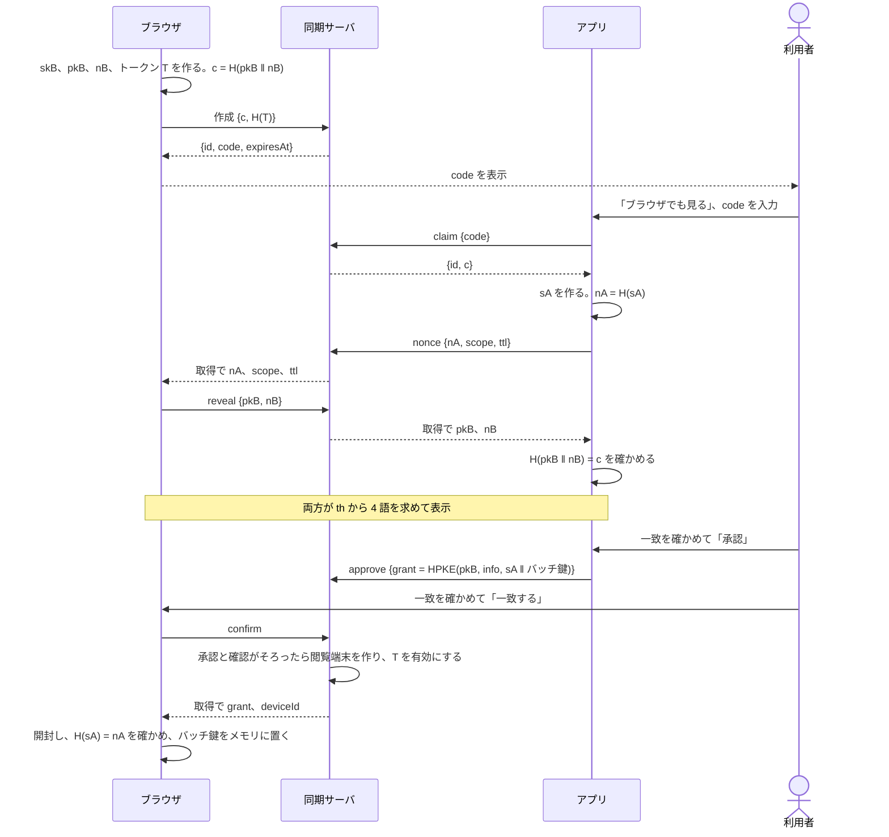

# ブラウザのペアリング v1（設計案）

> 状態：**予定**。未実装の設計案であり、利用者の判断を待つ点を [未決事項](#未決事項) に挙げる。
> 現行の同期は [`sync-protocol.md`](../sync-protocol.md)（v1）、鍵の階層の将来案は [`key-hierarchy.md`](key-hierarchy.md)（v2）である。
> 形式モデルは [`formal/crypto/browser_pairing.spthy`](../../formal/crypto/browser_pairing.spthy) にある。

最初の Web 閲覧のために、カメラを使わずにアプリからブラウザへ **バッチ鍵** を渡す手順を定める。
v1 の鍵（`K`、バッチ鍵 = HKDF(`K`, `ashidori batch v1`)、ASH1 の blob）は変えない。
手順は v2 のブラウザのペアリングの部分集合とし、v2 では渡すものをバッチ鍵から世代ごとの EK に替えるだけで済むようにする。

## 要件と信頼の前提

| 項目 | 決定 |
| --- | --- |
| ブラウザが受け取るもの | バッチ鍵だけ。`K` と復旧コードは渡さない |
| 受け渡し | ブラウザの一時的な X25519 鍵に宛てた HPKE（RFC 9180 base mode） |
| ブラウザでの保管 | メモリだけ。再読み込みやタブを閉じると消え、ペアリングからやり直す |
| ブラウザの扱い | 読み取り専用の端末（閲覧端末）。自分のトークンを持つ。アプリと管理ページから失効できる |
| 期限 | 既定 24 時間。期限後はサーバが閲覧端末のトークンを `401` にする |
| 照合 | ブラウザが短いコードを表示し、利用者がアプリに入力する。両方に同じ 4 語を表示し、利用者が見比べる |
| 有効にする操作 | 「ブラウザでも見る」。説明は「アプリだけで見る場合より、保護は弱くなります。」と「詳しく」 |

**信頼の前提**：ページは同期サーバと同じ Worker が配信し、利用者が自分で有効にする。
書き換えたページはバッチ鍵を外へ送れるので、ページの配信者は信頼する。
この手順が防ぐ攻撃者は、ページを書き換えずに API、D1、R2、通信路を操作する者である（D1 だけの漏洩や改ざん、将来の別の場所からのページの配信を含む）。

「詳しく」で示す、v1 で弱くなる点：

- バッチ鍵は全期間のすべての batch を読める。期限はサーバが暗号文を渡すのをやめるだけで、鍵そのものは失効しない。
- バッチ鍵は AEAD の鍵なので、持つ者はアプリが受理する blob を作れる。サーバと組めば偽の記録を入れられる。
- 漏れた後に守る方法は、v1 にはない（`K` の取り替えがない）。v2 では付与する範囲を月と種別に限り、書き込みには署名を要する。

## 流れ

- アプリの「承認」は、バッチ鍵を渡してよいという判断である（秘匿を守る）。
- ブラウザの「一致する」は、受け取る鍵がそのアプリから来たと判断する根拠である（取り違えと偽の付与を防ぐ）。これを省くと、サーバがアプリになりすまして自分の鍵をブラウザに渡し、偽の記録を見せられる（[形式検証](#形式検証) の `APPONLY`）。秘匿は保たれる。要件の「承認はアプリで」に一つ操作を加えるので、[未決事項](#未決事項) で判断を求める。
- 二つの操作の順序は問わない。
- サーバは両方の操作の後でだけ `grant` を渡すが、これは正直なサーバでの順序である。ブラウザは自分で「一致する」を押す前に届いた `grant` を受け入れない。

## 値と符号化

H は SHA-256、‖ は連結である。ラベルは ASCII で、終端の文字を含めない。
JSON では byte 列を base64url（パディングなし）で送る。

| 値 | 作る者 | 長さ | 定義 |
| --- | --- | --- | --- |
| `skB`、`pkB` | ブラウザ | 32 | X25519。WebCrypto で取り出し不可として作る |
| `nB` | ブラウザ | 32 | 乱数 |
| `T` | ブラウザ | 32 | 乱数。base64url で 43 文字（デバイストークンと同じ形式） |
| `c`（commit） | ブラウザ | 32 | H(`ashidori pair commit v1` ‖ pkB ‖ nB) |
| `id` | サーバ | 16 | 乱数。ペアリングの試行 ID |
| `code` | サーバ | 8 文字 | Crockford base32 の大文字。`XXXX-XXXX` と表示し、入力ではハイフンを除く |
| `sA` | アプリ | 32 | 乱数。付与の中でだけ開示する |
| `nA` | アプリ | 32 | H(`ashidori pair app v1` ‖ sA) |
| `scope` | アプリ | 可変 | v1 では `batch-v1` だけ |
| `ttl` | アプリ | 4 | 閲覧端末の有効期間（秒、big-endian）。既定 86400 |
| `th` | 両方 | 32 | H(`ashidori pair v1` ‖ id ‖ code ‖ c ‖ nA ‖ len(scope) (1) ‖ scope ‖ ttl ‖ pkB ‖ nB) |
| 4 語 | 両方 | 44 bit | H(`ashidori pair sas v1` ‖ th) の先頭 44 bit を 11 bit ずつ 4 つに分け、BIP-39 の日本語の単語表で引く |

可変長の欄は `scope` だけで、長さを前に置くので、`th` の入力は一意に分解できる。

**HPKE の付与**：

| 項目 | 値 |
| --- | --- |
| モード、方式 | base mode。KEM DHKEM(X25519, HKDF-SHA256) `0x0020`、KDF HKDF-SHA256 `0x0001`、AEAD AES-256-GCM `0x0002` |
| 受け取り手 | `pkB` |
| `info` | `ashidori viewer grant v1` ‖ th |
| `aad` | 空（Tink の `HybridEncrypt` は文脈を `info` に入れ、AAD を空にする。v2 の HPKE と同じ扱い） |
| 平文 | 版 `0x01`（1）‖ sA（32）‖ バッチ鍵（32）、65 byte |
| `grant` | enc（32）‖ 暗号文（81）、113 byte |

ブラウザは、開封の成功、版、H(`ashidori pair app v1` ‖ sA) = nA を確かめてから、バッチ鍵を取り出し不可の AES-GCM の `CryptoKey` として読み込む。
元の byte 列と `skB` は捨てる。
`localStorage`、`sessionStorage`、IndexedDB には何も置かない。

**sA を付与に入れる理由**：HPKE の base mode は送り手を認証しない。
`pkB` を知るサーバは、`pkB` 宛てに自分の鍵を包める。
4 語は `nA` を認証するので、`nA` の原像 `sA` を含む付与だけが、照合したアプリからの付与である（`NOGRANTAUTH`）。

## 試行の束縛と 1 回限りの規則

commit を先に固定するので、サーバは相手の値を見てから自分の値を選べない。

| 規則 | 守る者 | 理由 |
| --- | --- | --- |
| ブラウザは `c` を作成の要求で送り、以後変えない | ブラウザ、サーバ | `pkB`、`nB` を `nA` より前に固定する |
| アプリは `c` を受け取ってから `sA` を作り、`nA` を送る | アプリ | サーバが `nA` を見てから自分の commit を選べないようにする |
| ブラウザは `nA` を受け取るまで `pkB` と `nB` を送らない | ブラウザ | サーバが `pkB`、`nB` を見てから `nA` を選べないようにする |
| 各端は最初に受け取った `c`、`nA`、`pkB`、`nB` だけを使う。別の値が来たら中断する | ブラウザ、アプリ | 一つの試行で値を選び直させない |
| アプリは H(pkB ‖ nB) ≠ c なら中断する | アプリ | |
| code 一つに claim は一つ。各状態の遷移は一度だけ | サーバ | 正直なサーバでの使い勝手。安全性はクライアントの規則による |
| 中断、不一致、期限切れの後は、新しい `skB`、`nB`、`T`、`sA`、code でやり直す | ブラウザ、アプリ | 値を試行をまたいで使わない |

## ビット強度

| 項目 | 強さ | 根拠 |
| --- | --- | --- |
| サーバによる中間者（commit あり） | 1 試行あたり 2⁻⁴⁴ | 4 語は双方の値が固定された後に決まり、サーバは 1 試行に 1 回しか賭けられない |
| 同じく（commit なし） | 実用的に破れる | サーバは `nA` を見てから自分の nonce を探せる。2⁴⁴ ≈ 1.8 × 10¹³ 回の SHA-256 は GPU 1 枚（10¹⁰ 回/秒）で約 30 分、10 枚で約 3 分で、ペアリングの 10 分に収まる |
| 試行の回数 | N 回の試行で N × 2⁻⁴⁴ 以下 | 各試行は利用者の照合を要する。作成と claim の回数制限で抑える |
| commit の秘匿 | 256 bit | `nB` が 32 byte の乱数 |
| `sA` | 256 bit | 付与の中でだけ開示する |
| code | 40 bit | 秘密ではない（サーバは知る）。試行を探す手がかりにすぎない |

見比べの誤り（見ずに承認する）は残る。
Tamarin はハッシュを理想化するので、確率は上の表で示し、モデルは「後から選ぶ者は一致させられる」ことを関数 `grindA`、`grindB` で表す。

## サーバ API

| メソッド | 経路 | 認証 | 本文 → 応答 |
| --- | --- | --- | --- |
| POST | `/v1/viewer-pairings` | なし（回数制限） | `{commit, tokenHash}` → `201 {id, code, expiresAt}` |
| GET | `/v1/viewer-pairings/:id` | `T` | → `{state, expiresAt, nA?, scope?, ttl?, grant?, deviceId?, viewerExpiresAt?}` |
| POST | `/v1/viewer-pairings/:id/reveal` | `T` | `{pkB, nB}` → `200` |
| POST | `/v1/viewer-pairings/:id/confirm` | `T` | → `200` |
| POST | `/v1/viewer-pairings/claim` | 全権限の端末 | `{code}` → `{id, commit, expiresAt}` |
| POST | `/v1/viewer-pairings/:id/nonce` | claim した端末 | `{nA, scope, ttl}` → `200` |
| GET | `/v1/viewer-pairings/:id/app` | claim した端末 | → `{state, expiresAt, pkB?, nB?, confirmed}` |
| POST | `/v1/viewer-pairings/:id/approve` | claim した端末 | `{grant}` → `200 {deviceId?}` |
| POST | `/v1/viewer-pairings/:id/abort` | `T` または claim した端末 | → `200` |

- `tokenHash` は SHA-256(`T`) の hex である。サーバは `T` を受け取る前からハッシュだけを持ち、以後の要求の `Authorization: Bearer <T>` と定数時間で比べる。
- 有効になるまで、`T` が通るのは自分の試行の経路だけである。有効になると同じ `T` が閲覧端末のトークンになる。
- 取得はポーリングで、両端とも 2 秒ごとに行う。10 分で最大 300 回なので、長いポーリング（Worker で待つか Durable Object）は使わない。
- `nonce` は `ttl` を 3600〜86400 秒に限る。`scope` が `batch-v1` 以外なら `400`。
- 本文の値は長さを確かめる（`commit`、`nA`、`pkB`、`nB` は 32 byte、`grant` は 113 byte）。

**状態**：

| 状態 | 入る操作 | 次の状態 |
| --- | --- | --- |
| `open` | 作成 | `claimed` |
| `claimed` | claim | `nonce` |
| `nonce` | nonce | `revealed` |
| `revealed` | reveal | 承認と確認の両方で `active` |
| `active` | 承認と確認の後の方（同じトランザクションで閲覧端末を作る） | なし |
| `aborted` | 中断 | なし |

- 承認と確認は `revealed` の中の二つの印であり、順序は問わない。
- 各遷移は D1 の一文で、元の状態と D1 の時刻による期限（作成から 10 分）を条件にする。登録コードの消費と同じく、遅れた要求が期限後に遷移させることはない。
- `active` になるまで `grant` はブラウザに渡さない。期限を過ぎた試行は `410 {"error": "pairing expired"}`、中断した試行は `410 {"error": "pairing aborted"}` を返す。
- 試行の行は期限の 1 日後に定期処理が消す。`grant` もその時に消える。

**回数制限**（既存の 2 層と同じ仕組み）：

| 対象 | 上限 |
| --- | --- |
| 作成 | IP ごとに 10 回 / 10 分 |
| claim | IP ごとと利用者ごとに 20 回 / 10 分。誤った code も数える |
| ポーリング | エッジの制限だけ |
| 有効な閲覧端末 | 利用者ごとに 5。超えると claim と有効化が `409 {"error": "too many viewers"}` |

### 閲覧端末とトークンの範囲

`devices` に `kind`（`device` または `viewer`）、`expires_at`、`granted_by`（承認した端末）を加える。
閲覧端末は `USER_MAX_DEVICES` に数えない。
期限切れか失効の後 30 日で定期処理が行を消す（batch を持たないので安全である）。

| 経路 | 閲覧端末 |
| --- | --- |
| `GET /v1/devices` | 可。応答の各端末に `kind`、`expiresAt` を加える |
| `GET /v1/batches`、`GET /v1/batches/:deviceId/:stream/:seq` | 可 |
| `GET /v1/viewer-pairings/:id`（自分の試行） | 可 |
| その他すべて（送信、`/v1/pairing`、claim、失効、共有チェックイン、フォロー） | `403 {"error": "read-only token"}` |

**サーバでの強制**：

- 認証の関数が `kind` を返し、経路が閲覧端末を許すと宣言していなければ `403` にする（既定で拒否、許す経路の一覧を持つ）。
- 期限は認証の一文で `expires_at` と D1 の時刻を比べる。期限切れと失効は `401`。
- 試験：全経路を閲覧端末のトークンで呼び、許す一覧以外がすべて `403` になることを確かめる（経路を足すと試験が一覧の更新を求める）。
- 失効は既存の `POST /v1/devices/:id/revoke`（アプリ）と `POST /admin/devices/:id/revoke`（管理ページ）を使う。アプリと管理ページは一覧で閲覧端末を「ブラウザ」と期限付きで示す。

## 失敗、期限、中断

| 場面 | ブラウザ | アプリ | サーバ |
| --- | --- | --- | --- |
| 4 語が一致しない | 「一致しない」で中断 | 「一致しない」で中断 | `aborted` |
| commit と reveal が合わない | — | 中断し、やり直しを案内 | `aborted` |
| `nA` などが 2 回目に別の値で届く | 中断 | 中断 | — |
| 付与を開けない、版が違う、H(sA) ≠ nA | 鍵を捨て、アプリでの失効とやり直しを案内 | — | （閲覧端末は有効のまま。利用者が失効させる） |
| 作成から 10 分 | 期限切れを表示 | 期限切れを表示 | `410` |
| 閲覧端末の期限 | 取得が `401` になり、再ペアリングを案内 | — | `401` |
| タブを閉じる、再読み込み | 鍵とトークンが消える | — | 閲覧端末は期限か失効まで残るが、鍵がないので使えない |
| 応答の消失 | 同じ値で取得し直す | 同じ値で再送。同じ値なら `200`、違えば `409` | 遷移は値が同じなら冪等 |

## サーバに見えるもの

| 値 | サーバ |
| --- | --- |
| `code`、`id`、`c`、`nA`、`scope`、`ttl`、`pkB`、`nB` | 見える（公開の値） |
| 4 語 | 計算できる。秘密である必要はない |
| `sA`、バッチ鍵 | 見えない（`pkB` 宛ての付与の中）。ページを書き換えれば得られる |
| `T` | 作成ではハッシュ、以後は要求ごとに平文（デバイストークンと同じ） |
| メタデータ | IP、User-Agent、各操作の時刻、承認した端末、閲覧端末が取得した batch と時刻、期限 |
| `K`、復旧コード | 見えない。この手順では送らない |

## ライブラリ

2026-10-14 に確かめた最新版を固定する。

| 部品 | アプリ（Android） | ブラウザ |
| --- | --- | --- |
| HPKE | Tink `com.google.crypto.tink:tink-android:1.23.0`（Apache-2.0）。公開 API（`HpkeParameters`、`HpkePublicKey`、`HybridEncrypt`）、variant は `NO_PREFIX` | `@hpke/core` 1.9.0（MIT、WebCrypto だけを使う。依存は `@hpke/common`）。`DhkemX25519HkdfSha256`、`HkdfSha256`、`Aes256Gcm` |
| X25519 の鍵ペア | 不要（送るだけ） | WebCrypto の X25519（Chrome 133、Firefox 130、Safari 17 以降） |
| SHA-256、乱数 | JCA の `MessageDigest`、`SecureRandom` | WebCrypto の `digest`、`getRandomValues` |

- ブラウザのライブラリは同じ Worker から配信し、CDN を使わない。CSP は `connect-src 'self'`、インラインのスクリプトは nonce 付きだけにする。npm の integrity を lockfile で固定する。
- `@hpke/core` が取り出し不可の X25519 の秘密鍵で開封できることを実装時に確かめる。できなければ版を見直す。
- 試験：RFC 9180 のテストベクタ（両方）、Tink で包んで `@hpke/core` で開く相互運用、異常系（壊れた `enc`、別の `info`、空でない `aad`、短い `grant`）、`th` と 4 語の固定ベクタ（両方で同じ値）。

## 形式検証

`formal/crypto/browser_pairing.spthy`（`formal/run.sh tamarin` で実行）。
攻撃者は通信路とサーバ（Worker、D1、R2）であり、code、`id`、commit、`nA`、reveal、付与を差し替え、任意の公開鍵に宛てて HPKE で包める。
ページ、アプリ、乱数、利用者は信頼する。
利用者は、code を表示したブラウザとそれを入力したアプリの 4 語が等しいときだけ、アプリで承認し、ブラウザで確認する。

| 補題 | 内容 | 結果 |
| --- | --- | --- |
| `executable` | 正常な承認と受け取りが起こりうる | 成立（到達の確認） |
| `master_key_secrecy` | `K` は誰にも渡らない | 成立 |
| `batch_key_secrecy` | バッチ鍵は攻撃者に渡らない | 成立 |
| `grant_agreement` | ブラウザが受け取った鍵は、アプリがそのブラウザの `pkB` と試行に承認したものであり、承認一つにつき受け取りは一つ（単射的一致） | 成立 |
| `-D=NOCOMMIT` の `batch_key_secrecy` | commit をやめ、ブラウザが `pkB`、`nB` を先に送る | 期待どおり反例あり（サーバが `nA` を見てから `grindA` で 4 語を合わせる） |
| `-D=NOGRANTAUTH` の `grant_agreement` | ブラウザが付与の `sA` を確かめない | 期待どおり反例あり（サーバが付与を差し替える） |
| `-D=APPONLY` の `grant_agreement`、`batch_key_secrecy` | ブラウザでの確認を省く | 一致は反例あり（サーバがアプリになりすます）、秘匿は成立 |

モデルの 4 語は `pkB`、`nB`、`nA` だけから作り、`id`、`code`、`scope`、`ttl` は省いた。これらは束縛を強めるだけで、省いても攻撃者に有利な側に倒れる。
各実行は 1 秒ほどで終わる。

## v2 との関係

| v1（この文書） | v2（[`key-hierarchy.md`](key-hierarchy.md#端末とブラウザのペアリング)） |
| --- | --- |
| ブラウザが code を表示し、アプリで入力する | v2 の文書はアプリが発行してブラウザで入力する向きである。この文書の向きに揃える |
| `c` = H(pkB ‖ nB)、`nA`、reveal、4 語 | 同じ（`pkB` は `VK`） |
| `th` の入力：id、code、c、nA、scope、ttl、pkB、nB | 同じに `RS` の指紋を加える |
| `scope` = `batch-v1` | 種別と月の範囲 |
| 付与 = HPKE(pkB, sA ‖ バッチ鍵) | HPKE(VK, アカウント記録、範囲の EK)、`DS` の署名。`sA` は残してよい |
| アプリで承認、ブラウザで確認 | 同じ。v2 の文書の図にはブラウザでの確認がなく、同じ欠けがある |
| 閲覧端末（`kind = viewer`）、期限、読み取りの範囲 | 閲覧トークン。取得できる object を付与の kid に限る |
| `/v1/viewer-pairings/…` | `/v2/pairing/…`。状態と遷移は同じ |

移行の時、v1 の閲覧端末は失効させる。
v2 の付与は v1 のバッチ鍵を含めない（`legacy` の EK はブラウザに渡さない）。

## 未決事項

| 項目 | 推奨 |
| --- | --- |
| ブラウザでの確認（「一致する」） | 入れる。省くと、秘匿は保たれるが、サーバが偽の鍵と記録をブラウザに見せられる。省く場合は「ブラウザが表示する記録は正しいとは限らない」を「詳しく」に書く |
| 期限の上限と選択肢 | 24 時間を上限にし、選択肢は 1 時間と 24 時間 |
| ブラウザからの終了（自分のトークンの失効） | 許す。現状の要件は閲覧端末の失効を禁じるが、自分の終了は害がない |
| 承認した端末の失効に閲覧端末を連動させるか | 連動させない。一覧で `granted_by` を示す |
| 閲覧端末の上限と保持 | 有効なもの 5、期限か失効の 30 日後に消す。`USER_MAX_DEVICES` に数えない |
| code の形式 | 登録のペアリングコードと同じ 8 文字。入力する画面が違うので取り違えない |
| 共有チェックインのフィードを閲覧端末に許すか | 許さない（要件どおり batch と端末だけ） |
| 既存の文書の改訂 | 実装の際、`sync-protocol.md` の「Web ページは `K` を扱わない」に例外（バッチ鍵、利用者が有効にした場合）を書き、[`web-viewer.md`](../web-viewer.md) の「`K` を受け取る」をバッチ鍵に直す |
