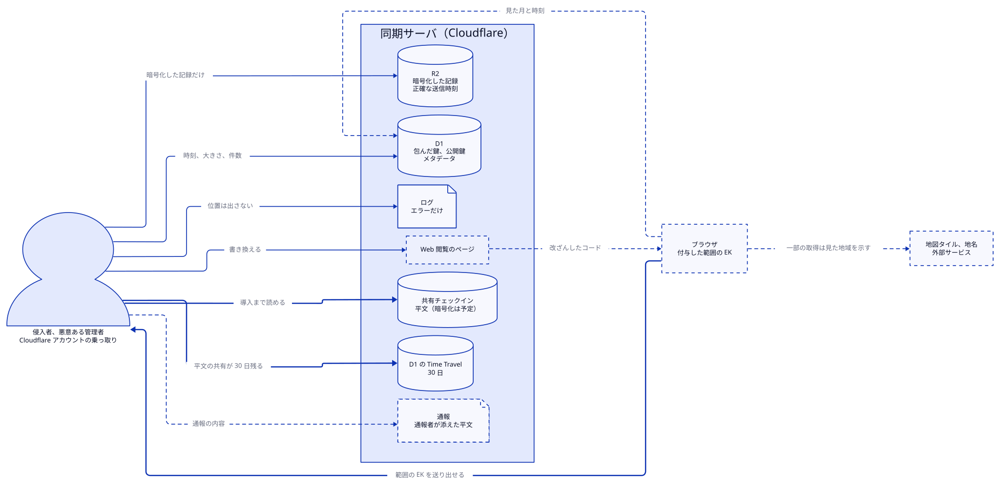
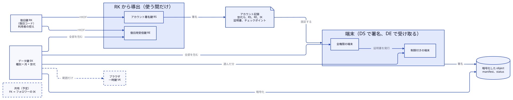
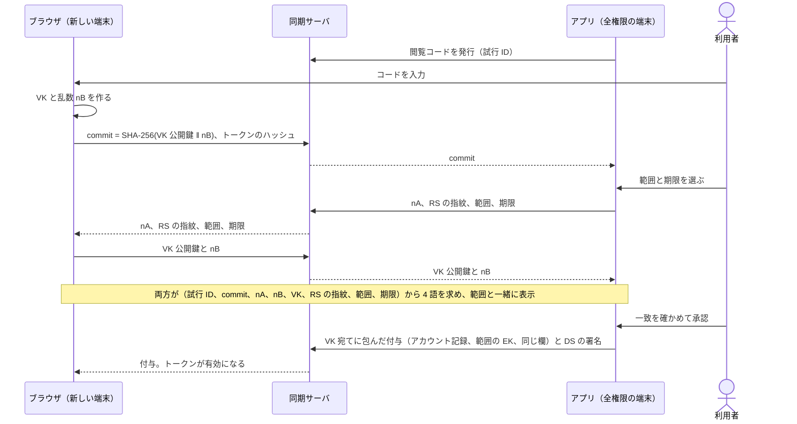
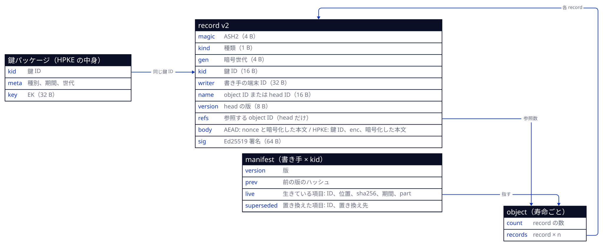

# 鍵の階層と同期 v2（設計案）

> 状態：**予定**。未実装の設計案であり、利用者の判断を待つ点を [未決事項](#未決事項) に挙げる。
> 現行の仕様は [`sync-protocol.md`](../sync-protocol.md)（v1）である。
> 採用した部分は、実装の際に `sync-protocol.md` に移す。

## 目的と脅威モデル

目的は優先順に次の二つである。

1. **サーバ側から記録の内容（位置、履歴、チェックイン、場所）が漏れない。**
2. **どの鍵が一つ漏れても、被害をその鍵の範囲（保持者、用途、期間、能力）に限る。**

現行（v1）は利用者ごとの一つの鍵 `K` ですべてを暗号化する。
`K` は全端末に常駐し、失効した端末も漏れた復旧コードも全期間を読める。
端末 ID はサーバが割り当てるため、サーバは 2 台に同じ ID を与えられる（[`formal/README.md`](../../formal/README.md)）。

| 攻撃者 | 得るもの | この設計で守るもの | 守れないもの |
| --- | --- | --- | --- |
| **サーバ側（最優先）**：侵入、D1/R2 の流出、悪意ある管理者、Cloudflare アカウントの乗っ取り | 暗号文、包んだ鍵、公開鍵、メタデータ。ページとコードの書き換え | 記録の内容。端末の追加と鍵の差し替え（アカウント署名鍵が要る） | メタデータの一部。Web 閲覧で付与した範囲。失効の隠蔽による、失効を知らない書き手のデータ（[下記](#名簿と失効の保証の限界)） |
| 端末の紛失、盗難 | その端末の鍵と、受け取ったデータ鍵 | 失効を知った書き手が以後に書くデータ。他の利用者 | 失効までにその端末が読めた範囲（再暗号化しない限り） |
| ブラウザの侵害（改ざんしたページ、拡張機能） | 付与した範囲のデータ鍵 | 範囲外のデータ。書き込み | 範囲内のデータ。期限後に同じ月へ追記されたデータ |
| 復旧コードの漏洩 | 復旧鍵 | 単独では暗号文を得られない | サーバ側の攻撃者と組み合わさると全期間 |

対象外：使用中の端末を支配するマルウェア、可用性（削除、隠蔽）、IP アドレス、サイドチャネル、量子計算機（必要になれば HPKE の KEM を X-Wing などに替える）。

**不変条件：サーバは鍵を持たない。**
サーバが保存するのは、暗号文、公開鍵に宛てて包んだ鍵、公開鍵、署名、メタデータだけである。
平文の鍵、復旧コード、鍵の導出の元を受け取る API は作らない。

**前提：登録時に利用者はアプリの端末を 1 台持つ。**
アカウントと `RK` は常に端末で作る。ブラウザから始める登録は作らない。
Web での閲覧（ペアリング、パスキー）は、既存の端末か承認済みの環境から後で加える。
登録の入口は招待（1 回限り、期限付き）と、サーバが許す場合の自由な登録の二つで、どちらも同じ「最初の端末」の手順に入る。

## サーバ側からの漏洩経路

| 経路 | 現状（v1） | この設計 | 残る危険 |
| --- | --- | --- | --- |
| D1/R2 の保存データ | 暗号文。`K` は端末だけ | 暗号文、包んだ鍵、公開鍵、署名。上の不変条件 | 別の経路で漏れた鍵の範囲 |
| メタデータ | 時刻（D1 は時単位、R2 は正確）、大きさ、件数、stream 名、seq | 不透明な ID、大きさの切り上げ、送信の間隔の固定（[下記](#メタデータの対策)） | 通信できた時刻、記録量の目安。公開の kid、record の数、head の更新頻度による活動の相関 |
| Web 閲覧 | 未実装 | 既定で無効。範囲と期限を最小にする。配信の確認手段 | 有効にした利用者の付与した範囲を、ページの配信者が読める。**最大の残存経路** |
| 閲覧のアクセスパターン | なし | 付与の時に範囲を一括で取得する | どの月を見たか、いつ見たか |
| 地図タイル、地名の問い合わせ | アプリは「オンライン地図と地名検索」がオフの間は止める | ブラウザも同じ basemap を丸ごと取得する（Range で一部を取ると見た地域が漏れる） | basemap を丸ごと取得する通信量 |
| 共有チェックイン | 平文 | フォロワーの鍵で暗号化する（[下記](#共有チェックインの暗号化)、導入の最後） | それまでの共有は秘匿の対象外。フォローの関係、共有の回数と時刻 |
| 通報 | なし | 通報者が平文を添える | 運用者は通報された内容を読める（通報者の同意による） |
| 既存の共有データとバックアップ | D1 の Time Travel（30 日）に平文の共有チェックインが残る | 暗号化の導入後も 30 日は残ることを明記する | その 30 日間 |
| ログ | 呼び出しログは無効。`console` はエラーの文言だけ | 維持し、テストで確かめる | 書き換えた Worker は IP や時刻を記録できる |

Cloudflare アカウントの乗っ取りは悪意ある管理者と同じに扱う。
保存済みの暗号文は読めないが、以後のメタデータの記録、Web 閲覧のページの差し替え、名簿の隠蔽はできる。

### メタデータの対策

段階的に入れ、通信量と電池への影響を測ってから次へ進む。

| 段階 | 対策 | 費用（端末 1 台） |
| --- | --- | --- |
| 1 | stream 名と seq をやめ、object と kid を不透明な乱数にする | なし |
| 1 | 平文を Padmé（Nikitin ほか、PETS 2019）で切り上げる。最小 4 KiB | 4 KiB 以上では最大 12% 増。最小値のため、小さな status や差分は数倍から十数倍になる |
| 2 | 当日分の断片を、記録の有無によらず設定した間隔で送る（空でも送る） | 1 時間ごとなら、断片、manifest、status が各 24 回で 1 日約 300 KiB、1 か月約 9 MiB。断片は日のアーカイブで置き換えて消すので、保存量はゴミ箱の 7 日分の断片で頭打ちになる |

Android の定期実行は Doze などで遅れるので、間隔の固定は努力目標である。
送信の時刻は「通信できた時刻」を表す。
生データは Wi-Fi のときに別のジョブで送るため、大きさと時刻から推測できる。

### Web 閲覧の配信

Web ページは配信する者が書き換えられ、ブラウザが受け取った鍵を外へ送れる。
被害は付与する範囲と期限で限る（[ブラウザのペアリング](#端末とブラウザのペアリング)）。

| 手段 | 運用者による差し替えを防ぐか | 費用 |
| --- | --- | --- |
| SRI | 防がない（HTML ごと差し替えられる） | 小 |
| CSP（`connect-src 'self'`、インラインと `eval` の禁止） | 防がない。依存ライブラリや XSS による第三者への送出は防ぐ | 小 |
| 再現可能なビルドとハッシュの公開 | 自動では防がない。事後の監査ができる。画面に出すハッシュも偽装できる | 中 |
| 別の場所に置いた静的な複製 | 同期サーバの運用者からは防ぐ。信頼は複製の配信者に移る | 中（CORS） |
| ブラウザ拡張による照合 | 拡張を入れた利用者だけ防ぐ | 大 |

推奨：Web 閲覧は決定済みの信頼の前提（ページの配信者を信頼する）のもとで、同じ Worker から配信する。
CSP、再現可能なビルド、ハッシュの公開を必ず行う。
公開リポジトリから作った静的な複製は任意で用意する。

### 共有チェックインの暗号化

導入の最後の段階である。
それまでの共有チェックインは平文であり、秘匿の保証に含めない。

- 共有する利用者は **フォロワー鍵 `FK`** を持つ。共有するチェックインは `FK` で暗号化し、端末の署名を付ける。
- `FK` は承認したフォロワーの **受信鍵 `IK`** に宛てて HPKE で包む。`IK` の公開鍵はフォロワーのアカウント記録に載る。
- **初回の照合**：相手のアカウント署名鍵（`RS`）の指紋を、対面などで見比べてから固定する。以後に `RS` が変わったら警告する。
- **フォロワーの一覧**：共有する側の端末が、承認と解除の記録を署名して世代付きの鎖にする。サーバのフォロー状態だけを信じず、この一覧の相手にだけ包む。
- **`FK` の更新**：フォローの解除と、フォロワーの `IK` の更新（そのフォロワーの世代の更新）のたびに、新しい `FK` を作って残る全員に包み直す。`IK` の更新はアカウント記録の新しい版として届くので、共有する側は `RS` の署名で確かめてから更新する。
- 費用は更新のたびにフォロワー数だけの HPKE（1 件 100 byte ほど）であり、数百人でも問題にならない。
- 管理者は内容を見て削除を判断できなくなる。ID による削除と、フォロワーからの通報で替える。

| API | 変更 |
| --- | --- |
| `PUT /v1/checkins/shared/:localId` | 本文を `{rev, record}` にする。平文の欄はなくなる |
| `GET /v1/checkins/feed` | 項目は `{id, cursor, user, record, updatedAt, deleted}` |
| `GET /v1/users/lookup` | アカウント記録を返す |
| `PUT /v2/followers`、`GET /v2/follow-keys` | 署名したフォロワーの一覧と、フォロワーごとの `FK` の包み |
| `GET /admin/checkins` | 内容を返さない |

## 信頼の起点と暗号世代

### アカウント記録

**アカウント記録** は `{accountId, 世代 G, RS 公開鍵, RE 公開鍵, IK 公開鍵, 端末の証明書の一覧, チェックポイント, 前の版のハッシュ}` であり、`RS` が署名する。
世代を進めるたびに新しい版を作る。

- 全権限の端末は、復旧コードから `RS` と `RE` を自分で導出し、サーバから得た記録と照合して固定する。
- 制限付きの端末とブラウザは、ペアリングで 4 語の照合に `RS` の指紋を含めて固定する。
- 鍵を包む宛先（`RE`、各端末の `DE`、他人の `IK`）は、固定したアカウント記録から得たものだけを使う。サーバが返す公開鍵をそのまま使わない。

### 暗号世代と権限

失効、`RK` の取り替え、`IK` の更新は、すべて **世代を一つ進める** 操作に統一する。
世代を進めると、前の世代の EK はすべて **書き込みに使えなくなる**。
過去の月への追記も、新しい世代の EK で行う。

| 操作 | 必要な権限 |
| --- | --- |
| 世代を進める（失効、`RK` の取り替え、`IK` の更新） | `RS`（復旧コードの入力） |
| 全権限の端末の追加 | `RS` |
| 制限付きの端末の追加、ブラウザへの付与 | 全権限の端末の `DS` |
| 世代内の EK の発行（月の切り替え） | その世代の名簿にある全権限の端末の `DS` |
| object と head の書き込み | 名簿にある端末の `DS`。制限付きの端末は自分のデータだけ |
| サーバでのトークンの停止 | 同じ利用者の端末、管理者。いつでもでき、暗号の世代は変えない |

失効に `RS` を要するのは、盗まれた端末の `DS` でも失効と鍵の配布ができてしまうからである。
`DS` を持つ者は、自分の知る EK を作って正規の端末に包んで配れる。
このため `DS` の漏洩は端末全体の漏洩と同じに扱い、次の世代まで将来のデータも読まれうる。
トークンを止めれば、盗んだ者はサーバ側の攻撃者と組まない限り新しい暗号文を取得できない。
同じ世代で同じ（種別、期間）の EK が二つできたら、読む側は両方を使い、書く側は kid の小さい方に揃える。
`IK` の秘密鍵は EK と同じく自分の端末に包んで配る。

### 名簿と失効の保証の限界

- 名簿は、各世代のアカウント記録（`RS` 署名）と、世代内の追加の記録（全権限の端末の追加は `RS`、制限付きは発行した端末の署名）をハッシュで鎖にしたものである。
- **失効のチェックポイント**：新しい世代の記録は、全端末の各 head の版とハッシュ、名簿の先頭のハッシュを固定する。前の世代の EK による record は、固定した版とハッシュまでだけ受理する。盗んだ `DS` で同じ版の別の内容を作っても受理されない。
- **保証の限界**：守られるのは、新しい世代を観測した書き手が以後に書いたデータである。サーバが端末 A に古い名簿を見せ続けると、A は失効した端末も読める鍵で書き続ける。
- **端末間の照合**：各端末は status に、見ている世代と名簿の先頭のハッシュを署名して載せる。食い違いや、他の端末の status が届かない状態が続けば警告する。設定の画面には名簿の 4 語を表示し、端末どうしで手で見比べられるようにする。
- 新しい端末には比べる過去の状態がない。全端末を失った後の復旧では、サーバが古いが整合した状態を見せても検出できない。このため復旧では必ず世代を進め、復旧した端末だけを残す。
- 記憶した head の後退、同じ版の別のハッシュ、既知の object の欠落は検出できる。まだ見ていない更新の隠蔽は検出できない。

## 鍵の階層

| 鍵 | 種類 | 作り方 | 用途 |
| --- | --- | --- | --- |
| 復旧鍵 `RK` | 32 byte の乱数 | 最初の端末が作り、復旧コードとして表示する | `RS` と `RE` の導出だけ |
| アカウント署名鍵 `RS` | Ed25519 | 種 = HKDF(`RK`, `ashidori root sign v2`) | アカウント記録と全権限の端末の証明書に署名する |
| 復旧用受信鍵 `RE` | X25519 | HPKE の `DeriveKeyPair`(HKDF(`RK`, `ashidori root kem v2`)) | すべての EK の宛先の一つ。復旧に使う |
| 端末署名鍵 `DS` | Ed25519 | 端末が作る | 書く能力。公開鍵の SHA-256 が **端末 ID** |
| 端末受信鍵 `DE` | X25519 | 端末が作る | 鍵パッケージを受け取る |
| データ鍵 `EK` | 32 byte の乱数 | 書く端末が必要な時に作る | 種別 × 月 × 暗号世代ごと。読む能力 |
| ブラウザの一時鍵 `VK` | X25519 | ブラウザがタブごとに作る（取り出し不可の WebCrypto の鍵） | 付与された EK を受け取る |
| 受信鍵 `IK`、フォロワー鍵 `FK` | X25519、32 byte の乱数 | 世代ごと | 共有チェックイン、段階 5 |
| デバイストークン、閲覧トークン | 32 byte の乱数 | 現行どおり | サーバへの認証だけ |

`RK` は日常の端末に置かない。
入力するのは、全権限の端末の追加、世代を進める時、復旧の時だけである。
日常の送信、月の切り替え、制限付きの端末やブラウザへの付与は `RK` なしでできる。

| 軸 | 分け方 | 効果 |
| --- | --- | --- |
| 保持者 | 端末ごとに `DS` と `DE`、ブラウザごとに `VK`。端末は全権限と制限付きに分ける | 漏れた端末だけを外せる。制限付きの端末は選んだ EK しか持たない |
| 用途 | データの種別ごとに EK | 経路だけを見せる、生データを渡さない、ができる |
| 期間 | 月ごと。世代を進めると新しい EK | EK 一つの漏洩は 1 種別の 1 か月の 1 世代に限る |
| 能力 | 読む = EK、書く = `DS`（名簿の端末だけ） | EK だけを持つブラウザは偽のデータを作れない |

| 種別 | 内容 | 期間 |
| --- | --- | --- |
| `track` | `fixes`、`motion`、`battery`、`gnss_status` のアーカイブと当日分の断片 | 記録の日付（端末の現地日付）の月 |
| `raw` | `gnss_raw`、`gnss_sat`、`gnss_nav`、`nmea`、`imu` | 同上 |
| `status` | 端末の status | 送った日付の月 |
| `checkin` | チェックイン | チェックインの日付の月 |
| `edit` | 場所、移動手段の修正 | なし（世代だけ）。新しい世代は全件のスナップショットから始める |

EK は書き手ごとには分けない。
読む端末は全端末のデータを読むので、分けても端末の漏洩の範囲は変わらない。

**期間を月にする理由**：月のアーカイブと一致し、閲覧の範囲を月で選べる。
5 種別で 1 年に 60 鍵であり、日（約 1800）ほど多くなく、年ほど付与が広くない。
期間は端末の漏洩の範囲を変えない（全権限の端末は全期間の EK を持つ）。
効くのは、制限付きの端末やブラウザに渡す範囲と、EK 一つの漏洩の範囲である。
鍵 ID は不透明なので、後から週単位に変えても形式は変わらない。

### 漏洩したときの範囲

| 鍵 | 保持者 | 保存場所 | 漏れたときに読まれるもの、できること | 限る方法、回復 |
| --- | --- | --- | --- | --- |
| `RK`（復旧コード） | 利用者 | 紙など | サーバの暗号文と合わせて全期間。端末の追加、世代の操作 | `RK` を取り替えて世代を進める。過去は再暗号化しない限り残る |
| `RS`、`RE` | （`RK` から導出） | 使う間のメモリ | `RK` と同じ | 同上 |
| 全権限の端末の `DS`、`DE`、EK | その端末 | Keystore の AES 鍵で包む | 受け取った全 EK（全期間）。次の世代まで、自分で作った EK を配って将来分も読める。制限付きの端末の追加 | トークンの停止、世代を進める。過去は任意で再暗号化 |
| 制限付きの端末の鍵 | その端末 | 同上 | 付与された種別と期間。その端末の名で書く | 同上 |
| `EK`（種別、月、世代） | 端末、付与したブラウザ | 端末内、ブラウザのメモリ | その種別のその月のその世代。後から同じ月に同じ世代で追記された分も含む | 世代を進める。過去は任意で再暗号化 |
| `VK` | ブラウザ | タブのメモリ | 付与した範囲 | タブを閉じる。期限はサーバの取得の制限 |
| `IK`、`FK` | 端末 | 端末内 | フォロー相手の共有チェックイン、自分の共有チェックイン | 世代を進め、共有する側が `FK` を更新する |
| デバイストークン、閲覧トークン | 端末、ブラウザ | 端末内、メモリ | 暗号文の取得。送信と自分の object の参照の変更（デバイストークン） | 停止、期限 |
| v1 の `K` | 移行までの端末 | 端末内 | v1 で送った全データ。移行前の v1 データの偽造 | 移行後に消す。任意で再暗号化 |

## 操作ごとの流れ

### 最初の端末

1. 端末はトークン、`DS`、`DE` を作る。`RK` を作り、`RS`、`RE`、`IK` を用意する。
2. 招待か、サーバが許す場合は招待なしで（`POST /v2/accounts`）、ユーザ名、世代 1 のアカウント記録、自分の証明書を送る。
3. 復旧コードを表示し、一部を入力させて控えを確かめる。
4. `RK`、`RS`、`RE` の秘密鍵を消す。

### 端末の追加

| | 全権限の端末 | 制限付きの端末（既定） |
| --- | --- | --- |
| 入力 | ペアリングコードと復旧コード | ペアリングコードと 4 語の照合 |
| 証明書 | 新しい端末が `RS` で署名する | 既存の全権限の端末が `DS` で署名する |
| 受け取る EK | `RE` 宛ての全 EK を開き、自分の `DE` 宛てに包み直す | 既存の端末が選んだ範囲だけを包む。既定は直近 3 か月の `raw` 以外 |
| 以後の EK | 全部 | 付与した種別の新しい月の分を、発行する端末が包む |
| `RK` | 使った後に消す | 一度も受け取らない |

制限付きの端末が `RK` を受け取らないので、範囲は暗号的な制限になる。

### 端末とブラウザのペアリング

制限付きの端末とブラウザは、同じ照合の手順を使う。

- **試行の規則**：コード一つに試行は一つである。各端は最初に受け取った commit と nA だけを受け付け、差し替えを拒む。乱数は試行ごとに作り直す。不一致や中断の後は、新しいコードからやり直す。
- 4 語は BIP-39 の日本語の単語表から選ぶ（44 bit）。commit を先に固定するので、中間者が一致させられる確率は 1 試行あたり 2⁻⁴⁴ である。試行の回数はコードの発行の回数制限で抑える。見比べの誤りは残る。
- ブラウザは付与のアカウント記録を、照合した `RS` の指紋で確かめる。偽の名簿、付与、履歴は受け付けない。
- **ブラウザの範囲**：既定は直近 1 か月の `track`、`status`、`checkin` である。`edit`（場所と修正）は期間がなく全件と将来の変更を含むので、別の承認にする。`raw` は含めない。
- **期限はサーバの取得の制限であり、暗号の制限ではない。** 月の EK を渡すと、期限後に同じ月へ追記された分も、その EK で読める。`edit` の EK は世代が続く限り将来の変更も読める。厳密な期限が要るなら、閲覧用のスナップショットを一回限りの鍵で作る（将来）。
- ブラウザは EK をメモリにだけ置き、タブを閉じると消える。サーバは閲覧トークンで取得できる object を付与の kid に限る（多層の防御）。
- 有効にする操作の文言は「ブラウザでも見る」、説明は「アプリだけで見る場合より、保護は弱くなります。」と「詳しく」のリンクとする（決定済み）。

### 世代を進める（失効、`RK` の取り替え）

1. 全権限の端末で失効を選ぶ。トークンはすぐに止める。続けて復旧コードを入力する。
2. 端末は新しい世代のアカウント記録を作る。残す端末の証明書、新しい `IK`、チェックポイントを載せ、`RS` で署名する。
3. 書く種別の新しい EK と `edit` のスナップショットを作り、残る端末と `RE` に包む。
4. `RK` の取り替えでは、新しい `RS` と旧い `RS` の両方で署名し、全 EK を新しい `RE` に包み直し、古い `RE` 宛てを消し、新しい復旧コードを表示する。
5. 失効した端末が読めた過去のデータは読めるまま残る。任意の **再暗号化** は、選んだ期間を新しい世代で暗号化し直して古い object を消す。攻撃者がまだ古い暗号文を持っていない場合にだけ効く。

### 復旧

全端末を失ったときは、管理者のコードか `POST /v2/recover`（`RS` の署名で所有を示す）で新しい端末を登録する。
`RE` 宛ての鍵パッケージから全 EK を開き、必ず世代を進めて復旧した端末だけを残す。
`/v2/recover` は、7 日以内に動いた端末があれば 72 時間保留し、その間は鍵パッケージも渡さない。
これは正直なサーバでだけ効く。

### object と commit

当日分は、アーカイブと同じスキーマの Parquet（列の圧縮は zstd）の断片として送る。
解像度（全点か間引き）、間隔、回線は利用者が選ぶ。
日のアーカイブは常に全点で正本になり、その日の断片を置き換える。

- **寿命で object を分ける**：当日の断片、日と月のアーカイブ（大きければ 8 MiB 以下の part）、`checkin` と `edit` の差分、`edit` のスナップショット。異なる寿命の record を一つの object に混ぜない。1 回の同期は通常 1〜2 object になる。
- **manifest**（Iceberg の snapshot に相当）と **status** は、書き手 × kid ごとの head である。manifest は生きている項目と置き換えた項目を並べ、同じ EK で暗号化する。ブラウザは範囲の kid の manifest だけを読む。
- **参照の公開**：head の record は、参照する object ID の一覧を署名付きの平文で持つ。object の record の kid はもともと見えるので、新しく漏れるものはない。サーバは参照数だけで置き換えの完了を判断でき、内容を読む必要がない。読む側は、平文の一覧が manifest の中身と一致することを確かめる。

object の状態：

| 状態 | 入る | 出る |
| --- | --- | --- |
| 送信中 | 試行の中の `PUT` | commit で確定。試行の開始から `G` = 24 h で掃除 |
| 確定 | commit | 参照数が 0 になる commit でゴミ箱へ |
| ゴミ箱 | 参照数 0 | 参照する commit で確定に戻る。7 日後の消去 |
| 消去 | ゴミ箱に 7 日、参照数 0 | なし |

- **試行**：`POST /v2/uploads` が試行 ID と D1 の時刻 `start` を記録する。`PUT` は試行に結び付き、commit は `start + D`（`D` = 1 h）までだけ受理する。v1 と同じく `D + 2·skew ≤ G` で、掃除が確定済みの object を消さない。
- **冪等**：同じ ID で同じ sha256 の `PUT` と commit は、2 回目以降 `200` を返す。同じ ID で別の sha256 は `409` で、端末は新しい ID を使う。
- **CAS の失敗**：head は書き手だけが更新するので、失敗は自分の前回の commit が通っていたか、手元の状態が古いことを意味する。端末は自分の head を取得し、送ろうとした版と同じハッシュなら成功として扱う。違えば取り込み直して新しい試行で送る。失敗した commit の object は掃除される。
- **消去と復元の競合**：ゴミ箱からの復元（commit）と消去は、どちらも D1 の一文で参照数とゴミ箱の時刻を判定する。先に確定した方が勝つ。消去済みの object を参照する commit は `409 missing object` になり、端末は送り直す。R2 の実体は D1 の行を消した後に消す。
- これは正直なサーバでの契約である。悪意あるサーバは消去も隠蔽もできる。ゴミ箱は誤りと盗んだトークンへの備えであり、悪意ある管理者への保証ではない。
- **利用者のバケット（将来）**：object は不透明、不変、暗号化と署名済みなので、S3 互換のバケットに置ける。head には条件付き書き込みが要る。

### 読み出し

1. 名簿を取得し、固定したアカウント記録から鎖を確かめる。
2. 読める kid ごとに head を取得する。署名、名簿、チェックポイント、版の後退の有無を確かめてから復号する。
3. 手元にない object を取得し、sha256、署名、AEAD の順に確かめる。

### 段階 5（一時的な現在地の共有）との関係

相手の `IK` は、初回に照合して固定したアカウント記録から得る。
共有ごとに新しいセッション鍵を作って `IK` に包み、種別 `live` の head で送る。
期限が来たら送信をやめて head を消す。
`RE` は自分の復旧だけに使い、他人との共有には使わない。
この階層は段階 5 を妨げない。

## 形式

### record

暗号化するものはすべて record にする。
整数は big-endian の固定長、可変長の欄は 4 byte の長さを前に置く。
平文の中身は決定的な CBOR（RFC 8949 §4.2.1）にする。

| 欄 | 長さ | 内容 |
| --- | --- | --- |
| magic | 4 | `ASH2` |
| kind | 1 | 1 object の record、2 manifest、3 status、4 鍵パッケージ、5 付与、6 共有チェックイン、7 名簿の記録 |
| gen | 4 | 暗号世代 |
| kid | 16 | 鍵 ID（乱数）。サーバには種別も期間もわからない |
| writer | 32 | 書き手の端末 ID |
| name | 16 | object ID または head ID |
| version | 8 | head の版。object では 0 |
| refs | 可変 | head だけ。参照する object ID の一覧 |
| 本体 | 可変 | AEAD：nonce（12）と AES-256-GCM の暗号文。AAD は magic から refs まで。HPKE（kind 4、5、6 の包み）：受け取り手の鍵 ID（32、公開鍵の SHA-256）、`enc`（32）、暗号文 |
| sig | 64 | Ed25519。対象は `ashidori record v2` ‖ magic から本体の末尾まで |

- HPKE は base mode の一回限りの Seal で、`info` = `ashidori hpke v2` ‖ magic から受け取り手の鍵 ID まで、`aad` は空とする。
- 読む側は、署名、名簿、AEAD の順に確かめる。署名は暗号文に掛けるので、内容は漏れない。
- kind 7 の writer は、署名した鍵（`RS` または `DS`）の公開鍵の SHA-256 とする。
- 平文の先頭 1 byte は型（1 Parquet、2 CBOR）、続いて Padmé のパディングの長さを置く。
- 鍵パッケージの平文は `{kid, 種別, 期間, 世代, EK}` である。

### 名前と復旧コード

| 項目 | 名前 | 変更 |
| --- | --- | --- |
| object | 乱数 128 bit（R2 のキーは `o/{id}.{試行の乱数}`） | 不変 |
| manifest、status | `{書き手}/{kid}/m`、`{書き手}/{kid}/s` | 書き手だけが版を上げて更新する |

R2 のキーにも D1 の行にも、日付、stream 名、種別を入れない。

v1 の復旧コードは `K` とチェックサムで 55 文字、v2 は版の 1 byte（`0x02`）を加えて 56 文字になり、長さで区別する。

### 暗号の部品とライブラリ

| 部品 | Android | ブラウザ | Worker |
| --- | --- | --- | --- |
| HPKE（RFC 9180、DHKEM(X25519, HKDF-SHA256)、HKDF-SHA256、AES-256-GCM） | Tink（`tink-android`）、prefix なし | `hpke-js`（`@hpke/core`、X25519 は WebCrypto） | 使わない |
| Ed25519 | Tink | WebCrypto（Chrome 137、Firefox 129、Safari 17 以降）。古いブラウザは `@noble/curves` | WebCrypto（記録と証明書の検証） |
| X25519 | Tink（Conscrypt があれば使う） | WebCrypto（Chrome 133、Firefox 130、Safari 17 以降） | 使わない |
| HKDF、AES-GCM | 現行の JCA | WebCrypto | 使わない |

- HPKE は自作しない。版を固定して同梱し、RFC 9180 のテストベクタ、Tink との相互運用、異常系（壊れた `enc`、別の `info`）の試験を CI に置く。
- Tink は Google が保守する。`hpke-js` は公式のテストベクタで試験されているが、正式な監査はない（開発元が明記している）。
- Android 標準の HPKE API は新しい版だけにあり、`minSdk` 33 では使えない。BouncyCastle は予備とする。

## サーバ API の変更点

| 経路 | 種類 | 内容 |
| --- | --- | --- |
| `GET /v1/info` | 変更 | `protocols: [1, 2]` を加える |
| `PATCH /admin/users/:id` | 変更なし | v1 で導入済み（旧形式の利用者のユーザ名の設定） |
| `POST /v2/accounts` | 新規 | `{token, username, invite?, deviceName?, accountRecord, cert}`。ユーザ名が使用中なら `409` |
| `POST /v2/devices/register` | 新規 | `{code, token, cert}`。全権限は `RS`、制限付きは発行した端末の署名を検証する |
| `POST /v2/recover` | 新規 | challenge への `RS` の署名で登録する。保留あり |
| `GET /v2/roster`、`POST /v2/roster` | 新規 | 名簿の取得と追記（先頭のハッシュで CAS） |
| `GET /v2/keys`、`POST /v2/keys` | 新規 | 自分宛ての鍵パッケージの取得と登録 |
| `POST /v2/uploads` | 新規 | 試行の開始 → `{attemptId, start}` |
| `PUT /v2/objects/:id`、`GET /v2/objects/:id` | 新規 | 試行の中の送信と取得。8 MiB まで |
| `POST /v2/commit` | 新規 | `{attemptId, objects, heads: [{id, ifVersion, record}]}` を一つのトランザクションで確定する |
| `GET /v2/heads?kid=…`、`GET /v2/changes?after=…` | 新規 | head の取得と変更の一覧 |
| `POST /v2/pairing/…` | 新規 | 試行、commit、乱数、開示、付与、閲覧トークン |
| `POST /v2/account/migrate` | 新規 | v1 の利用者にアカウント記録を登録する（冪等）。ユーザ名のない旧形式の利用者はユーザ名も登録する |
| `PUT /v1/batches/…` | 変更 | 移行を終えた利用者には `410`。`GET` は残す |
| 共有チェックイン | 変更 | [上記](#共有チェックインの暗号化) |

## 移行

既存のデータは読めるまま残す。
手順は再開できるように、各段階の完了を端末に保存してから次へ進む。

| 段階 | 内容 | 完了の条件 |
| --- | --- | --- |
| 1 | 新しい `RK` を作り、Keystore で包んで仮に保存する。ユーザ名がなければ選ぶ | 保存の確認 |
| 2 | 新しい復旧コードを表示し、一部を入力させる | 入力の一致 |
| 3 | アカウント記録と自分の証明書を登録する | サーバの応答（冪等） |
| 4 | 旧バッチ鍵 HKDF(`K`, `ashidori batch v1`) を `legacy` の EK として自分の `DE` と `RE` に包んで送る | サーバから取得して開けること |
| 5 | **移行 manifest**：v1 の全 batch の（v1 の端末 ID、stream、seq、sha256）を並べ、`RS` で署名して送る | 同上 |
| 6 | ASH1 の受理の終了を端末に保存する。以後は移行 manifest にある ASH1 だけを、v1 の AAD で読む | 保存の確認 |
| 7 | `K` と仮の `RK` を消す | — |

- `K` は、失効した端末も含めて全端末に置かれてきたので、`RK` に流用しない。
- 他の端末は全権限の端末の追加と同じ手順で名簿に載る。それまでは v1 で送れる。全端末が載ったら v1 の送信を閉じる。サーバの `410` だけに頼らず、端末側の段階 6 で降格を防ぐ。
- 移行前に `K` を知る者が作った偽の v1 データは判別できない。
- 任意：v1 のデータを v2 に暗号化し直して v1 の blob を消す。その後は古い復旧コードで読めるものはない（サーバが正しく消した場合）。古い復旧コードの控えは、その後に破棄するよう案内する。

## 導入の順序

| 順 | 内容 |
| --- | --- |
| 1 | 信頼の起点と失効：アカウント記録、端末 ID、名簿、暗号世代、チェックポイント |
| 2 | object と commit：寿命で分けた object、参照数、試行と期限、ゴミ箱。メタデータの対策の段階 1 |
| 3 | 再開できる移行 |
| 4 | Web 閲覧と制限付きの端末 |
| 5 | 共有チェックインの暗号化。それまでの平文の共有は秘匿の保証に含めない |

## 検証計画

Tamarin では新しいモデル（`formal/crypto/keys.spthy`、`pairing.spthy`）で次を示す。
v1 の `batch.spthy` は `legacy` の読み出しのために残し、低エントロピーの位置を扱う識別不能性（`batch_privacy.spthy`）は v2 の record に引き継ぐ。

| 補題 | 内容 | 期待 |
| --- | --- | --- |
| `ek_scope` | EK を一つ漏らしても、他の kid の平文は秘匿される | 成立 |
| `device_leak_after_revoke` | 端末 d の鍵を漏らしても、d を外した世代を観測した書き手が以後に書いた平文は秘匿される | 成立 |
| `device_leak_past`、`rk_leak` | d が受け取った範囲、`RK` で全期間を読める | 反例あり（範囲の確認） |
| `ds_only_injection` | `DS` だけを持つ者が配った EK を、次の世代を観測した書き手は使わない | 成立 |
| `reader_cannot_forge` | 全 EK を漏らしても、受理した record は名簿の端末の署名による | 成立 |
| `writer_binding` | 書き手 ID は署名した鍵から決まる（`same_device_id_for_two_devices` の解消） | 成立 |
| `key_substitution` | サーバが `RE`、`DE`、`IK` を差し替えても EK を得られない | 成立 |
| `roster_fork` | 失効を隠された書き手のデータは読まれうる | 反例あり（保証の限界の確認） |
| `checkpoint` | 失効した端末の、チェックポイントより後の record は受理されない | 成立 |
| `revoke_after_add`、`rk_rotation` | 追加の後の失効、`RK` の取り替えの後に、古い鍵で新しい世代を読めない | 成立 |
| `pairing_grant` | 4 語が一致した付与は、そのブラウザだけが開き、照合した `RS` の名簿と範囲だけを受理する | 成立 |
| `pairing_no_sas` | 4 語を見比べない変異 | 反例あり |
| `checkin_followers` | 共有チェックインはフォロワーにだけ読め、`IK` の更新の後の世代は失効した端末に読めない | 成立 |

Tamarin はハッシュを理想化するので、4 語の確率と commit の必要性は紙で示す。

TLA+ は、正直なサーバでの CAS と状態遷移を検査する。
悪意あるサーバへの保証は Tamarin とクライアントの検証規則で扱い、両者を混同しない。

| 優先 | モデル | 主な性質 |
| --- | --- | --- |
| 1 | `ObjectCommit`（`BatchCommit` を置き換える） | 参照のある object を消さない。混在した参照、掃除、ゴミ箱からの復元と消去の競合、冪等な再送 |
| 2 | 移行の中断（`RegistrationClient` を拡張） | どこで落ちても `K` か `RK` と `legacy` の EK のどちらかが残る |
| 3 | `KeyRotation` | 世代を観測した書き手は前の世代の EK で書かない。残る端末はいずれ新しい EK を得る |
| 4 | `Outbox`（`_archive`、`_late`） | 消した断片の行は確定したアーカイブにある |

`StatusDownload` と `StatusRotation` は、status が head になるので v1 の間だけ残す。

## 未決事項

| 項目 | 推奨 |
| --- | --- |
| 移行時の復旧コード | 新しくする。`K` は失効した端末にも残っている |
| 全権限の端末の追加 | 復旧コードを必須にする |
| 端末の追加の既定 | 制限付き（直近 3 か月、`raw` なし）。全期間は全権限の端末として追加する |
| 失効に復旧コードを要すること | 要する。トークンの停止はすぐにでき、暗号の世代は復旧コードで進める |
| 復旧コードだけでの登録（`/v2/recover`） | 7 日以内に動いた端末があれば 72 時間保留し、その間は鍵パッケージも渡さない。悪意あるサーバには効かない |
| 期間の長さ | 月 |
| `raw` の EK を渡す端末 | 記録した端末と選んだ端末だけ（`RE` には常に包む） |
| ブラウザの既定 | 直近 1 か月の `track`、`status`、`checkin`、期限 24 時間。`edit` は別の承認 |
| 再暗号化 | v1 の移行分だけを先に実装する。保管済みの暗号文の回収は保証しない |
| メタデータの対策 | 段階 1 を先に入れ、段階 2 は通信量、電池、保存量を測ってから決める |
| Web 閲覧の配信 | 同じ Worker、CSP、再現可能なビルド、ハッシュの公開。別の場所の複製は任意 |
| 共有チェックインの暗号化 | 行う（導入の最後）。管理者は ID で削除でき、内容を見て判断する能力を失う |
| ブラウザの HPKE | `hpke-js` を版を固定して使い、相互運用と異常系を試験する |
