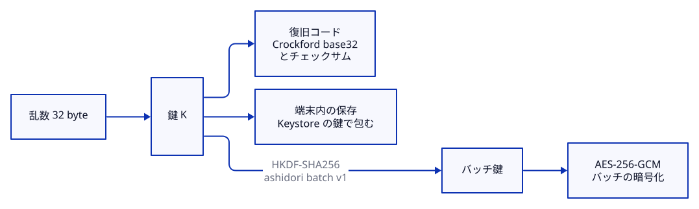
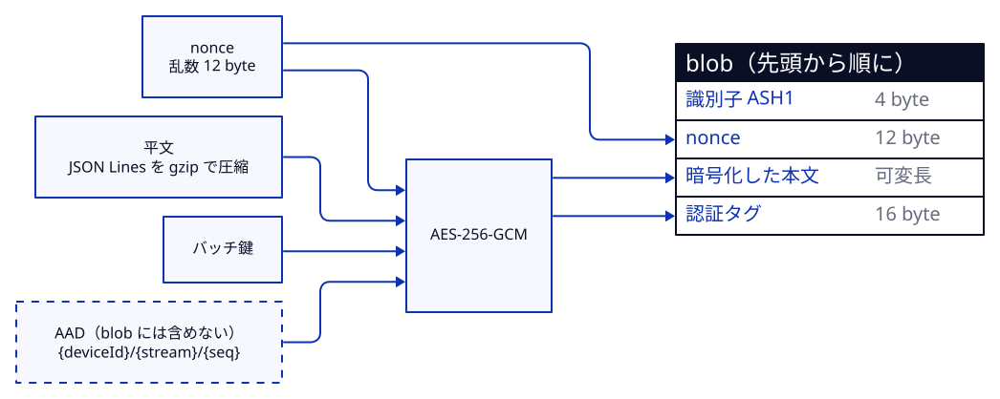
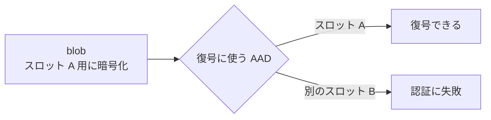

# 暗号化と鍵

[概要に戻る](overview.md)

同期する記録は、端末で暗号化してからサーバへ送る（エンドツーエンド暗号化）。
暗号化の元になる鍵 `K` は利用者の端末だけが持ち、サーバには渡らない。
正確な仕様は [`sync-protocol.md` の Keys and encryption](sync-protocol.md#keys-and-encryption) にある。

## 鍵の関係

| 名前 | 生成方法 | 用途 |
| --- | --- | --- |
| **鍵 `K`** | 最初の端末が乱数 32 byte から作る | すべての鍵の元 |
| **復旧コード** | `K` を Crockford base32 にし、2 byte のチェックサムを付け、4 文字ずつ区切る | 別の端末に `K` を渡す。紛失に備えて控える |
| **バッチ鍵** | HKDF-SHA256（`K`、salt は空、info は `ashidori batch v1`） | 同期する記録（バッチ）の暗号化 |
| **認証鍵 `Ka`** | HKDF-SHA256（`K`、salt は空、info は `ashidori batch auth v1`） | blob の MAC（v1.1）。アプリだけが持ち、ブラウザには渡さない |
| 端末内の保存 | 取り出せない Android Keystore の AES 鍵で `K` を包む | 端末の再起動後も `K` を使う |

復旧コードのチェックサムは入力の誤りを見つけるためのものである。
既存の端末に QR コードを表示して `K` を渡す方式は実装していない。

## blob の形式

平文は、記録を 1 行 1 件の JSON Lines にして gzip で圧縮したものである。
これをバッチ鍵で AES-256-GCM により暗号化し、次の形式で送る。

| 位置 | 長さ | 内容 |
| --- | --- | --- |
| 先頭 | 4 byte | 形式の識別子 `ASH1` |
| 続き | 12 byte | nonce（乱数） |
| 続き | 可変 | 暗号化した本文 |
| 末尾 | 16 byte | GCM の認証タグ |

blob は 32 byte 以上になり、サーバはそれより短いものを拒否する。

v1.1 以降のアプリは、この形式の識別子を `ASHM` にし、末尾に 32 byte の MAC を加えて書く（`ASHM`）。
MAC は HMAC-SHA256（`Ka`、`ashidori blob auth v1` ‖ AAD の長さ（2 byte、big-endian）‖ AAD ‖ MAC より前の全 byte）である。
GCM の鍵と AAD は `ASH1` と同じである。

## blob の認証（v1.1）

ブラウザでの閲覧を有効にすると、ブラウザもバッチ鍵を持つ。
バッチ鍵だけで作れる `ASH1` の blob は、バッチ鍵が漏れるとサーバと組んで偽造できる。
`Ka` を持たない者は `ASHM` の MAC を作れないので、アプリは MAC を確かめて偽の blob を拒否する。

| 読む側 | `ASHM` | `ASH1` |
| --- | --- | --- |
| アプリ | MAC を確かめてから復号する | 切り替えの記録 `C` の規則に従うものだけを受理する |
| ブラウザ | MAC を除いて復号する。書き手を確かめられない（v2 の署名まで） | 復号する |

最初のブラウザを承認するアプリは、承認の前に切り替えの記録 `C`（stream `authcut`）を作る。
`C` は、その時点の端末と stream の組ごとに、それまでの seq の範囲と blob の SHA-256 の要約を持つ。
`C` を知ったアプリは必須の状態に入り、以後は `C` の範囲にあり要約の一致する `ASH1` だけを受理する。
必須の状態に入る前でも、`ASHM` を受理した seq より上の `ASH1` は拒否する。
詳細は [`sync-protocol.md` の Blob authentication](sync-protocol.md#blob-authentication-v11) にある。

## AAD によるスロットの束縛

暗号化のとき、AAD として文字列 `{deviceId}/{stream}/{seq}` を結び付ける。
この組（端末 ID、stream、seq）を **スロット** と呼ぶ。
復号する側は、取得したスロットから AAD を作り直して復号する。

サーバが blob を別のスロットへ移したり、古い blob を別の seq として返したりすると、復号が失敗する。
ただし AAD の端末 ID はサーバが割り当てた値である。
悪意あるサーバが 2 台に同じ ID を与えると、受信側はどちらの端末が暗号化したかを区別できない。
この場合も内容の秘匿は保たれる。

## サーバにできることとできないこと

| サーバにできること | サーバにできないこと |
| --- | --- |
| blob を消す、返さない、古いファイルの目録を返す | 記録の内容を読む |
| 目録に存在しないファイルを載せる（他の端末の status の受信は遅れる） | blob を別のスロットへ移して受理させる |
| 同じ端末 ID を 2 台に割り当てる | `K` を持たずに、アプリが受理する blob を作る（バッチ鍵が漏れた場合の例外は [Blob authentication](sync-protocol.md#blob-authentication-v11) の残る危険） |
| メタデータ（大きさ、時刻、件数）を記録する | 共有していないチェックインを読む |

## 前方秘匿性がないこと

同期するすべての記録は、一つの `K` から導いた鍵で暗号化する。
このため、後から `K` を知った者は、サーバに残る過去の暗号化した記録をすべて復号できる。
端末を失効させてもトークンが無効になるだけで、`K` は変わらない。
失効させた端末や漏れた復旧コードからは、引き続きすべてを読める。
`K` を取り替える機能（新しい鍵での再アップロード）は実装していない。
