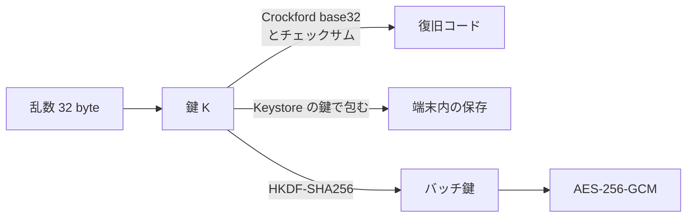
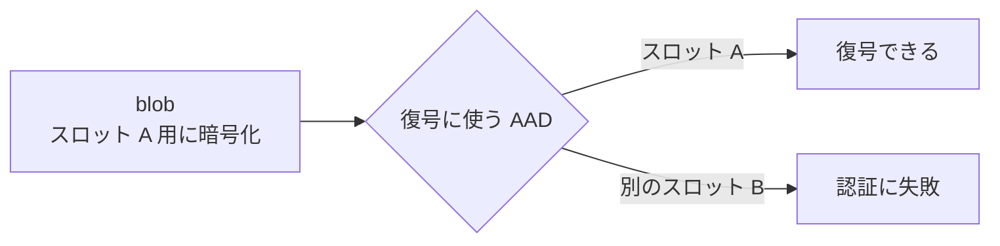

# 暗号化と鍵

[概要に戻る](overview.md)

同期する記録は、端末で暗号化してからサーバへ送る（エンドツーエンド暗号化）。
暗号化の元になる鍵 `K` は利用者の端末だけが持ち、サーバには渡らない。
正確な仕様は [`sync-protocol.md` の Keys and encryption](sync-protocol.md#keys-and-encryption) にある。

## 鍵の関係

| 名前 | 作り方 | 用途 |
| --- | --- | --- |
| **鍵 `K`** | 最初の端末が乱数 32 byte から作る | すべての鍵の元 |
| **復旧コード** | `K` を Crockford base32 にし、2 byte のチェックサムを付け、4 文字ずつ区切る | 別の端末に `K` を渡す。紛失に備えて控える |
| **バッチ鍵** | HKDF-SHA256（`K`、salt は空、info は `ashidori batch v1`） | バッチの暗号化 |
| 端末内の保存 | 取り出せない Android Keystore の AES 鍵で `K` を包む | 端末の再起動後も `K` を使う |

復旧コードのチェックサムは入力の誤りを見つけるためのものである。
既存の端末に QR コードを表示して `K` を渡す方式は実装していない。

## blob の形式

平文は、記録を 1 行 1 件の JSON Lines にして gzip で圧縮したものである。
これをバッチ鍵で AES-256-GCM により暗号化し、次の形式で送る。

| 位置 | 長さ | 内容 |
| --- | --- | --- |
| 先頭 | 4 byte | 形式の識別子 `ASH1` |
| 続き | 12 byte | nonce（乱数） |
| 続き | 可変 | 暗号文 |
| 末尾 | 16 byte | GCM の認証タグ |

blob は 32 byte 以上になり、サーバはそれより短いものを拒否する。

## AAD によるスロットの束縛

暗号化のとき、AAD として文字列 `{deviceId}/{stream}/{seq}` を結び付ける。
この組（端末 ID、stream、seq）を **スロット** と呼ぶ。
復号する側は、取得したスロットから AAD を作り直して復号する。

サーバが blob を別のスロットへ移したり、古い blob を別の seq として返したりすると、復号が失敗する。
ただし AAD の端末 ID はサーバが割り当てた値である。
悪意あるサーバが 2 台に同じ ID を与えると、受信側はどちらの端末が暗号化したかを区別できない。
この場合も内容の秘匿は保たれる。

## サーバにできることとできないこと

| サーバにできること | サーバにできないこと |
| --- | --- |
| blob を消す、返さない、古い一覧を返す | 記録の内容を読む |
| 一覧に存在しない行を出す（他の端末の status の受信は遅れる） | blob を別のスロットへ移して受理させる |
| 同じ端末 ID を 2 台に割り当てる | `K` を持たずに受理される blob を作る |
| メタデータ（大きさ、時刻、件数）を記録する | 共有していないチェックインを読む |

## 前方秘匿性がないこと

すべてのバッチは、一つの `K` から導いた鍵で暗号化する。
このため、後から `K` を知った者は、サーバに残る過去の暗号文をすべて復号できる。
端末を失効させてもトークンが無効になるだけで、`K` は変わらない。
失効させた端末や漏れた復旧コードからは、引き続きすべてを読める。
`K` を取り替える機能（新しい鍵での再アップロード）は実装していない。
