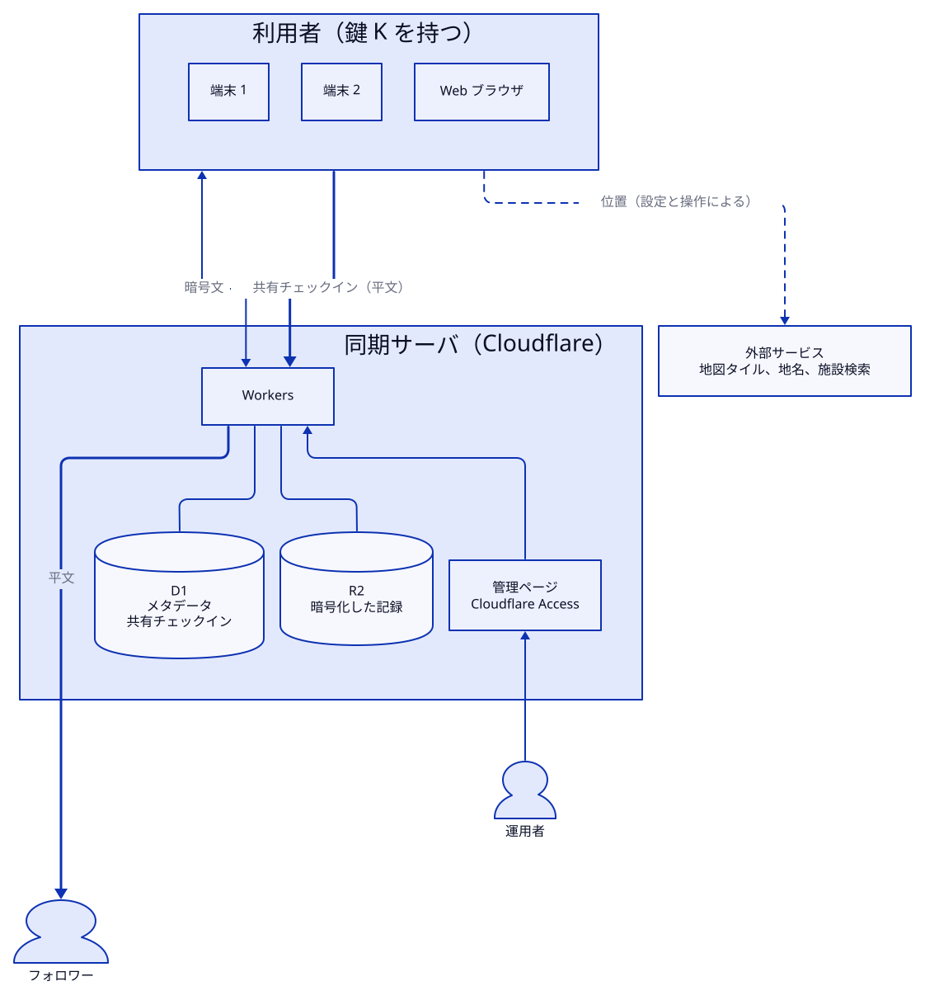

# ashidori の仕組み

> このドキュメントは ashidori の仕組みの概要である。
> 各項目の詳細は下の個別のページに分け、正確な仕様は [`sync-protocol.md`](sync-protocol.md)（英語）に定める。
> 両者が食い違う場合は `sync-protocol.md` に従う。

表記の約束は次のとおりである。

- **予定**：設計の方針だけがあり、実装していないもの。
- **実装中**：作業中で、まだ既定の動作になっていないもの。

## 全体像

ashidori は、端末で位置の履歴を記録する Android アプリと、任意の同期サーバからなる。
記録は端末の中で完結し、同期サーバは使わなくてもよい。
同期する場合、端末は記録を鍵 `K` で暗号化してから送る。
`K` を持つのは利用者の端末だけであり、サーバとその運用者は記録を復号できない。

図の破線は予定または条件付きの経路、太線は平文が出る経路を表す。

| 構成要素 | 役割 | 記録の内容を読めるか |
| --- | --- | --- |
| 端末（アプリ） | 記録、表示、暗号化、同期 | 読める（`K` を持つ） |
| 同期サーバ（Workers、D1、R2） | 暗号文とメタデータの保存と中継 | 読めない。共有チェックインだけは平文で持つ |
| 管理ページ | 利用者と端末の管理、共有チェックインの削除。Cloudflare Access と Worker の両方で管理者を確かめる | 読めない |
| 外部サービス | 地図タイル、Android の Geocoder、施設の検索（OpenStreetMap） | 送った位置だけが伝わる |
| Web ブラウザ（予定） | 読み取り専用の閲覧 | 読める（ペアリングで `K` を受け取る） |

## 利用の段階

利用者は必要な段階まで使えばよい。
段階 2 以降は同期サーバへの登録を前提にする。

| 段階 | 状態 | サーバに保存するもの | 読める者 |
| --- | --- | --- | --- |
| 1. 端末内のみ | 実装済み | なし | 端末の利用者 |
| 2. 暗号化したバックアップと端末間の同期 | 実装済み。サーバからの復元は未実装 | 暗号化した記録とそのメタデータ | 利用者の端末。運用者はメタデータだけ |
| 3. Web での閲覧 | 予定 | 段階 2 と同じ。加えてペアリングの間はブラウザの公開鍵 | 利用者の端末とブラウザ。ページを配信する運用者を信頼する |
| 4. フォロワーへのチェックインの共有 | サーバは実装済み。アプリの共有の画面は未実装 | 共有したチェックインの平文 | フォロワーと運用者 |
| 5. 一時的な現在地の共有 | 予定 | 未定 | 未定 |

## 個別のページ

| ページ | 内容 |
| --- | --- |
| [端末内の記録](recording.md) | 記録する内容、日単位の Parquet へのアーカイブ、当日分が端末に留まる理由 |
| [暗号化と鍵](encryption.md) | 鍵 `K`、復旧コード、バッチ鍵、blob の形式、サーバにできることとできないこと |
| [同期の流れ](sync.md) | outbox、アップロード、一覧と取得、他の端末の status、障害時の再送 |
| [登録とペアリング](pairing.md) | 招待と自己登録、ユーザ名、2 台目の追加、登録の再試行 |
| [プライバシー](privacy.md) | 運用者に見えるもの、「位置情報を外部サービスに送らない」、端末内の地名と地図 |
| [Web での閲覧](web-viewer.md) | 信頼の前提、ブラウザのペアリング（バッチ鍵だけを渡す）、地図、表示できる範囲 |
| [Web の画面](web-ui.md) | 閲覧と管理の画面の構成、操作、文言、アクセシビリティの規則 |
| [検証](verification.md) | レビューと形式検証（Tamarin、TLA+）で確かめたことと確かめていないこと |

## 用語

- **鍵 `K`**：利用者ごとの 32 byte の乱数の鍵。すべての暗号化の元になる。
- **復旧コード**：`K` を人が書き写せる文字列にしたもの。別の端末に `K` を渡すときに入力する。
- **バッチ**：端末がサーバへ送る暗号化の単位。暗号化したバイト列を **blob** と呼ぶ。
- **stream**：バッチの種類（`places`、`checkins`、`status`、`archive` など）。
- **seq**：端末が stream ごとに 0 から振る通し番号。
- **スロット**：（端末 ID、stream、seq）の組。一つのスロットに保存できる blob は一つである。
- **AAD**：暗号化のときに blob に結び付ける付加データ。ashidori ではスロットを結び付ける。
- **outbox**：送信待ちの暗号文を置く、端末内の表。
- **カーソル**：サーバがバッチの確定順に振る番号。一覧の取得位置に使う。
- **ペアリングコード**：端末を利用者に登録するための 8 文字のコード。1 回だけ、10 分間使える。
- **デバイストークン**：端末がサーバに対して自分を示す秘密の値。端末が生成する。
- **status**：端末の最新の状態（電池、記録モード、最後の測位）。1 時間ごとに送る。
- **アーカイブ**：終わった日の記録を変換した Parquet ファイル。
- **共有チェックイン**：利用者がフォロワーに公開したチェックイン。サーバに平文で置く。
- **運用者**：同期サーバ（Cloudflare のアカウントと管理ページ）を管理する者。
