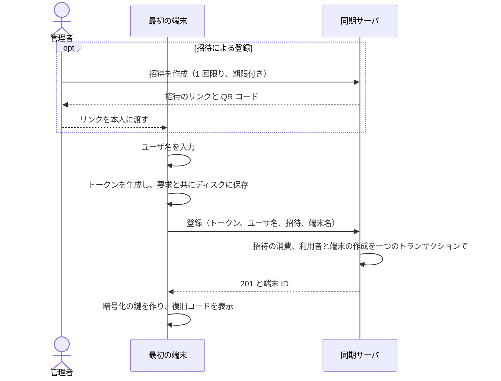
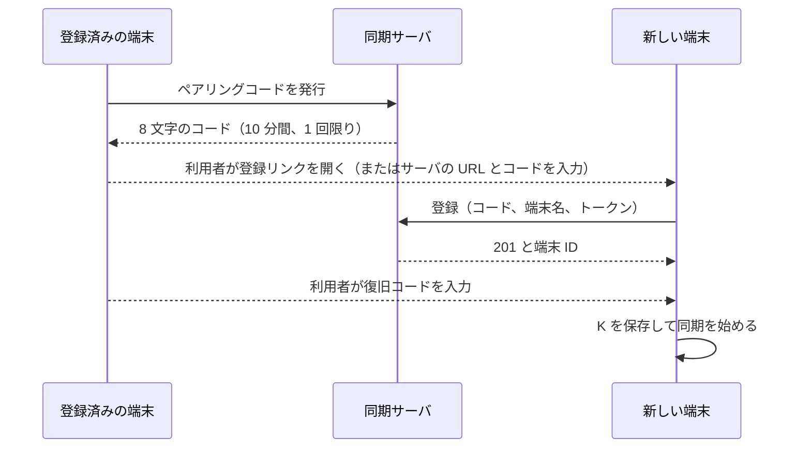

# 登録とペアリング

[概要に戻る](overview.md)

端末はいずれか一人の利用者に属し、同じ利用者の端末どうしだけがデータを共有する。
利用者は Web にログインせず、端末がデバイストークンでサーバに対して自分を示す。
正確な仕様は [`sync-protocol.md` の Authentication](sync-protocol.md#authentication) と [Registration and limits](sync-protocol.md#registration-and-limits) にある。

アプリの同期設定は、何が起きるかを名前で示す。

| 表示 | 起きること | 使うもの |
| --- | --- | --- |
| 「新しく登録」 | この端末で利用者を作り、この端末を最初の端末にする。続けて鍵 `K` を作る | 招待（またはサーバが許す場合は何も要らない）とユーザ名 |
| 「この端末を追加」 | 登録済みの利用者にこの端末を加える。続けて復旧コードを入力する | ペアリングコードと復旧コード |

## ユーザ名

利用者を表す名前は「ユーザ名」の一つだけである。
英小文字・数字・`_` の 3〜20 文字で、サーバ内で一意とし、大文字と小文字を区別しない（小文字で保存する）。
本人が最初の端末で決め、アプリ、管理ページ、フォローの検索はすべてこれで利用者を示す。
表示名は別に持たない。

ユーザ名の導入前に作られた利用者にはユーザ名がない。
管理ページはそれらを「未設定」として示し、管理者が設定する。
API では `username` と呼ぶ。D1 の列名は互換性のため `users.handle` のままである。

## 最初の端末

利用者は必ず最初の端末で作る。
ブラウザから始める登録はなく、管理者も利用者を作らない。
入口は招待と、サーバが許す場合の招待のない登録の二つで、どちらも同じ「新しく登録」の手順に入る。

| サーバの変数 `REGISTRATION` | 招待による登録 | 招待のない登録 | 向く場面 |
| --- | --- | --- | --- |
| `admin`（既定） | できる | できない | 利用者を限定するサーバ |
| `open` | できる | できる（自己登録） | 自分や身内だけのサーバ、暗号化したデータの保存先として公開するサーバ |

アプリは `GET /v1/info` でサーバの方式を確かめ、`open` なら「新しく登録」と「この端末を追加」の選択を示す。



- 招待は 1 回限りで、有効期限（1〜30 日、既定 7 日）がある。期限は D1 の時計で判定する。
- 招待の時点では利用者は存在しない。本人が登録したときに初めて作られる。
- ユーザ名が使用済みなら `409` を返し、何も変えない。招待は未使用のまま残るので、本人は別のユーザ名で登録し直せる。
- 管理者は未使用の招待を取り消せる。取り消した招待、期限切れ、使用済み、未知の招待はどれも同じ `401` になる。
- 招待のない登録の数は、IP ごとの回数制限とサーバ全体の利用者数の上限（`MAX_USERS`）で抑える。招待による登録は管理者の判断なので `MAX_USERS` で止めない。
- 招待のない登録で作った利用者が 7 日たっても何も保存していなければ、サーバの定期処理がその利用者を削除する。招待で作った利用者は削除しない。

## 2 台目以降の端末

2 台目以降は、方式によらずペアリングコードと復旧コードで追加する。
ペアリングコードは利用者への所属を、復旧コードは鍵 `K` を新しい端末に渡す。



サーバは復旧コードも `K` も受け取らない。
ペアリングコードを知った者が端末を登録できても、`K` がなければ記録は読めない。
端末をすべて失った利用者やユーザ名導入前の利用者には、管理者が管理ページでペアリングコードを発行できる。

## 登録リンク

ペアリングコードと招待は、サーバとコードを一つにした登録リンクとしても渡せる。
管理ページの「招待を作成」と「ペアリングコード発行」、アプリの「別の端末を追加」がリンクとその QR コードを表示する。

```text
https://<サーバ>/pair#c=<ペアリングコード>   この端末を追加（8 文字）
https://<サーバ>/pair#i=<招待>               新しく登録（16 文字）
```

- コードはフラグメント（`#` 以降）に置く。ブラウザはフラグメントをサーバに送らないため、リンクを開いてもコードはリクエスト行にもサーバのログにも残らない。
- フラグメントは `c=` か `i=` のどちらか一つだけで、値はサーバが発行したとおりの文字列（Crockford base32 の大文字、ハイフンなし）でなければならない。キーと長さが合わないもの、両方を含むもの、余分なものは拒否する。
- アプリの同期設定の「QR コードを読み取る」で QR コードを読み取ると、リンクを開いた場合と同じ扱いになる。読み取りは CameraX と ZXing により端末内で行い、映像を外部に送らない。カメラの権限は、このボタンを押したときに求める。
- App Links でアプリが開くのは、ビルド時に Gradle のプロパティ `ashidori.defaultServer` で指定したホストのリンクだけである（指定しなければ宣言しない）。それ以外ではサーバの `/pair` ページが開き、ペアリングコードまたは「招待」、「アプリで開く」（`ashidori://pair?server=<URL>&c=<コード>` または `&i=<招待>`）、リンクの QR コードを表示する。PC で開いたページの QR コードは、スマートフォンのアプリで読み取れる。
- アプリはリンクからサーバとコードを入力するだけで、登録はしない。招待なら「新しく登録」でユーザ名を、ペアリングコードなら「この端末を追加」を示し、どちらも登録先のサーバを表示する。利用者がそれを確かめてから登録する。入力済みのサーバと登録済みのサーバ以外へのリンクは、そのサーバ名を示して確認を求める。
- **復旧コードはリンクにも QR コードにも含めない。** ペアリングのリンクが漏れても渡るのは利用者への所属だけで、`K` は渡らない。2 台目以降の端末は、登録の後に復旧コードを別に入力する。

形式の詳細は [`sync-protocol.md` の Registration links](sync-protocol.md#registration-links) にある。

## ブラウザ

ブラウザは読み取り専用の端末（閲覧端末）として加える。
ペアリングコードと復旧コードは使わず、ブラウザが表示する QR コードをアプリの「ブラウザでも見る」で読み取り、両方に出る 4 語を見比べて、アプリで「承認」、ブラウザで「一致する」を押す。
カメラで読み取れない場合は、「コードを入力」でブラウザに表示されたコードを入力する。
QR コードは同期しているサーバのページのものだけを受け付ける。
ブラウザが受け取るのは記録を復号する鍵（[バッチ鍵](encryption.md#鍵の関係)）だけで、元になる鍵 `K`、復旧コード、blob の認証鍵は渡さない。

| 項目 | 内容 |
| --- | --- |
| 期限 | 1 時間（既定）か 24 時間。期限後はトークンが `401` になる |
| 台数 | 有効なものは利用者ごとに 5 台まで。端末数の上限（`USER_MAX_DEVICES`）には数えない |
| できること | 端末の一覧と batch の取得、自分の登録の解除だけ。ほかの操作は `403` |
| 終了 | アプリの一覧の「終了」、ブラウザの「登録を解除」、管理ページの失効 |

詳細は [Web での閲覧](web-viewer.md) と [`design/browser-pairing-v1.md`](design/browser-pairing-v1.md) にある。

## 登録の再試行

登録は、応答が失われても安全に再試行できる。
その仕組みは、トークンをサーバではなく端末が生成することにある。

1. 端末はトークンを生成し、要求と共にディスクに書き込んでから送る。
2. サーバはトークンのハッシュだけを保存し、`201` と端末 ID を返す。
3. 応答が失われたら、端末は同じトークンと同じ要求を送り直す。サーバは同じ端末 ID を `200` で返す。

| 状況 | 再試行への応答 |
| --- | --- |
| 最初の要求が成功していた | `200` と同じ端末 ID |
| その後に運用者が自己登録を止めた、上限に達した、回数制限にかかった、招待の期限が切れた | それでも `200` と同じ端末 ID。制限するのは新しく作る要求だけである |
| 同じ要求が同時に二つ届いた | 一方が `201`、もう一方が `200` で、どちらも同じ端末 ID |
| 使用済みのコードや招待を別のトークンで使った | `401`（未知のコードや招待と同じ） |
| 同じユーザ名の登録が同時に二つ届いた | 一方が `201`、もう一方が `409`。後者の招待は未使用のまま残る |

コードの消費と端末の作成は一つの D1 トランザクションで行い、片方だけが起きることはない。
招待の消費、利用者の作成、最初の端末の作成も同様である。

## 失効と停止

| 操作 | 実行者 | 結果 |
| --- | --- | --- |
| 招待の取り消し | 管理者 | 未使用の招待が使えなくなる。使用済みの招待は取り消せない |
| 端末の失効 | 同じ利用者の端末、または管理者 | トークンが `401` になる。その端末が発行した未使用のコードも消え、その端末が承認したブラウザも失効し、途中のブラウザのペアリングは中止になる。`K` は変わらない |
| 利用者の停止 | 管理者 | 利用者の全端末のトークンと未使用のコードが使えなくなる。データは消さず、再開すれば元に戻る |
