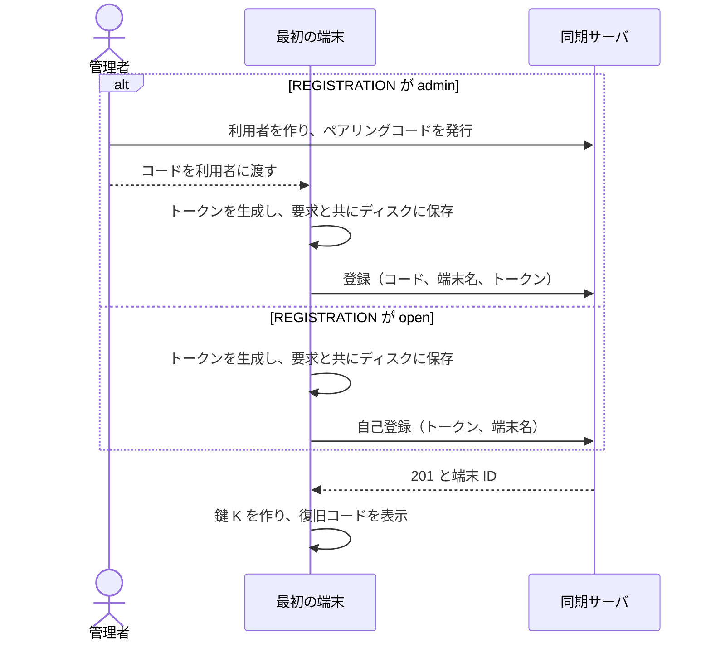
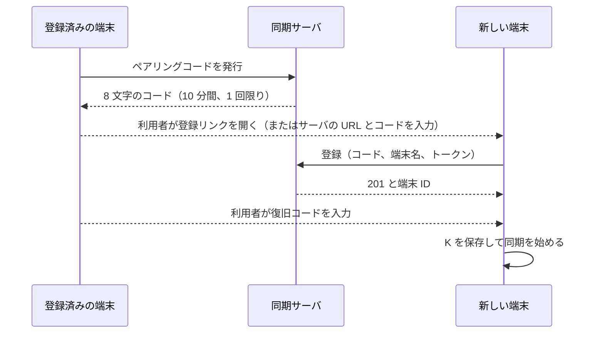

# 登録とペアリング

[概要に戻る](overview.md)

端末はいずれか一人の利用者に属し、同じ利用者の端末どうしだけがデータを共有する。
利用者は Web にログインせず、端末がデバイストークンでサーバに対して自分を示す。
正確な仕様は [`sync-protocol.md` の Authentication](sync-protocol.md#authentication) と [Registration and limits](sync-protocol.md#registration-and-limits) にある。

## 最初の端末

最初の端末の登録には二つの方式があり、サーバの変数 `REGISTRATION` で選ぶ。
アプリは `GET /v1/info` でサーバの方式を確かめる。

| 方式 | 利用者を作る者 | 最初の端末の手順 | 向く場面 |
| --- | --- | --- | --- |
| `admin`（既定） | 管理者が管理ページで作る | 管理者から受け取った登録リンクを開く（またはペアリングコードを入力する） | 利用者を限定するサーバ |
| `open` | 最初の端末が自分で作る（自己登録） | 「新しく始める」を選ぶ | 自分や身内だけのサーバ、暗号化したデータの保存先として公開するサーバ |



自己登録の利用者が 7 日たっても何も保存していなければ、サーバの定期処理がその利用者を削除する。
自己登録の数は、IP ごとの回数制限とサーバ全体の利用者数の上限（`MAX_USERS`）で抑える。

## 2 台目以降の端末

2 台目以降は、方式によらずペアリングコードと復旧コードで追加する。
ペアリングコードは利用者への所属を、復旧コードは鍵 `K` を新しい端末に渡す。



サーバは復旧コードも `K` も受け取らない。
ペアリングコードを知った者が端末を登録できても、`K` がなければ記録は読めない。

## 登録リンク

ペアリングコードは、サーバとコードを一つにした登録リンクとしても渡せる。
管理ページの「ペアリングコード発行」と、アプリの「別の端末を追加」がリンクとその QR コードを表示する。

```text
https://<サーバ>/pair#c=<コード>
```

- コードはフラグメント（`#` 以降）に置く。ブラウザはフラグメントをサーバに送らないため、リンクを開いてもコードはリクエスト行にもサーバのログにも残らない。
- アプリの同期設定の「QR コードを読み取る」で QR コードを読み取ると、リンクを開いた場合と同じ扱いになる。読み取りは CameraX と ZXing により端末内で行い、映像を外部に送らない。カメラの権限は、このボタンを押したときに求める。
- App Links でアプリが開くのは、ビルド時に Gradle のプロパティ `ashidori.defaultServer` で指定したホストのリンクだけである（指定しなければ宣言しない）。それ以外ではサーバの `/pair` ページが開き、コード、「アプリで開く」（`ashidori://pair?server=<URL>&c=<コード>`）、リンクの QR コードを表示する。PC で開いたページの QR コードは、スマートフォンのアプリで読み取れる。
- アプリはリンクからサーバとコードを入力欄に入れるだけで、登録はしない。利用者が登録先のサーバを確かめて「この端末を登録」を押す。入力済みのサーバと登録済みのサーバ以外へのリンクは、そのサーバ名を示して確認を求める。
- **復旧コードはリンクにも QR コードにも含めない。** リンクが漏れても渡るのは利用者への所属だけで、`K` は渡らない。2 台目以降の端末は、登録の後に復旧コードを別に入力する。

形式の詳細は [`sync-protocol.md` の Registration links](sync-protocol.md#registration-links) にある。

## 登録の再試行

登録は、応答が失われても安全に再試行できる。
その仕組みは、トークンをサーバではなく端末が生成することにある。

1. 端末はトークンを生成し、要求と共にディスクに書き込んでから送る。
2. サーバはトークンのハッシュだけを保存し、`201` と端末 ID を返す。
3. 応答が失われたら、端末は同じトークンと同じ要求を送り直す。サーバは同じ端末 ID を `200` で返す。

| 状況 | 再試行への応答 |
| --- | --- |
| 最初の要求が成功していた | `200` と同じ端末 ID |
| その後に運用者が自己登録を止めた、上限に達した、回数制限にかかった | それでも `200` と同じ端末 ID。制限するのは新しく作る要求だけである |
| 同じ要求が同時に二つ届いた | 一方が `201`、もう一方が `200` で、どちらも同じ端末 ID |
| 使用済みのコードを別のトークンで使った | `401`（未知のコードと同じ） |

コードの消費と端末の作成は一つの D1 トランザクションで行い、片方だけが起きることはない。

## 失効と停止

| 操作 | 実行者 | 結果 |
| --- | --- | --- |
| 端末の失効 | 同じ利用者の端末、または管理者 | トークンが `401` になる。その端末が発行した未使用のコードも消える。`K` は変わらない |
| 利用者の停止 | 管理者 | 利用者の全端末のトークンと未使用のコードが使えなくなる。データは消さず、再開すれば元に戻る |
