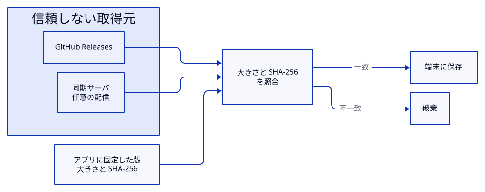

# プライバシー

[概要に戻る](overview.md)

位置の履歴が端末の外へ出る経路は二つある。
一つは同期サーバであり、記録は暗号文で届くが、メタデータは運用者に見える。
もう一つは外部サービスであり、地図タイルの取得や地名の問い合わせで位置が伝わる。
正確な仕様は [`sync-protocol.md` の What the server operator can see](sync-protocol.md#what-the-server-operator-can-see) と、[README の「地名と位置情報の送信」](../README.md#地名と位置情報の送信) にある。

## 同期サーバの運用者に見えるもの

運用者（Cloudflare のアカウントと管理ページを管理する者）は、位置の履歴について信頼しない。
設計は運用者に記録を読ませないことを目指し、サービスを使っている事実までは隠さない。

| 情報 | 運用者に見えるか |
| --- | --- |
| 記録の内容（位置、時刻、場所の名前、チェックイン、status） | 見えない（暗号文） |
| バッチの端末、stream 名、seq、大きさ、SHA-256 | 見える |
| バッチのアップロード時刻 | 見える。D1 は 1 時間単位に切り捨て、R2 は正確な時刻を持つ |
| 利用者のユーザ名、登録の経路（招待か、招待なしか）。旧形式の利用者は以前の名前とメールアドレス（任意） | 見える |
| 招待（コードのハッシュ、作成者、作成・期限・使用・取り消しの時刻） | 見える |
| 端末の名前、登録時刻、最終アクセス（1 時間単位） | 見える |
| フォローの関係と、その時刻（1 時間単位） | 見える |
| **共有チェックイン**（時刻、位置、施設名、コメント） | **平文で見える** |
| IP アドレス | Cloudflare のエッジには見える。Worker は回数制限のカウンタにだけ保存し、約 10 分後に消す |

内容が見えなくても、次のことは推測できる。

- バッチの数、大きさ、送信の時刻から、移動していたか、端末がオフラインだったかが分かる。
- `archive` の大きさから、詳細ログをどの程度記録しているかが分かる。
- カーソルは全利用者で共通なので、自分のカーソルの間隔から、他の利用者の送信量がおおよそ分かる。

運用者はサーバのコードを変えられるので、より多くのメタデータ（IP、正確な時刻）を記録させることもできる。
それでも `K` はサーバに届かないため、記録は復号できない。

## 「位置情報を外部サービスに送らない」

この設定（既定でオン）は、利用者の操作なしにアプリが位置を外部へ送る経路を止める。

| 経路 | オン | オフ |
| --- | --- | --- |
| 地図の表示 | 端末内の簡易地図。「詳しい地図で表示」を押すか地図の種類でオンラインの地図を選んだ地図（マップのタブ、期間の画面のそれぞれ）だけ、画面に表示している間その地図を取得する。画面を離れるかアプリがバックグラウンドに入ると、その地図を破棄して新たな取得を止める。破棄の前に出した要求や予約した要求の取り消しは MapLibre に任せており、取り消しが反映されるまでに、その要求（同じ地図で同意した範囲のもの）が送られたり完了したりすることはある。この選択は地図ごとに記憶し、画面を離れても、アプリを再起動しても保つ。簡易地図に戻すか、この設定を切り替えると取り消す。他の地図には適用しない | 選択中の地図 |
| 地図の静止画、地図の種類のサムネイル | 端末内の簡易地図。オンラインの地図のサムネイルは、アプリに同梱した固定の範囲（東京駅付近）の見本 | 選択中の地図 |
| 地名 | 端末内の索引のみ | 索引で求まらない位置に限り Android の Geocoder |
| 近くの施設の検索（OpenStreetMap） | 端末に保存した過去の結果を表示する。新たな検索は指示したときのみ | 保存した結果を先に表示し、1 日以内に検索していない場所は自動で検索する |

設定の対象外は次のとおりである。

| 経路 | 扱い |
| --- | --- |
| 利用者の明示的な操作（地図アプリで開く、エクスポートの共有、詳しい地図の表示、施設の検索） | その操作の分だけ位置を渡す |
| 共有チェックイン | 平文で送る。設定によらず、チェックインごとの共有操作でだけ送る（アプリの共有の画面は未実装） |
| 端末間の同期 | 暗号化して送るので、サーバは位置を読めない |
| OS の測位サービス | 端末の設定に従う。Google の位置情報の精度などが送る情報は、この設定では止まらない |

## 端末内の地名の索引

名前のない場所の地名（「渋谷区宇田川町付近」など）は、アプリに同梱する索引から求める。

| 範囲 | データ | 求め方 |
| --- | --- | --- |
| 日本国内 | 国土交通省の大字・町丁目レベル位置参照情報 | 最も近い代表点（2 km 以内）。それより遠ければ市区町村名 |
| 国外 | GeoNames の都市 | 都市名 |

## 端末内の簡易地図

簡易地図は、日本をズーム 10 まで、全世界をズーム 5 まで収録し、通信せずに表示する。
アプリには同梱せず、初回にダウンロードする（**実装中**）。
手順は [README の「簡易地図」](../README.md#簡易地図) にある。

- 取得元は GitHub Releases か、その版を配信している同期サーバである。一方が失敗すると他方を試す。
- アプリに固定した大きさと SHA-256 で照合するので、どちらの取得元も信頼する必要はない。
- 地図は日本と全世界をまとめて含むので、取得しても利用者の位置は伝わらない。このため「位置情報を外部サービスに送らない」の対象にしない。取得元には端末の IP アドレスが伝わる。
- 既定では従量制でない回線を待つ。
