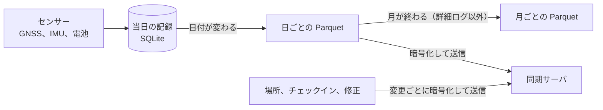

# 端末内の記録

[概要に戻る](overview.md)

アプリは記録をすべて端末に保存する。
同期は任意であり、同期しなくても記録と表示はすべて端末の中で動く。

## 記録する内容

| 種類 | 内容 | 同期の stream |
| --- | --- | --- |
| 測位 | 時刻、緯度経度、精度、高度、速度、方位、測位の方式 | `archive`（`fixes` 表） |
| 動き | 加速度から求めた区間ごとの動きと歩数 | `archive`（`motion` 表） |
| 電池 | 残量、充電中か、画面の状態、記録モード | `archive`（`battery` 表） |
| GNSS の状態 | 見えている衛星と使った衛星の数など | `archive`（`gnss_status` 表） |
| 詳細ログ | GNSS の生の観測値、航法メッセージ、NMEA、IMU の生データ | `archive`（`gnss_raw` など） |
| 編集できるデータ | 場所、チェックイン、移動手段の修正 | `places`、`checkins`、`overrides` |
| 端末の状態 | 電池、記録モード、最後の測位、アプリの版 | `status` |

表と列の正確な一覧は [`sync-protocol.md` の Streams and records](sync-protocol.md#streams-and-records-inside-the-ciphertext) にある。

## 当日の記録とアーカイブ

信号の記録（測位、動き、電池、GNSS、IMU）は、当日の分を SQLite に置く。
日が終わると、その日の記録を表ごとに Parquet ファイルに変換する。
月が終わると、測位、動き、電池、GNSS の状態の日ごとのファイルを月単位に統合する。
詳細ログの表は量が多いので、日ごとのファイルのままにする。

同期するのはアーカイブしたファイルだけであり、当日の記録は日付が変わるまで端末に留まる。
このため、日中に端末を失うと、同期が成功した直後であってもその日の測位は失われる。
編集できるデータと端末の状態は、アーカイブを待たずに 1 時間ごとの同期で送る。

## 記録を失わないための仕組み

記録の書き込みは、ほかの処理と分ける。

- 測位、動き、電池、GNSS の状態、詳細ログは、記録専用のスレッドで SQLite に書き込む。画面の読み込みやアーカイブの処理を待たない。
- メモリ上で待つ記録には上限がある。測位と動きは最大 5 秒、詳細ログは最大 3 秒か 2000 行で書き込みに回す。書き込みが追いつかずに上限を超えた分は捨て、動作の記録に残す。上限がないと、溜まった記録ごとプロセスがメモリ不足で終わる。
- 記録中に、計画から見て長すぎる時間（起きている時間で最短 15 分）一行も保存されなければ、動作の記録に残し、通知する。
- SQLite が破損を報告しても、データベースのファイルを削除しない。Android の既定の処理はファイルを削除し、記録をすべて失う。
- 異常終了（クラッシュ、ANR、記録中のメモリ不足による強制終了）は起動時に通知し、状態タブに 24 時間表示する。

アーカイブ（日ごとの Parquet への変換）は別のプロセス（`:maintenance`）で行う。

- 記録サービスと同じプロセスでメモリ不足になると、記録も止まる。v0.20 までは、全力ログで長時間記録した日の変換がメモリ不足で失敗し、起動のたびに同じ日の変換で落ちて、その間の記録が失われた。
- 変換は SQLite から一定行ずつ読み、Parquet に行グループ単位で書く。既存のファイルも行グループ単位で読む。メモリの使用量は日の長さによらない。
- SQLite から消すのは、Parquet に書いて行数をフッタで確かめ、ファイルとディレクトリを fsync した行だけである。長い日は 2 分か 200 万行ごとの区切りで書き、確かめ、消す。OS にジョブを止められても、読んだ分は書き終えてから止まる。途中でプロセスが終わっても、次の回は残った行を既存のファイルと統合し、同じ行は一度だけ残す。
- 消す行は「開始時点の最大の rowid 以下」に限る。記録の書き込みは、以前に使った rowid を再び使わない（`rowid_floor`）。このため、まとめの途中に届いた行を読まずに消すことはない。
- 変換できない行（対応する表がない行や形式の壊れた行）は SQLite に残す。
- 変換はアプリの起動直後には行わない。充電中で端末を使っていないとき、または起動から 30 分後に行う。端末診断の「記録をまとめ直す」で今すぐ行える。
- 同じ日の変換が 2 回失敗すると、その日を保留する。記録は SQLite に残る。保留した日は、充電中（1 日 1 回まで）、アプリの更新後、または「記録をまとめ直す」で再び試す。
- 本体のプロセスが 6 時間に 3 回異常終了すると、アーカイブと自動の同期を止める。記録は続ける。アプリの更新か「記録をまとめ直す」で再開する。

## バックアップ

端末診断の「バックアップを書き出す」は、記録を端末内の形式のまま ZIP にまとめ、利用者が選んだ場所に保存する。

- 内容は SQLite のデータベース（WAL を含む）、Parquet のアーカイブ、動作の記録である。地図と施設データは再び取得できるので含まない。
- ファイルを一つずつ一定の大きさのバッファで写す。行を解釈しないので、メモリの使用量は記録の量によらない。
- 記録を続けたまま書き出せる。データベースは WAL をチェックポイントしてから本体のファイルを写し、その間のチェックポイントを止める。最後に WAL を書き込みのロックの下で写す。アーカイブの処理とはファイルのロックで排他する。
- 本体のファイルは、プロセスの間ずっと開いたままの一つの記述子で読む。データベースのファイルの記述子を一つでも閉じると、そのプロセスの SQLite が持つ POSIX ロックがすべて外れ、別のプロセスが WAL を消してデータベースを壊しうる。
- ZIP は暗号化しない。位置の記録をすべて含むので、保存先に注意する。

## 送信の区分

| 区分 | 対象 | 間隔 | 回線 |
| --- | --- | --- | --- |
| 小さい stream | 編集できるデータ、測位、動き、電池、GNSS の状態のアーカイブ、status | 1 時間 | 接続があれば送る。「モバイル回線でも同期」がオフなら従量制でない回線のみ |
| 詳細ログ | GNSS の生の観測値、衛星、航法メッセージ、NMEA、IMU のアーカイブ | 6 時間 | 従量制でない回線のみ。充電中に限ることもできる |

送信の手順は [同期の流れ](sync.md) にまとめる。
