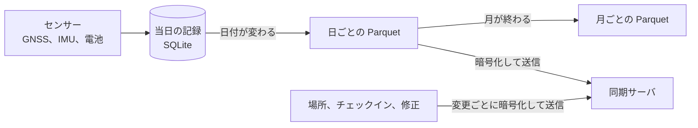

# 端末内の記録

[概要に戻る](overview.md)

アプリは記録をすべて端末に保存する。
同期は任意であり、同期しなくても記録と表示はすべて端末の中で動く。

## 記録する内容

| 種類 | 内容 | 同期の stream |
| --- | --- | --- |
| 測位 | 時刻、緯度経度、精度、高度、速度、方位、測位の方式 | `archive`（`fixes` 表） |
| 動き | 加速度から求めた区間ごとの動きと歩数 | `archive`（`motion` 表） |
| 電池 | 残量、充電中か、画面の状態、記録モード | `archive`（`battery` 表） |
| GNSS の状態 | 見えている衛星と使った衛星の数など | `archive`（`gnss_status` 表） |
| 詳細ログ | GNSS の生の観測値、航法メッセージ、NMEA、IMU の生データ | `archive`（`gnss_raw` など） |
| 編集できるデータ | 場所、チェックイン、移動手段の修正 | `places`、`checkins`、`overrides` |
| 端末の状態 | 電池、記録モード、最後の測位、アプリの版 | `status` |

表と列の正確な一覧は [`sync-protocol.md` の Streams and records](sync-protocol.md#streams-and-records-inside-the-ciphertext) にある。

## 当日の記録とアーカイブ

信号の記録（測位、動き、電池、GNSS、IMU）は、当日の分を SQLite に置く。
日が終わると、その日の記録を表ごとに Parquet ファイルに変換する。
月が終わると、その月の日ごとのファイルを月単位に統合する。

同期するのはアーカイブしたファイルだけであり、当日の記録は日付が変わるまで端末に留まる。
このため、日中に端末を失うと、同期が成功した直後であってもその日の測位は失われる。
編集できるデータと端末の状態は、アーカイブを待たずに 1 時間ごとの同期で送る。

## 送信の区分

| 区分 | 対象 | 間隔 | 回線 |
| --- | --- | --- | --- |
| 小さい stream | 編集できるデータ、測位、動き、電池、GNSS の状態のアーカイブ、status | 1 時間 | 接続があれば送る。「モバイル回線でも同期」がオフなら従量制でない回線のみ |
| 詳細ログ | GNSS の生の観測値、衛星、航法メッセージ、NMEA、IMU のアーカイブ | 6 時間 | 従量制でない回線のみ。充電中に限ることもできる |

送信の手順は [同期の流れ](sync.md) にまとめる。
