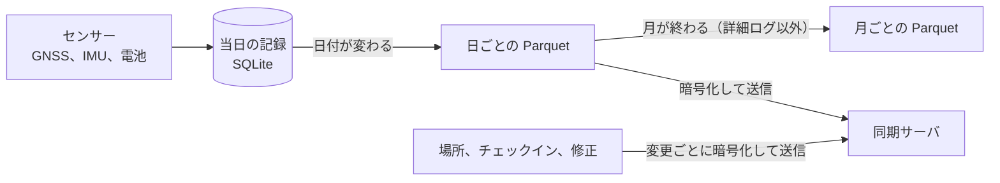

# 端末内の記録

[概要に戻る](overview.md)

アプリは記録をすべて端末に保存する。
同期は任意であり、同期しなくても記録と表示はすべて端末の中で動く。

## 記録する内容

| 種類 | 内容 | 同期の stream |
| --- | --- | --- |
| 測位 | 時刻、緯度経度、精度、高度、速度、方位、測位の方式 | `archive`（`fixes` 表） |
| 動き | 加速度から求めた区間ごとの動きと歩数 | `archive`（`motion` 表） |
| 電池 | 残量、充電中か、画面の状態、記録モード | `archive`（`battery` 表） |
| GNSS の状態 | 見えている衛星と使った衛星の数など | `archive`（`gnss_status` 表） |
| 詳細ログ | GNSS の生の観測値、航法メッセージ、NMEA、IMU の生データ | `archive`（`gnss_raw` など） |
| 編集できるデータ | 場所、チェックイン、移動手段の修正 | `places`、`checkins`、`overrides` |
| 端末の状態 | 電池、記録モード、最後の測位、アプリの版 | `status` |

表と列の正確な一覧は [`sync-protocol.md` の Streams and records](sync-protocol.md#streams-and-records-inside-the-ciphertext) にある。

## 当日の記録とアーカイブ

信号の記録（測位、動き、電池、GNSS、IMU）は、当日の分を SQLite に置く。
日が終わると、その日の記録を表ごとに Parquet ファイルに変換する。
月が終わると、測位、動き、電池、GNSS の状態の日ごとのファイルを月単位に統合する。
詳細ログの表は量が多いので、日ごとのファイルのままにする。

同期するのはアーカイブしたファイルだけであり、当日の記録は日付が変わるまで端末に留まる。
このため、日中に端末を失うと、同期が成功した直後であってもその日の測位は失われる。
編集できるデータと端末の状態は、アーカイブを待たずに 1 時間ごとの同期で送る。

## 記録を失わないための仕組み

記録の書き込みは、ほかの処理と分ける。

- 測位、動き、電池、GNSS の状態、詳細ログは、記録専用のスレッドで SQLite に書き込む。画面の読み込みやアーカイブの処理を待たない。
- SQLite は両プロセスの接続で `synchronous=FULL` とする。書き込みが戻った時点で記録はディスクにあり、電源断で巻き戻らない。
- メモリ上で待つ記録には上限がある。測位と動きは最大 5 秒、詳細ログは最大 3 秒か 2000 行で書き込みに回す。
- 書き込み待ちが上限に達したら、詳細ログはファイルに退避し（fsync）、待ちが減ってから取り込む。取り込みは、行と取り込み済みの印を一つのトランザクションで書き、ファイルの削除が成功してディレクトリを fsync してから印を消す。途中で失敗しても二重に取り込まない。測位などの上限は数日分であり、SQLite に書けない状態が続かない限り達しない。上限がないと、溜まった記録ごとプロセスがメモリ不足で終わる。
- SQLite が書き込みを拒んだ記録は再試行する。それでも失敗した行は失われた行として数え、すぐにファイルと動作の記録に残す。最後に保存した時刻は、書き込みが成功したときにだけ進む。
- 記録中に、計画から見て長すぎる時間（起きている時間で最短 15 分）一行も保存されないか、ある種類（位置、動き、詳細ログなど）の記録が 3 分を超えて保存されないままなら、動作の記録に残し、通知する。保存に失敗した種類は、その種類が次に保存されるまで未保存として数える。電池の行だけが保存されても、測位の停止は隠れない。端末診断に種類ごとの最後の保存を表示する。
- SQLite が破損を報告しても、データベースのファイルを削除しない。Android の既定の処理はファイルを削除し、記録をすべて失う。
- 異常終了（クラッシュ、ANR、記録中のメモリ不足による強制終了）は起動時に通知し、状態タブに 24 時間表示する。

アーカイブ（日ごとの Parquet への変換）は別のプロセス（`:maintenance`）で行う。

- 記録サービスと同じプロセスでメモリ不足になると、記録も止まる。v0.20 までは、全力ログで長時間記録した日の変換がメモリ不足で失敗し、起動のたびに同じ日の変換で落ちて、その間の記録が失われた。
- 変換は SQLite から一定行ずつ読み、Parquet に行グループ単位で書く。既存のファイルのうち新しい行より前の行グループは、デコードせずに写す。メモリの使用量は日の長さによらない。
- 長い日は 2 分か 200 万行ごとの区切りで処理する。区切りごとに、Parquet を書いて fsync し、フッタの行数を確かめる。次に、置き換えるファイルと消す行を記録（fsync）してから、ファイルを rename してディレクトリを fsync し、最後に SQLite から行を消す。どの fsync が失敗しても消さない。
- rename と削除の間でプロセスが終わっても、その記録から続きを行う。続きの処理は、対象のファイルとディレクトリを fsync してから削除する。未完了の記録がある間は、その表を読む処理、バックアップ、次のまとめは先に続きを行い、それが失敗すれば進まない。アーカイブと SQLite の両方に同じ行が残り続けることはない。
- 画面や書き出しは、表ごとのロックを共有で取って読む。置き換えと削除は同じロックを排他で取る。このため、読む側は各行をアーカイブか SQLite のどちらか一方から一度だけ読む。
- 消す行は「開始時点の最大の rowid 以下」に限る。記録の書き込みは、以前に使った rowid を再び使わない（`rowid_floor`）。開始時点の最大値の取得と下限の引き上げは同じトランザクションで行い、データベースを開くたびにも下限を引き上げる。このため、まとめの途中に届いた行を読まずに消すことはない。
- 変換できない行（対応する表がない行、値が型に合わない行、時刻のない行）は元の文字列のまま SQLite に残し、消さない。値がないこと（空欄）は誤りとしない。
- 時刻が保存順から 60 秒以上ずれた行は、その場では書かずに残し、日の最後にまとめて時刻順に並べてから書く。重複は、同じ時刻の行についてハッシュが一致した後に値を比べて落とす。
- 変換はアプリの起動直後には行わない。充電中で端末を使っていないとき、または起動から 30 分後に行う。端末診断の「記録をまとめ直す」で今すぐ行える。
- 同じ日の変換が 2 回失敗すると、その日を保留する。記録は SQLite に残る。保留した日は、充電中（1 日 1 回まで）、アプリの更新後、または「記録をまとめ直す」で再び試す。
- 本体のプロセスが 6 時間に 3 回異常終了すると、アーカイブと自動の同期を止め、予約済みのジョブも取り消す。記録は続ける。アプリの更新で再開するほか、端末診断の「記録をまとめ直す」と「自動の同期」の行でそれぞれ再開できる。
- 同期は、送ったファイルをその版（世代）で記録する。区切りの途中で送った日のファイルも、後で書き足されれば送り直す。まとめの途中の日は、終わるまで送らない。v0.21 より前に送ったファイルは版が分からないので一度だけ送り直す。受け手はすべての版を合わせ、同じ行を落とす。

## バックアップ

端末診断の「バックアップを書き出す」は、記録を ZIP にまとめ、利用者が選んだ場所に保存する。

- 内容は SQLite のデータベースの複製、Parquet のアーカイブ、まだ取り込んでいない退避ファイル、動作の記録である。地図と施設データは再び取得できるので含まない。複製の間は退避ファイルの取り込みを止めるので、各ファイルは複製に取り込み済みとして含まれるか、ZIP に取り込み前のまま含まれるかのどちらかになる。
- 表ごとのロックを共有で取り、SQLite に一貫した複製をアプリの領域へ書かせる（`VACUUM INTO`、読み取り専用の接続）。同時にアーカイブのファイルをすべて開いておく。記録は書き込みを続けられる。
- ロックを外してから、複製と開いたファイルを一つずつ一定の大きさのバッファで ZIP に書く。保存先が遅くても、記録もアーカイブの処理も待たない。複製は最後に消す。
- 645 万行・728 MB のデータベースで記録しながら測ると、エミュレータで 8〜30 秒かかった。追加の容量は最大でデータベースの約 1.25 倍（複製と ZIP）、WAL は増えず、記録の書き込みが 1 秒以上待たされることはなかった。空き容量はデータベースの 1.5 倍と 64 MB を求める。
- データベースのファイルそのものは開かない。データベースのファイルの記述子を一つでも閉じると、そのプロセスの SQLite が持つ POSIX ロックがすべて外れ、別のプロセスが WAL を消してデータベースを壊しうる。
- ZIP は暗号化しない。位置の記録をすべて含むので、保存先に注意する。

## 送信の区分

| 区分 | 対象 | 間隔 | 回線 |
| --- | --- | --- | --- |
| 小さい stream | 編集できるデータ、測位、動き、電池、GNSS の状態のアーカイブ、status | 1 時間 | 接続があれば送る。「モバイル回線でも同期」がオフなら従量制でない回線のみ |
| 詳細ログ | GNSS の生の観測値、衛星、航法メッセージ、NMEA、IMU のアーカイブ | 6 時間 | 従量制でない回線のみ。充電中に限ることもできる |

送信の手順は [同期の流れ](sync.md) にまとめる。
