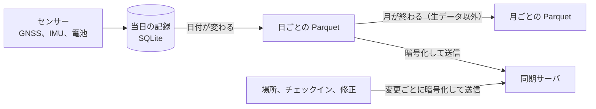

# 端末内の記録

[概要に戻る](overview.md)

アプリは記録をすべて端末に保存する。
同期は任意であり、同期しなくても記録と表示はすべて端末の中で動く。

## 記録する内容

| 種類 | 内容 | 同期の stream |
| --- | --- | --- |
| 測位 | 時刻、緯度経度、精度、高度、速度、方位、測位の方式 | `archive`（`fixes` 表） |
| 動き | 加速度から求めた区間ごとの動きと歩数 | `archive`（`motion` 表） |
| 電池 | 残量、充電中か、画面の状態、記録モード | `archive`（`battery` 表） |
| GNSS の状態 | 見えている衛星と使った衛星の数など | `archive`（`gnss_status` 表） |
| 生データ | GNSS の生の観測値、航法メッセージ、NMEA、IMU の生データ | `archive`（`gnss_raw` など） |
| 編集できるデータ | 場所、チェックイン、移動手段の修正 | `places`、`checkins`、`overrides` |
| 端末の状態 | 電池、記録モード、最後の測位、アプリの版 | `status` |

表と列の正確な一覧は [`sync-protocol.md` の Streams and records](sync-protocol.md#streams-and-records-inside-the-ciphertext) にある。

## 当日の記録とアーカイブ

信号の記録（測位、動き、電池、GNSS、IMU）は、当日の分を SQLite に置く。
日が終わると、その日の記録を表ごとに Parquet ファイルに変換する。
月が終わると、測位、動き、電池、GNSS の状態の日ごとのファイルを月単位に統合する。
生データの表は量が多いので、日ごとのファイルのままにする。

同期するのはアーカイブしたファイルだけであり、当日の記録は日付が変わるまで端末に留まる。
このため、日中に端末を失うと、同期が成功した直後であってもその日の測位は失われる。
編集できるデータと端末の状態は、アーカイブを待たずに 1 時間ごとの同期で送る。

## 記録を失わないための仕組み

記録の書き込みは、ほかの処理と分ける。

- 測位、動き、電池、GNSS の状態、生データは、記録専用のスレッドで SQLite に書き込む。画面の読み込みやアーカイブの処理を待たない。
- SQLite は両プロセスの接続で `synchronous=FULL` とする。書き込みが戻った時点で記録はディスクにあり、電源断で巻き戻らない。
- メモリ上で待つ記録には上限がある。測位と動きは最大 5 秒、生データは最大 3 秒か 2000 行で書き込みに回す。
- 書き込み待ちが上限に達したら、生データはファイルに退避し（fsync）、待ちが減ってから取り込む。取り込みは、行と取り込み済みの印を一つのトランザクションで書き、ファイルの削除が成功してディレクトリを fsync してから印を消す。途中で失敗しても二重に取り込まない。測位などの上限は数日分であり、SQLite に書けない状態が続かない限り達しない。上限がないと、溜まった記録ごとプロセスがメモリ不足で終わる。
- SQLite が書き込みを拒んだ記録は再試行する。それでも失敗した行は失われた行として数え、すぐにファイルと動作の記録に残す。最後に保存した時刻は、書き込みが成功したときにだけ進む。
- 記録中に、計画から見て長すぎる時間（起きている時間で最短 15 分）一行も保存されないか、ある種類（位置、動き、生データなど）の記録が 3 分を超えて保存されないままなら、動作の記録に残し、通知する。通知は、すべての種類が保存されるようになったときにだけ消す。通知を出したことは端末に残し、アプリの再起動をまたいだ通知は、そのとき保存されていなかった種類がすべて再起動後に保存されてから消す（0.21 が出した通知は、再起動後に何かが保存され、停止がなくなってから消す）。再起動で通知が消えていても、未解消なら出し直す。通知の表示・取り消しと、その状態の保存（`commit()` の結果を確かめる）は、確認のたびに、通知を出すべきかどうかと突き合わせ、ずれていれば直す。一度の失敗や一部だけの成功（保存に失敗して通知だけ出た場合など）も、次の確認で直る。利用者が消した通知は、同じ停止の間は出し直さない。確認は一つずつ行い、ほかの確認が割り込むことはない。前の版が種類を表示名（「位置」「詳細ログ」など）で保存していた場合は、読むときに内部の名前に直す。保存に失敗した種類は、その種類が次に保存されるまで未保存として数える。電池の行だけが保存されても、測位の停止は隠れない。端末診断に種類ごとの最後の保存を表示する。
- SQLite が破損を報告しても、データベースのファイルを削除しない。Android の既定の処理はファイルを削除し、記録をすべて失う。
- 異常終了（クラッシュ、ANR、記録中のメモリ不足による強制終了）は起動時に通知し、状態タブに 24 時間表示する。

アーカイブ（日ごとの Parquet への変換）は別のプロセス（`:maintenance`）で行う。

- 記録サービスと同じプロセスでメモリ不足になると、記録も止まる。v0.20 までは、最高精度で長時間記録した日の変換がメモリ不足で失敗し、起動のたびに同じ日の変換で落ちて、その間の記録が失われた。
- 変換は SQLite から一定行ずつ読み、Parquet に行グループ単位で書く。既存のファイルのうち新しい行より前の行グループは、デコードせずに写す。メモリの使用量は日の長さによらない。
- 長い日は 2 分か 200 万行ごとの区切りで処理する。区切りごとに、Parquet を書いて fsync し、フッタの行数を確かめる。次に、置き換えるファイルと消す行を記録（fsync）してから、ファイルを rename してディレクトリを fsync し、最後に SQLite から行を消す。どの fsync が失敗しても消さない。
- rename と削除の間でプロセスが終わるか失敗しても、その記録から続きを行う。記録を書いた後は、失敗しても一時ファイルを消さない。続きの処理（修復）は、対象のファイルを丸ごと読み、行を SQLite と照らし合わせるので `:maintenance` で行う。本体のプロセスが未完了の記録に気づくと、そのジョブをすぐ予約する。
- 修復は次の 3 つの規則に従う。core のテストで、各段階の直後に処理が中断した場合を含めて確かめる。
  - **A. 修復は記録のファイルを自動で消さない。** 一時ファイル、以前のファイル、置き換え済みのファイルのうち、消す代わりに残すものはすべて隔離ディレクトリ（`archive/quarantine/<記録の名前>/`）へ移す。移した後はファイルと移動元・移動先のディレクトリを fsync する。消してよいのは、置き換え済みのファイルにすべてあると確かめた SQLite の区切りの行だけである。隔離したファイルを消す操作はない。
    - 修復は一時ファイルを置き換えに使わない。以前のファイルが無傷に見えても、一時ファイルの中身がそれと同じだとは証明できないので、一時ファイルはすべて隔離する。置き換えていない表は、以前のファイルと SQLite の行から次の整理が作り直す。以前のファイルが記録どおりに読めない場合、または 0.21.0 の記録で以前の版を確かめられない場合は、一時ファイルが以前の行の唯一の正しい写しでありうるので、端末診断に示す。
    - 置き換え済みの表は、ファイルを記録と照らし合わせる。フッタの行数が引き継いだ行数と区切りの行数の和であること、すべての行グループが読めて時刻順であること、時刻の範囲、記録した区切りの行があることを確かめる。さらに、その表の区切りの行のうち SQLite に残るものをすべて読み、全列から求めた 64 ビットのハッシュの多重集合で、どの行もファイルに 1 回以上あることを確かめる（同じ行は整理で 1 行にまとまるので、回数は 1 回以上を求める）。引き継いだ行は、以前のファイルが置き換わってもう無いので、行数だけを確かめる。これが残る中で最もよい確認であり、修復の確認画面にもそう示す。確かめられた表だけ、ファイルとディレクトリを fsync してから、通常の整理と同じ範囲（区切りの位置、開始時点の最大の rowid、残した行を除く）で、その表に変換される行を SQLite から消す。途中で中断した後の続きでは、もう消した行は照合の対象から外れる。
    - 照合に使う行は 1 つの集合につき最大 200 万行（`RowBag.Cap`）とする。超えると照合しない。その場合は自動では何もせず、「整理を修復」では確かめられないファイルとして扱う（隔離し、削除しない）。
    - 確かめられない置き換え済みのファイル、読めない以前のファイル、以前の版でも新しい版でもないファイルは、自動では移さない。「整理を修復」で隔離し、行は SQLite に残す。以前の行がそのファイルにしか残らない可能性がある場合は、端末診断にそう示す。月の整理の続きでは、月のファイルに含まれたと確かめた日のファイルも、消さずに隔離する。
  - **B. 修復の印が先。** 修復は最初の変更（隔離への移動を含む）の前に、記録に「修復中」の印を付けて書き直す（記録を丸ごと書いて fsync し、ディレクトリを fsync する）。印があれば、通常の続き（完了か取り消し）ではなく修復を続ける。印は削除の行の後ろに置くので、0.21.0 は読まない。
    - 生データの記録には、0.21.0 が知らない表（`repair-guard`）を名指すファイルの行も書く（guard）。0.21.0 は記録を読めるが、その表のロックを取るところで例外になり、何も読まず、消さず、記録を残して止まる。0.21.0 が生データの表を読むのは整理のジョブ、起動時の続き、生データの書き出し、バックアップで、どれもこの例外を受け止める。
    - 位置・動き・電池・GNSS の状態と月の整理（ファイル 1 つ）の記録には guard を書かない。0.21.0 はこれらの表を記録サービスや画面のスレッドで読み、そこでは例外を受け止めないためである。これらは A で守る。修復は印の次に一時ファイルを隔離するので、0.21.0 はそれ以降、一時ファイルの無い記録を見る。何も置き換わっていなければ取り消し（消す一時ファイルは無い）、置き換え済みなら完了（置き換え済みのファイルが持つ行を SQLite から消す）となり、どちらも記録を失わない。印を付けてから隔離するまでの間の状態は、修復が何も変えていない状態と同じである。
    - 0.21.0 に戻した場合の動きは、印の直後、最初の隔離の直後、検証に失敗した一時ファイルを自動で隔離した後のそれぞれでエミュレータで確かめる。
  - **C. 未完了の整理で読み手が落ちない。** 本体のプロセスの読み手（記録サービスの電池の履歴、タイムライン、マップ、ステータス、書き出し、同期）は、未完了の記録があっても例外を出さない。その表は、置き換え済みの新しいファイルがあれば SQLite の区切りの行（月の整理なら置き換えられた日のファイル）を除き、無ければそのまま、今あるファイルと SQLite から読む。各行を一度だけ読み、通常の整理の途中と同じ表示になる。生データの区切りの行は問い合わせでは除けないので、それを除けない書き出し（生データのテキスト）と通常のバックアップは「整理待ち」として書き出さない（救出用バックアップは書き出せる）。
- 修復はすべての表を解決し、それぞれを fsync してから記録を消す。各段階を動作ログに残す。各段階は繰り返しても結果が変わらないので、途中で中断しても次の実行が続きを行う。
- 隔離した記録の一覧は両方のプロセスが書き換えるので、ファイルロックの下で読んで書き直す。
- 自動の修復は、一時ファイルを隔離し、隔離の要らない表を解決する。停止した 0.21.0 の記録は自動では解決しない（完了と取り消しは 0.21.0 も自動で行っていたので、上の確認のもとで自動で行う）。自動で解決できない場合は、端末診断と状態タブに「記録の整理が停止（要確認）」と表示し、端末診断の「整理を修復」を待つ。待つ間も記録は続ける。
- 隔離の後は、端末診断に、記録の整理は再開したこと、隔離したファイルの行は復元せず、タイムライン・書き出し・同期に含まないこと、取り出し方（「隔離したファイルを書き出す」、救出用バックアップ）を示す。
- 画面や書き出しは、表ごとのロックを共有で取って読む。置き換えと削除は同じロックを排他で取る。このため、読む側は各行をアーカイブか SQLite のどちらか一方から一度だけ読む。
- 消す行は「開始時点の最大の rowid 以下」に限る。記録の書き込みは、以前に使った rowid を再び使わない（`rowid_floor`）。開始時点の最大値の取得と下限の引き上げは同じトランザクションで行い、データベースを開くたびにも下限を引き上げる。このため、まとめの途中に届いた行を読まずに消すことはない。
- 変換できない行（対応する表がない行、値が型に合わない行、時刻のない行）は元の文字列のまま SQLite に残し、消さない。値がないこと（空欄）は誤りとしない。
- 時刻が保存順から 60 秒以上ずれた行は、その場では書かずに残し、日の最後にまとめて時刻順に並べてから書く。重複は、同じ時刻の行についてハッシュが一致した後に値を比べて落とす。
- 変換はアプリの起動直後には行わない。充電中で端末を使っていないとき、または起動から 30 分後に行う。端末診断の「記録を再整理」で今すぐ行える。
- 同じ日の変換が 2 回失敗すると、その日を保留する。記録は SQLite に残る。保留した日は、充電中（1 日 1 回まで）、アプリの更新後、または「記録を再整理」で再び試す。
- 本体のプロセスが 6 時間に 3 回異常終了すると、アーカイブと自動の同期を止め、予約済みのジョブも取り消す。記録は続ける。アプリの更新で再開するほか、端末診断の「記録を再整理」と「自動同期」の行でそれぞれ再開できる。
- 同期は、送ったファイルをその版（世代）で記録する。区切りの途中で送った日のファイルも、後で書き足されれば送り直す。まとめの途中の日は、終わるまで送らない。v0.21 より前に送ったファイルは版が分からないので一度だけ送り直す。受け手はすべての版を合わせ、同じ行を落とす。

## バックアップ

端末診断の「バックアップを書き出す」は、記録を ZIP にまとめ、利用者が選んだ場所に保存する。

- 内容は SQLite のデータベースの複製、Parquet のアーカイブ、まだ取り込んでいない退避ファイル、動作の記録である。地図と施設データは再び取得できるので含まない。複製の間は退避ファイルの取り込みを止めるので、各ファイルは複製に取り込み済みとして含まれるか、ZIP に取り込み前のまま含まれるかのどちらかになる。
- 表ごとのロックを共有で取り、SQLite に一貫した複製をアプリの領域へ書かせる（`VACUUM INTO`、読み取り専用の接続）。同時にアーカイブのファイルをすべて開いておく。記録は書き込みを続けられる。
- ロックを外してから、複製と開いたファイルを一つずつ一定の大きさのバッファで ZIP に書く。保存先が遅くても、記録もアーカイブの処理も待たない。複製は最後に消す。
- 645 万行・728 MB のデータベースで記録しながら測ると、エミュレータで 8〜30 秒かかった。追加の容量は最大でデータベースの約 1.25 倍（複製と ZIP）、WAL は増えず、記録の書き込みが 1 秒以上待たされることはなかった。空き容量は、データベースの 1.5 倍、アーカイブと退避ファイルの大きさ（ZIP に無圧縮で入る）、記録用の余裕 256 MB の合計を求める。書き出しの途中で空きが 256 MB を切れば、記録の領域を残すために中断する。
- バックアップがデータベースを複製している間、退避ファイルの取り込みは後回しにする（ロックを待たない）。記録の書き込みはバックアップを待たない。
- データベースのファイルそのものは開かない。データベースのファイルの記述子を一つでも閉じると、そのプロセスの SQLite が持つ POSIX ロックがすべて外れ、別のプロセスが WAL を消してデータベースを壊しうる。
- ZIP は暗号化しない。位置の記録をすべて含むので、保存先に注意する。
- 隔離したファイルも ZIP に含める。

記録の整理が停止している間、通常のバックアップは書き出せない（停止した表を読めない）。そのため端末診断に「救出用バックアップ」を置く。

- 表ごとのロックを共有で取るが、未完了の整理を先に進めない。データベースの複製（`VACUUM INTO`）、未完了の整理の記録、一時ファイル、置き換え済みと隔離したファイル、退避ファイル、`files/maintenance/` の状態のファイルを、そのままの形で ZIP に入れる。
- 一時ファイルは、書き手がロックの外で作って書く。救出用バックアップは、一時ファイルを書く間に取るロック（両プロセスのファイルロック）と表のロックを取った間に、入れるファイルをすべて作業用のディレクトリへハードリンクする（できなければ複製する）。書き手はいつも新しいファイルを作るので（置き換えは rename、一時ファイルは消してから作る）、リンクした内容は変わらない。ロックを外してから、リンクから ZIP を書き、最後にリンクを消す。書きかけの一時ファイルが ZIP に入ることはない。書きかけの退避ファイル（`.tmp`）は、作られて 1 分たったもの（書き手が終わったもの）だけを入れる。記録の書き込みはバックアップを待たない。
- 空き容量の確認は通常のバックアップと同じである。
- どの ZIP にも `manifest.txt` を入れ、それ以外のすべての項目（説明の文書と `commit-status.txt` も含む）の SHA-256、大きさ、名前を ZIP に書いた内容のとおりに記す。

端末診断の「隔離したファイルを書き出す」は、隔離したファイルとその一覧だけを ZIP にまとめる。

## 送信の区分

| 区分 | 対象 | 間隔 | 回線 |
| --- | --- | --- | --- |
| 小さい stream | 編集できるデータ、測位、動き、電池、GNSS の状態のアーカイブ、status | 1 時間 | 接続があれば送る。「モバイル回線でも同期」がオフなら従量制でない回線のみ |
| 生データ | GNSS の生の観測値、衛星、航法メッセージ、NMEA、IMU のアーカイブ | 6 時間 | 従量制でない回線のみ。充電中に限ることもできる |

送信の手順は [同期の流れ](sync.md) にまとめる。
