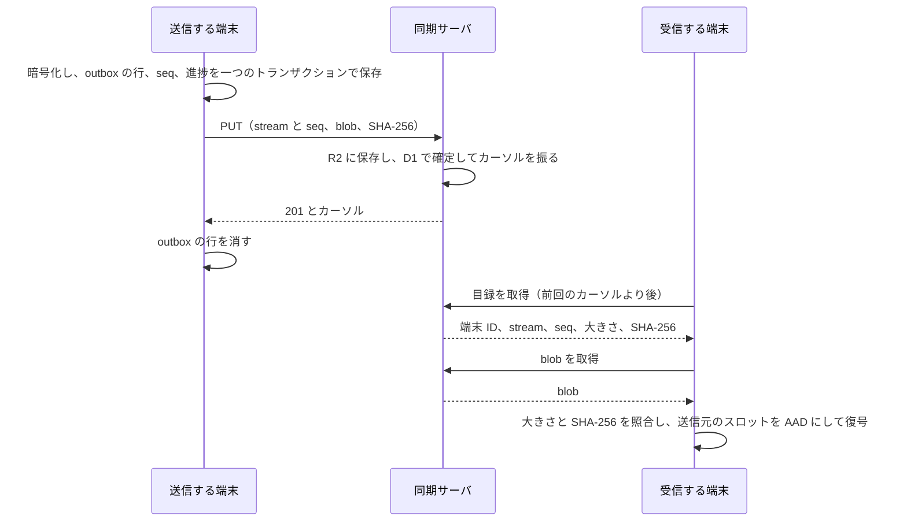
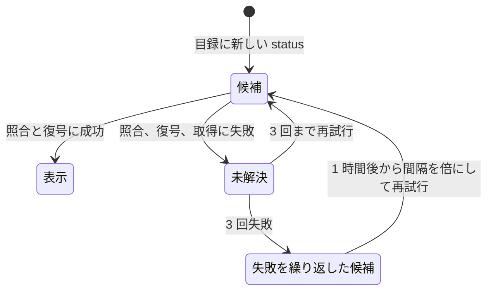

# 同期の流れ

[概要に戻る](overview.md)

端末は暗号化したバッチ（同期の単位。サーバには暗号化したファイルとして保存される）を outbox に保存してから送る。
他の端末は、サーバのファイルの目録をカーソルで辿って必要なバッチを取得する。
正確な仕様は [`sync-protocol.md`](sync-protocol.md) の Batches、Upload outbox on the device、Other devices' status の各節にある。

## アップロードと取得

- seq は端末が stream ごとに 0 から振る。一度振った seq に別の blob を入れることはない。
- 目録は利用者の全端末のバッチを、サーバが確定した順のカーソルで並べる。
- カーソルは全利用者で共通なので、自分の目録では値が飛ぶ。端末は値が増えることだけに頼る。

現在のアプリが取得するのは、他の端末の status だけである。
バックアップからの復元は実装していない。

## 他の端末の status

各端末は 1 時間ごとの同期で、自分の status（電池、記録モード、最後の測位、アプリの版）を送る。
同じ同期の中で、同じ利用者の他の端末の最新の status を取得し、設定の「端末」の欄に表示する。

- 端末ごとに候補を複数持ち、新しい候補が読めなければ次に新しい候補を試す。
- 読めなかった status は黙って飛ばさず、その端末の欄に問題として表示する。
- 目録は信用しない。サーバが存在しない行を出しても、ときどき目録を最初から辿り直すことで、正しい status の受信は遅れても止まらない。
- 表示する地名は端末内の地名データベースで求める。求めた地名はサーバへ送らない。

## 障害と再送

送信は、同じ要求を何度送っても結果が変わらないように作る。

| 起きること | 結果 |
| --- | --- |
| outbox に保存する前にクラッシュ | 行も進捗も残らない。次の実行で作り直す |
| PUT の応答が失われる | 同じ blob を同じ seq で再送する。サーバは `200 exists` を返す |
| サーバが R2 への保存の後に止まる | どの行からも参照されない R2 のオブジェクトを、定期処理が 24 時間後に消す |
| 確定が 1 時間の期限を超えた | サーバは `503` を返して保存しない。端末は同じ blob を再送する |
| 同じスロットに別の blob がある | `409`。正規の端末では起きない |
| 容量の上限に達した（`507`） | 再試行せず、同期の設定に表示する。次の定期実行で再び試す |

outbox の行を消すのは、`200` か `201` を受けた後だけである。
同期の処理（定期、今すぐ同期、生データ、status の取得、ペアリングの解除）は端末の中で一つずつ実行する。
