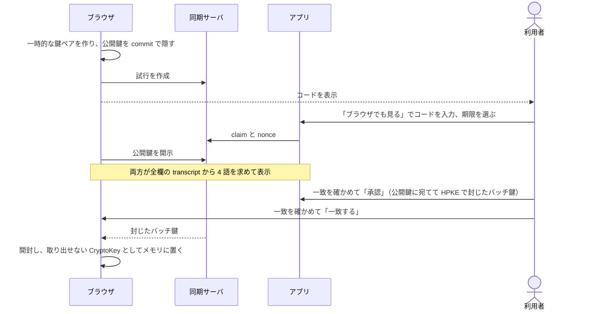

# Web での閲覧

[概要に戻る](overview.md)

ブラウザから自分の記録を閲覧できる。
ブラウザは利用者の読み取り専用の端末（閲覧端末）として登録し、スマートフォンのアプリから **バッチ鍵** だけを受け取る。
手順の詳細は [`design/browser-pairing-v1.md`](design/browser-pairing-v1.md)、サーバの規則は [`sync-protocol.md` の Browser viewers](sync-protocol.md#browser-viewers) にある。

## 信頼の前提

Web ページは、それを配信する者が書き換えられる。
書き換えたページは、受け取ったバッチ鍵を外へ送れる。
このため、Web での閲覧は利用者が自分で有効にした場合だけ使える（アプリの「ブラウザでも見る」）。
有効にしない利用者の記録の扱いは、段階 2（暗号化したバックアップと同期）から変わらない。

| | スマートフォンのアプリだけ | Web での閲覧を有効にした場合 |
| --- | --- | --- |
| ブラウザが持つもの | なし | バッチ鍵（メモリだけ） |
| `K`、復旧コード、blob の認証鍵 | 利用者の端末だけ | 利用者の端末だけ（ブラウザに渡さない） |
| 運用者が記録を読めるか | 読めない | ページを書き換えれば読める |
| 既定 | 有効 | 無効（利用者が選ぶ） |

バッチ鍵は変わらないので、受け取ったブラウザはこれまでの記録と、これから同じ鍵で送る記録を読める。
閲覧端末の期限（1 時間か 24 時間）はサーバが渡すのをやめるだけで、持ち出された鍵は期限後も使える。
アプリの承認の画面はこのことを示す。

## カメラを使わないペアリング

PC のブラウザでは、QR コードを読むカメラを使えないことがある。
そこで、ブラウザが一時的な鍵ペアとコードを作り、利用者がそのコードをアプリに入力する。

4 語を両方で見比べるのは、サーバが値をすり替えるのを防ぐためである。
アプリの「承認」は鍵を渡す判断であり、ブラウザの「一致する」は鍵がそのアプリから来たことの確認である。
再読み込みやタブを閉じると鍵は消え、ペアリングからやり直す。
ブラウザの登録は、アプリ、ブラウザ自身、管理ページのいずれからも終了できる。承認したアプリの端末を失効させると、そのアプリが承認したブラウザもすべて失効する。

## 地図

閲覧の地図は、既定ではオンラインの地図（OpenFreeMap の「標準」）である。地図の種類はアプリと同じく「標準」「シンプル」（OpenFreeMap）、「地理院 標準」「地理院 淡色」「航空写真」（地理院タイル）、「簡易地図（端末内）」から選ぶ。選択はブラウザの localStorage に保存し、最初の描画の前に読む。
オンラインの地図では、表示している範囲が地図の配信元に伝わる。簡易地図はどこにも送らない。
簡易地図を選ぶと、アーカイブ全体を一度だけ取得し、アプリと同じ固定の SHA-256 で確かめてブラウザの Cache Storage に置き、以後はブラウザの中だけで読む。一部だけを範囲指定で読むと見ている地域がサーバに伝わるため、範囲指定の取得はしない。
簡易地図を選んだまま Cache Storage から消えた場合は、オンラインの地図に切り替えず、地図の画像なしで経路を描き「簡易地図を再取得（約 64 MB）」を示す。サーバに簡易地図がなければ、選択肢を無効にして「サーバに簡易地図がありません」と示す。
CSP は他のオリジンとして、`connect-src` に地図の配信元（`https://tiles.openfreemap.org`、`https://cyberjapandata.gsi.go.jp`）だけを許す。スクリプトはビューア自身のファイルのパスだけに許す。

## 表示できる範囲

ブラウザが読めるのは、サーバにある暗号文だけである。

| 内容 | 表示 | 理由 |
| --- | --- | --- |
| 各端末の最新の status（最後の測位、電池、記録モード） | できる | 1 時間ごとに送られる |
| 場所、チェックイン、移動手段の修正 | できる | 変更が 1 時間ごとに送られる |
| 前日までの経路と記録 | できる | 日が終わるとアーカイブして送られる |
| 今日の経路 | 予定 | 同期ごとに当日分を送る仕組みを追加する（間引いた経路） |

現在は、当日の測位を日単位のアーカイブにするまで送らない（[端末内の記録](recording.md)）。今日の位置として見えるのは、status に含まれる最後の測位だけである。
当日分を同期ごとに小さな Parquet の断片として送る仕組みを追加すると、今日の経路も表示できる。日が終わるとアーカイブが正本になる。
