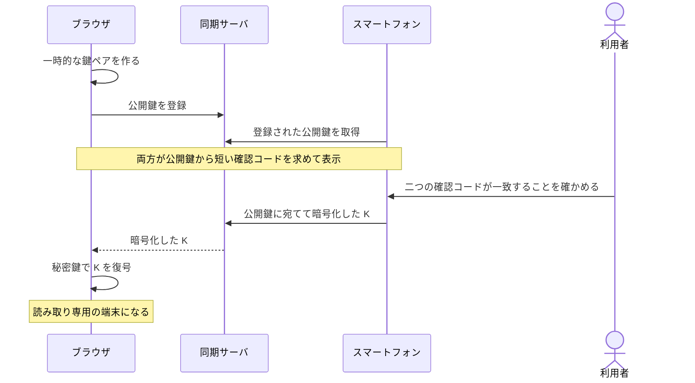

# Web での閲覧（予定）

[概要に戻る](overview.md)

このページは設計の方針であり、まだ実装していない。

ブラウザから自分の記録を閲覧できるようにする。
ブラウザは利用者の読み取り専用の端末として登録し、スマートフォンから鍵 `K` を受け取る。

## 信頼の前提

Web ページは、それを配信する者が書き換えられる。
書き換えたページは、受け取った `K` を外へ送れる。
このため、Web での閲覧は、ページを配信する者（同期サーバの運用者を想定）を信頼する利用者だけが、自分で有効にして使う。
有効にしない利用者の記録の扱いは、段階 2（暗号化したバックアップと同期）から変わらない。

| | スマートフォンのアプリだけ | Web での閲覧を有効にした場合 |
| --- | --- | --- |
| `K` を持つもの | 利用者の端末 | 利用者の端末とブラウザ |
| 運用者が記録を読めるか | 読めない | ページを書き換えれば読める |
| 既定 | 有効 | 無効（利用者が選ぶ） |

現行の仕様（[`sync-protocol.md`](sync-protocol.md#keys-and-encryption)）は、運用者が配信する Web ページで `K` や復旧コードを扱うことを禁じている。
Web での閲覧は、利用者が選んだ場合に限ってこの前提を緩めるものであり、実装の際は仕様の改訂を伴う。

## カメラを使わないペアリング

PC のブラウザでは、QR コードを読むカメラを使えないことがある。
そこで、ブラウザが一時的な鍵ペアを作り、スマートフォンがその公開鍵に宛てて `K` を暗号化する。

確認コードを見比べるのは、サーバが公開鍵をすり替えるのを防ぐためである。
サーバが自分の公開鍵に差し替えると、スマートフォンに表示される確認コードがブラウザのものと一致しなくなる。

## 表示できる範囲

ブラウザが読めるのは、サーバにある暗号文だけである。

| 内容 | 表示 | 理由 |
| --- | --- | --- |
| 各端末の最新の status（最後の測位、電池、記録モード） | できる | 1 時間ごとに送られる |
| 場所、チェックイン、移動手段の修正 | できる | 変更が 1 時間ごとに送られる |
| 前日までの経路と記録 | できる | 日が終わるとアーカイブして送られる |
| 今日の経路 | できない | 当日の記録は日付が変わるまで端末に留まる |

今日の経路が見えないのは、当日の測位を日単位のアーカイブにするまで送らないためである（[端末内の記録](recording.md)）。
今日の位置として見えるのは、status に含まれる最後の測位だけである。
